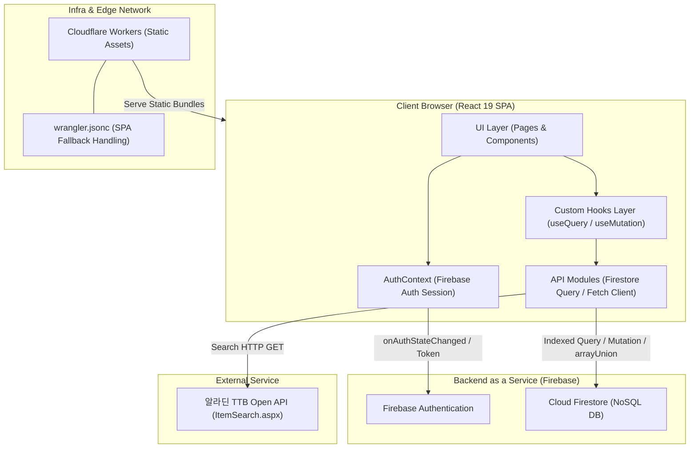

# bookieOn 스크린샷 촬영 가이드

이 문서는 `bookieOn.md`(리서치 문서) 및 `bookieOn.json`을 근거로, 포트폴리오 상세페이지 제작 시 실제로 촬영해야 할 화면과 그 근거, 배치 위치, 우선순위를 정리한 가이드입니다. 코드 실행/캡처가 불가능한 환경에서 작성되었으므로, 아래 항목은 실제 앱을 로컬 실행(`npm run dev`)하거나 배포본에서 직접 촬영해야 합니다.

---

## 1. 화면 스크린샷 체크리스트

- [ ] **메인 홈 서재 그리드**
  - 촬영 대상: `HomePage` — 프로필 헤더, 문학/비문학 카테고리 필터 토글, 독서 피드 3열 그리드(서재)
  - 근거: md "2. 담당 범위 - 홈 및 프로필 아카이빙" (`src/features/home/`, 커밋 `701de12`, `bc3b2e2`), md "9. 스크린샷 및 문서 제안" 표의 `bookieon_home_shelf.png` 권장 항목
  - 들어갈 위치: "1. 3분 요약" 옆 대표 이미지 / "2. 개요 - 대상 사용자" 옆
  - 우선순위: 필수
  - 비고: 문학/비문학 필터를 전환한 상태를 각각 1장씩 찍으면 필터링 기능이 명확히 드러남. 더미 독서 기록이 최소 4~6건 이상 있어야 그리드 형태가 보임.

- [ ] **독서 캘린더(잔디) 화면 — 기록 있는 월**
  - 촬영 대상: `CalendarPage` — 월별 7열 달력 그리드, 날짜별 도트(잔디) 인디케이터, 오늘/주말 구분
  - 근거: md "5. 핵심 구현 - 월별 7열 캘린더 그리드 알고리즘 및 O(1) 날짜별 기록 해시 맵 인덱싱" (커밋 `54312c9`, `src/features/calendar/CalendarPage.tsx`), json `features[2]`
  - 들어갈 위치: "5. 핵심 구현 - 월별 7열 캘린더 그리드 알고리즘" 옆
  - 우선순위: 필수
  - 비고: 여러 날짜에 걸쳐 기록이 흩어진 달을 선택해 "잔디"가 시각적으로 패턴을 이루도록 데이터를 준비. 한 달에 기록이 1~2개뿐이면 알고리즘의 효과가 안 보임.

- [ ] **독서 캘린더 — 날짜 선택 시 일일 기록 바텀 뷰**
  - 촬영 대상: 특정 날짜 클릭 후 나타나는 해당 일자의 독서 기록 카드(바텀 뷰) 및 Reading Log 통계 뷰 전환 상태
  - 근거: md "2. 담당 범위" 항목 "독서 캘린더 잔디 시각화 ... 일일 기록 바텀 뷰" (커밋 `54312c9`), md "5. 핵심 구현" 4단계 "선택 날짜 여부에 따라 Reading Log 통계 뷰와 일일 독서 카드 뷰를 전환"
  - 들어갈 위치: "5. 핵심 구현 - 월별 7열 캘린더 그리드 알고리즘" 옆 (위 캘린더 스크린샷과 나란히 Before/After 구성)
  - 우선순위: 권장
  - 비고: 기록이 있는 날짜와 없는 날짜 두 상태를 비교 캡처하면 O(1) 해시 맵 조회에 따른 즉각적인 상태 전환을 설명하기 좋음.

- [ ] **독서 기록 작성 화면**
  - 촬영 대상: `RecordCreatePage` — 알라딘 검색에서 선택한 책 카드(상단 고정), 시작/끝 페이지 입력, 소요 시간, 별점 컴포넌트, 메모 입력 폼
  - 근거: md "2. 담당 범위 - 독서 기록 CRUD" (`src/features/record/`, 커밋 `7426e04`, `3af6fc8`), md "9. 스크린샷 및 문서 제안" `bookieon_record_create.png`
  - 들어갈 위치: "5. 핵심 구현 - 알라딘 TTB Open API 연동 및 URLSearchParams 메타데이터 파이프라인" 옆
  - 우선순위: 필수
  - 비고: 도서 검색에서 실제로 책을 선택해 넘어온 상태(책 카드가 상단에 표시된 상태)를 캡처해야 URL 쿼리 파라미터 인계 흐름이 드러남. 빈 폼만 찍으면 의미가 약함.

- [ ] **알라딘 도서 검색 화면**
  - 촬영 대상: `BookSearchPage` — 검색어 입력 후 알라딘 API로부터 받은 검색 결과 리스트(표지 이미지, 제목, 저자 포함)
  - 근거: md "5. 핵심 구현 - 외부 알라딘 TTB Open API 클라이언트 및 화면 간 메타데이터 연동" (`src/lib/aladin.ts`, `src/features/search/BookSearchPage.tsx`, 커밋 `e710fa3`)
  - 들어갈 위치: "5. 핵심 구현 - 알라딘 TTB Open API 연동" 옆 (위 독서 기록 작성 화면과 짝지어 배치, 검색→선택→기록 흐름을 스토리텔링)
  - 우선순위: 권장
  - 비고: 실제 알라딘 API 키가 유효한 상태에서 검색해야 실제 표지 이미지가 노출됨. 빈 검색 결과(로딩/에러 상태)는 촬영 대상 아님.

- [ ] **독서 기록 상세 조회 화면**
  - 촬영 대상: `RecordDetailPage` — 작성된 기록의 상세 보기 및 삭제 버튼 UI
  - 근거: md "2. 담당 범위 - 독서 기록 CRUD" 항목("상세 조회/삭제"), 디렉터리 구조의 `RecordDetailPage.tsx` 설명
  - 들어갈 위치: "5. 핵심 구현 - TanStack Query를 활용한 정밀한 캐시 무효화 및 데이터 동기화" 옆
  - 우선순위: 권장
  - 비고: 삭제 버튼을 누르기 전 상태로 촬영. 삭제 후 홈 피드가 즉시 갱신되는 것을 보여주려면 "삭제 전 상세" + "삭제 후 홈 피드" 2장을 세트로 촬영하면 캐시 무효화 효과를 설명하기 좋음(선택 사항).

- [ ] **그룹(모임) 목록 화면 — "나의 그룹"**
  - 촬영 대상: `GroupListPage` — 내가 참여한 모임 카드 목록, 우측 하단 FAB(그룹 검색으로 연결)
  - 근거: md "2. 담당 범위 - 독서 모임 및 비동기 발제 토론" (`src/features/group/`), md "6. 트러블 슈팅 - '나의 그룹' 목록 조회 시 타인 모임 전체 노출 결함" (PR #5, 커밋 `98824dd`)
  - 들어갈 위치: "6. 트러블 슈팅 - '나의 그룹' 목록 조회 시 타인 모임 전체 노출 결함 및 쿼리 최적화" 옆
  - 우선순위: 필수
  - 비고: 반드시 "가입된 모임만" 노출되는 정상 상태를 캡처. 최소 2개 이상의 계정으로 서로 다른 모임에 가입한 상태를 만들어, "이 계정에는 이 모임만 보인다"는 것을 스크린샷 캡션으로 설명하면 트러블슈팅 근거가 명확해짐.

- [ ] **그룹 검색 화면**
  - 촬영 대상: `GroupSearchPage` — 실시간 키워드 검색 입력창과 Prefix Range Query 결과 리스트, 우측 하단 그룹 생성 FAB
  - 근거: md "5. 핵심 구현 - Firestore Prefix Range Query 기반의 실시간 모임 검색 구현" (커밋 `df5f3ce`, `src/features/group/api.ts`), md "6. 트러블 슈팅 - 그룹 내비게이션 플로우 결함 해결" (커밋 `c23fda5`, `df5f3ce`)
  - 들어갈 위치: "5. 핵심 구현 - Firestore Prefix Range Query 기반의 실시간 모임 검색 구현" 옆
  - 우선순위: 필수
  - 비고: 검색어를 입력해 일부 문자로 시작하는 그룹만 필터링되는 상태를 캡처(예: "독" 입력 시 "독서모임A"는 나오고 "책모임B"는 안 나오는 예시). 접두사 검색의 한계(중간 단어 불일치)를 보여주려면 의도적으로 "중간 단어로는 안 잡히는" 예시를 캡션에 곁들이는 것도 고려.

- [ ] **그룹 생성 화면**
  - 촬영 대상: `GroupCreatePage` — 모임명, 설명, 공개/비공개 여부, 문학/비문학 여부 등 입력 폼
  - 근거: 디렉터리 구조 설명 "GroupCreatePage.tsx — 독서 모임 신규 개설 화면", md "2. 담당 범위" 그룹 개설 언급
  - 들어갈 위치: "5. 핵심 구현 - Firestore Prefix Range Query 기반의 실시간 모임 검색 구현" 옆 (검색→생성 플로우 스토리텔링 보조)
  - 우선순위: 선택
  - 비고: 그룹 검색/목록 화면만으로도 핵심 흐름 설명이 가능하므로 여유 있을 때 추가.

- [ ] **그룹 상세 화면**
  - 촬영 대상: `GroupDetailPage` — 모임 정보, 멤버 가입 UI, 발제(discussion) 목록
  - 근거: 디렉터리 구조 설명 "GroupDetailPage.tsx — 모임 상세 정보, 멤버 가입, 발제 목록"
  - 들어갈 위치: "4. 설계 - 데이터 모델" 옆 (GROUP → DISCUSSION 관계를 실제 화면으로 보여주는 용도)
  - 우선순위: 권장
  - 비고: 발제 목록이 1개 이상 등록된 상태에서 캡처해야 GROUP-DISCUSSION 1:N 관계가 화면상 드러남.

- [ ] **발제 생성 화면**
  - 촬영 대상: `DiscussionCreatePage` — 도서 정보 및 발제 주제 등록 폼
  - 근거: 디렉터리 구조 설명 "DiscussionCreatePage.tsx — 도서 및 발제 주제 등록 화면"
  - 들어갈 위치: "4. 설계 - 데이터 모델" 옆 (선택 시 그룹 상세와 세트로)
  - 우선순위: 선택

- [ ] **발제 토론 상세(페이지 연계 댓글 스레드) 화면**
  - 촬영 대상: `DiscussionDetailPage` — 발제 도서 정보, 발제 주제, 페이지 번호가 연계된 댓글 목록
  - 근거: md "2. 담당 범위 - 독서 모임 및 비동기 발제 토론" 항목("발제문 생성 및 페이지 연계 댓글 스레드"), md "9. 스크린샷 및 문서 제안" `bookieon_discussion_thread.png` 권장 항목, json `dataModel` (DISCUSSION → COMMENT, COMMENT.page 필드)
  - 들어갈 위치: "4. 설계 - 데이터 모델" 옆
  - 우선순위: 필수
  - 비고: 댓글마다 다른 `page` 값이 표시되는 상태로 캡처해야 "페이지 구간별 비동기 발제 토론"이라는 핵심 가치 제안이 시각적으로 증명됨. 댓글이 최소 2~3개 이상, 서로 다른 페이지 번호를 가진 상태로 준비.

- [ ] **로그인 / 회원가입 화면**
  - 촬영 대상: `LoginPage`(비밀번호 가시성 토글 포함), `SignUpPage`(이름/생년월일/성별/닉네임 입력 폼)
  - 근거: md "2. 담당 범위 - 인증 및 세션 제어" (`src/features/auth/`, 커밋 `e710fa3`, `5f650ca`)
  - 들어갈 위치: "4. 설계 - 계층 구성과 요청 처리 흐름" 옆, 또는 "5. 핵심 구현 - Firebase Auth 세션 기반의 전역 AuthContext 및 ProtectedRoute 인가 가드" 옆
  - 우선순위: 권장
  - 비고: 로그인 화면은 비밀번호 가시성 토글을 켠 상태(평문 노출)와 끈 상태 두 컷을 같이 찍으면 세부 구현이 드러남. 필수는 아니고 있으면 완성도를 높이는 수준.

- [ ] **독서 메이트 검색 화면**
  - 촬영 대상: `MateSearchPage` — 닉네임 기반 메이트 검색 결과
  - 근거: 디렉터리 구조 설명 "mate/ — 독서 메이트 모듈", "MateSearchPage.tsx — 닉네임 기반 메이트 검색 화면"
  - 들어갈 위치: "4. 설계 - 디렉터리 구조" 옆 (기타 라우트 소개용)
  - 우선순위: 선택
  - 비고: md 본문에서 "핵심 구현"이나 "트러블슈팅"으로 별도 다뤄지지 않은 부가 기능이므로 우선순위 낮음.

- [ ] **인증 세션 복원 지연 재현 — 새로고침 순간의 로딩 상태**
  - 촬영 대상: `ProtectedRoute`가 `loading: true`일 때 노출하는 "불러오는 중..." 문구 화면 (로그인 상태에서 `/calendar` 등 보호된 라우트를 새로고침한 직후 찰나의 화면)
  - 근거: md "6. 트러블 슈팅 - 인증 세션 복원 지연으로 인한 ProtectedRoute 오작동 및 깜빡임 해결" (커밋 `e710fa3`, `src/context/AuthContext.tsx`, `src/components/layout/ProtectedRoute.tsx`)
  - 들어갈 위치: "6. 트러블 슈팅 - 인증 세션 복원 지연으로 인한 ProtectedRoute 오작동 및 깜빡임 해결" 옆
  - 우선순위: 권장
  - 비고: 밀리초 단위로 지나가는 화면이라 실제 캡처가 어려움. 브라우저 개발자 도구의 네트워크 쓰로틀링(Slow 3G 등)으로 Firebase Auth 초기화를 인위적으로 지연시켜 "불러오는 중..." 문구가 보이는 순간을 노려 캡처. 캡처가 어렵다면 코드 스니펫(`ProtectedRoute.tsx`)을 그대로 인용하는 것으로 대체 가능.

- [ ] **SPA 새로고침 404 재현 — Before/After**
  - 촬영 대상: (Before) `/group`, `/calendar` 등 하위 라우트에서 새로고침 시 발생하는 HTTP 404 오류 화면 / (After) 동일 라우트 새로고침 시 정상 렌더링되는 화면
  - 근거: md "6. 트러블 슈팅 - Cloudflare 정적 호스팅 환경에서 SPA 새로고침 시 HTTP 404 오류 해결" (커밋 `d789126`, `96a1549`, `wrangler.jsonc`)
  - 들어갈 위치: "6. 트러블 슈팅 - Cloudflare 정적 호스팅 환경에서 SPA 새로고침 시 HTTP 404 오류 해결" 옆
  - 우선순위: 필수
  - 비고: Before 화면은 `d789126` 커밋 이전 상태로 되돌리거나 `wrangler.jsonc`의 `not_found_handling` 설정을 임시로 제거한 로컬/스테이징 환경에서 재현해야 함. 재현이 번거로우면 브라우저 네트워크 탭에서 실제 배포 URL의 하위 경로를 새로고침해 HTTP 상태 코드(200)만 캡처하는 것으로 대체 가능(수치 확인 필요 항목이기도 함, md "10. 확인 필요 항목" #1 참고).

- [ ] **GitHub Actions CI 실행 결과 화면**
  - 촬영 대상: PR에 대한 GitHub Actions 워크플로우 실행 로그 — `npm run lint`(oxlint)와 `npm run build`(tsc + vite build) 단계가 초록색 체크로 통과한 화면
  - 근거: md "4. 설계 - 인프라 및 배포" (`.github/workflows/ci.yml`), md "9. 스크린샷 및 문서 제안" `bookieon_ci_workflow.png` 권장 항목
  - 들어갈 위치: "4. 설계 - 인프라 및 배포" 옆
  - 우선순위: 필수
  - 비고: 실제 GitHub 저장소(`eeeeeaaan/bookieOn`)의 Actions 탭에서 성공한 워크플로우 실행 화면을 그대로 캡처. 가능하면 "lint"와 "build" 두 잡(job)이 모두 보이는 요약 화면으로.

- [ ] **모바일 반응형 셸(430px) 레이아웃 전체 확인**
  - 촬영 대상: `AppLayout` — 모바일 셸 최대 폭(430px) 안에 콘텐츠 영역과 하단 3탭 `BottomNav`(그룹/홈/기록)가 고정된 전체 레이아웃
  - 근거: md "4. 설계 - 계층 구성과 요청 처리 흐름" 2번 항목("AppLayout이 모바일 셸 규격(최대 폭 430px)을 유지"), 디렉터리 구조의 `BottomNav.tsx` 설명("3대 탭 하단 고정 네비게이션")
  - 들어갈 위치: "4. 설계 - 계층 구성과 요청 처리 흐름" 옆
  - 우선순위: 권장
  - 비고: 데스크톱 브라우저 창을 넓게 유지한 상태로 캡처해 중앙에 430px 셸만 존재하고 좌우 여백이 남는 모습을 보여주면, md "8. 회고"의 "데스크톱 와이드 반응형 UI 미완성" 회고 내용과 자연스럽게 연결됨.

---

## 2. 직접 제작 필요 (다이어그램/그래프)

### 2-1. 아키텍처 다이어그램

md "4. 설계 - 아키텍처" 섹션에 이미 완성된 mermaid 코드가 있으므로, 이를 그대로 상세페이지에 삽입하면 됩니다(재작성 불필요, 원문 그대로 사용 권장).



참고로 md "4. 설계 - 디렉터리 구조"의 트리(`bookieOn/`)도 함께 첨부하면 아키텍처 다이어그램을 보조하는 자료로 활용할 수 있습니다(전체 트리는 md 원문 참고, 분량이 길어 이 문서에는 재수록하지 않음).

### 2-2. 성능/개선 전후 그래프

md와 json 전체를 검토한 결과, 실측 수치가 확보된 "before → after" 형태의 정량 데이터는 존재하지 않습니다.

- Firestore Read 절감(핵심 성과 3, json `keyResults[2]`)은 "전체 그룹 100개 기준 Read 비용 절감 측정 필요", "전체 그룹 50개 중 내 그룹 3개 환경에서 읽기 문서 수 50건 → 3건으로 감소 검증"(md "6. 트러블 슈팅" 결과 섹션)이라고 명시되어 있으나, 이는 모두 **아직 실측되지 않은 예시 시나리오**이며 md "10. 확인 필요 항목" #5에도 "실측치 측정 필요"로 별도 기재되어 있습니다.
- 번들 크기, Lighthouse 점수, CI 실행 시간 등도 모두 "(수치 확인 필요)"로 표기되어 있습니다(md "7. 결과" 참고).

따라서 이 항목은 **현재 근거로는 그래프를 제작하지 않습니다.** 실제로 Firestore 콘솔에서 그룹 50개/내 그룹 3개 시나리오를 재현해 Read 횟수를 실측한 뒤에만 "50건 → 3건" 형태의 막대그래프를 제작할 것을 권장합니다(측정 방법: 브라우저 개발자 도구 Network 탭에서 Firestore `Listen`/`RunQuery` 채널의 반환 문서 수 확인, 또는 Firebase 콘솔의 사용량 대시보드).

### 2-3. 배포/CI 인프라 구성도

md "4. 설계 - 인프라 및 배포"와 "6. 트러블 슈팅 - Cloudflare 정적 호스팅 환경에서 SPA 새로고침 시 HTTP 404 오류 해결" 내용을 근거로 아래 구성도를 제안합니다.

```mermaid
flowchart LR
    Dev["로컬 개발 (npm run dev)"] -->|git push / PR| GH["GitHub Repository\n(main 브랜치)"]

    subgraph CI ["GitHub Actions CI (.github/workflows/ci.yml)"]
        direction TB
        Trigger["Trigger: PR & push to main"]
        Env["ubuntu-latest, Node.js 22"]
        Install["npm ci"]
        Lint["npm run lint (oxlint)"]
        Build["npm run build\n(tsc -b && vite build)"]
        Trigger --> Env --> Install --> Lint --> Build
    end

    GH --> CI
    CI -->|검증 통과 시 병합 허용| Merge["main 브랜치 병합"]

    Merge -->|npm run deploy\n(npm run build && wrangler deploy)| Wrangler["Wrangler CLI"]
    Wrangler --> CFW["Cloudflare Workers"]

    subgraph CFW ["Cloudflare Workers 정적 자산 호스팅"]
        Assets["assets.directory = './dist'"]
        Fallback["assets.not_found_handling =\n'single-page-application'"]
        Assets --- Fallback
    end

    CFW -->|정적 번들 서빙 + SPA 라우팅 fallback| User["사용자 브라우저"]
```

이 구성도는 md "4. 설계 - 인프라 및 배포"의 "실행 단계: npm ci → npm run lint → npm run build"와 "배포 명령어: npm run deploy(npm run build && wrangler deploy)", 그리고 "6. 트러블 슈팅"의 `wrangler.jsonc` 설정(`assets.directory`, `assets.not_found_handling`)을 그대로 반영한 것입니다.

---

## 3. 촬영 체크리스트

| 화면명 | 우선순위 | 상태 |
| :--- | :--- | :--- |
| 메인 홈 서재 그리드 | 필수 | 미촬영 |
| 독서 캘린더(잔디) 화면 — 기록 있는 월 | 필수 | 미촬영 |
| 독서 캘린더 — 날짜 선택 시 일일 기록 바텀 뷰 | 권장 | 미촬영 |
| 독서 기록 작성 화면 | 필수 | 미촬영 |
| 알라딘 도서 검색 화면 | 권장 | 미촬영 |
| 독서 기록 상세 조회 화면 | 권장 | 미촬영 |
| 그룹(모임) 목록 화면 — "나의 그룹" | 필수 | 미촬영 |
| 그룹 검색 화면 | 필수 | 미촬영 |
| 그룹 생성 화면 | 선택 | 미촬영 |
| 그룹 상세 화면 | 권장 | 미촬영 |
| 발제 생성 화면 | 선택 | 미촬영 |
| 발제 토론 상세(페이지 연계 댓글 스레드) 화면 | 필수 | 미촬영 |
| 로그인 / 회원가입 화면 | 권장 | 미촬영 |
| 독서 메이트 검색 화면 | 선택 | 미촬영 |
| 인증 세션 복원 지연 재현 — 새로고침 순간의 로딩 상태 | 권장 | 미촬영 |
| SPA 새로고침 404 재현 — Before/After | 필수 | 미촬영 |
| GitHub Actions CI 실행 결과 화면 | 필수 | 미촬영 |
| 모바일 반응형 셸(430px) 레이아웃 전체 확인 | 권장 | 미촬영 |
