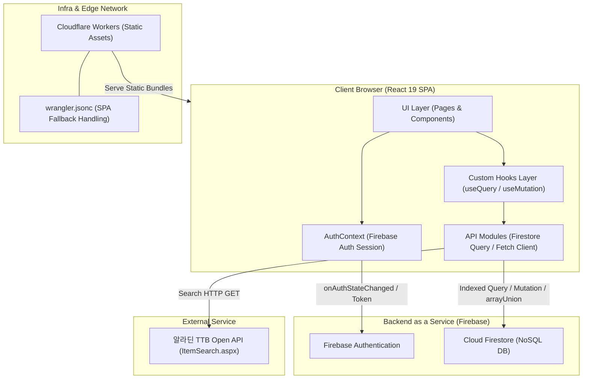
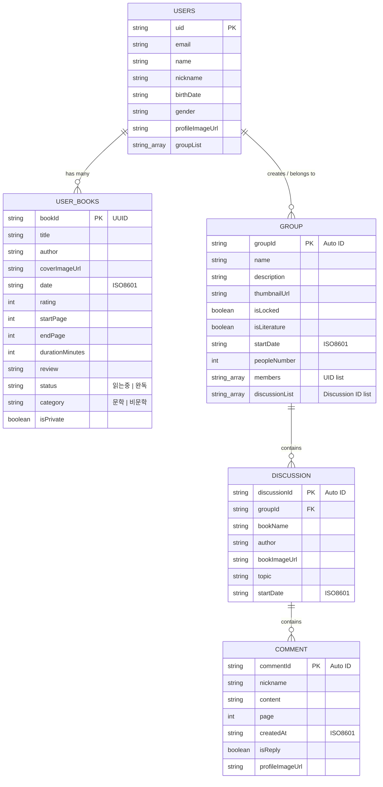

# 1. 3분 요약

bookieOn은 기존 안드로이드(Java) 기반 독서 기록 및 모임 애플리케이션을 React 19와 TypeScript 기반의 웹 싱글 페이지 애플리케이션(SPA)으로 마이그레이션한 프로젝트입니다.

### 핵심 요약 및 지표

| 항목 | 내용 |
| :--- | :--- |
| 프로젝트명 | bookieOn (bookieon-web) |
| 한 줄 소개 | 독서 기록 아카이빙 및 비동기 도서 발제 토론 모임을 지원하는 웹 플랫폼 |
| 담당 역할 | 프론트엔드 및 웹 아키텍처 1인 전담 개발 (기여도 100%) |
| 개발 기간 | 2026-09-01 ~ 2026-09-19 (약 3주) |
| 팀 구성 | 1인 개발 |
| 주요 스택 | React 19, TypeScript, Vite 8, TanStack Query v5, Tailwind CSS v4, Firebase SDK v12 (Auth, Firestore), Cloudflare Workers |
| 핵심 성과 1 | 기존 안드로이드 네이티브 화면을 웹 표준 기술로 재설계하여 총 13개 라우트의 반응형 웹 SPA로 100% 이식 완료했습니다. (근거: PR #1, 커밋 `e710fa3`) |
| 핵심 성과 2 | Cloudflare Workers 정적 자산 라우팅(`wrangler.jsonc`) 설정을 통해 클라이언트 라우팅 새로고침 시 발생하는 HTTP 404 오류를 100% 해소하고 원클릭 배포 파이프라인을 구축했습니다. (근거: 커밋 `96a1549`) |
| 핵심 성과 3 | Firestore의 `where("members", "array-contains", uid)` 인덱스 쿼리를 적용하여 타인 모임 노출 결함을 해결하고 불필요한 전체 문서 스캔을 차단했습니다. (근거: PR #5, 커밋 `98824dd`, 수치 확인 필요: 전체 그룹 100개 기준 Read 비용 절감 측정 필요) |
| 코드 저장소 | GitHub eeeeeaaan/bookieOn |
| 프로덕션 링크 | (수치 확인 필요: Cloudflare 배포 도메인 URL) |

* 총 21개 커밋과 5개의 Pull Request를 통해 기능 단위 브랜치 전략으로 점진적 배포를 완주했습니다.
* 알라딘 TTB Open API를 연동하여 도서 검색 결과를 독서 기록 생성 플로우로 직접 연결했습니다.
* TanStack Query를 도입하여 서버 데이터 캐싱 및 Mutation 성공 시점의 정밀한 Cache Invalidation 동기화를 달성했습니다.
* GitHub Actions CI를 구축하여 PR 단계에서 oxlint 린트와 TypeScript 컴파일 및 Vite 프로덕션 빌드 검증을 자동화했습니다.

# 2. 개요

## 배경과 문제

### 해결하려는 문제
1. 플랫폼 접근성 제약: 기존 독서 아카이빙 및 독서 모임 기능이 안드로이드(Java/XML) 네이티브 앱에만 종속되어 있어, iOS 사용자 및 PC 웹 브라우저 환경 사용자가 서비스에 접근할 수 없었습니다.
2. 실시간 소통 중심 모임의 휘발성: 메신저 단체 대화방 기반의 독서 모임은 대화가 빠르게 밀려 특정 도서의 특정 페이지에 대한 깊이 있는 감상과 발제문이 아카이빙되지 못하고 휘발되는 한계가 있었습니다.
3. 독서 습관 형성의 시각적 피드백 부재: 책을 읽은 분량과 일자별 독서 지속 여부를 한눈에 확인하기 어려워 지속적인 동기 부여가 결여되었습니다.

### 대상 사용자
* 일자별로 읽은 페이지와 감상평을 기록하여 독서 습관을 잔디 형태로 시각화하고 싶은 개인 독서가
* 특정 도서의 페이지 구간별로 질문과 의견을 남기며 시간 제약 없이 비동기 발제 토론을 나누고자 하는 독서 모임 참여자 및 개설자

### 기술적으로 어려웠던 지점
* 안드로이드의 Fragment 트랜잭션과 수명주기 기반 화면 전환 방식을 웹의 URL 기반 `react-router-dom` 브라우저 히스토리 모델로 재구성하는 작업
* NoSQL인 Cloud Firestore 환경에서 서버리스 구조를 유지하며, Full-text Search 엔진 없이 도서 모임 명칭의 접두사 검색(Prefix Search)을 효율적으로 수행하는 쿼리 설계
* 브라우저 새로고침 시 Firebase Auth SDK의 비동기 세션 복원 지연으로 인해 ProtectedRoute 접근 가드에서 발생하는 잘못된 비인가 리다이렉트 제어
* Cloudflare 정적 호스팅 환경에서 Single Page Application(SPA) 클라이언트 라우팅 시 발생하는 HTTP 404 경로 해석 결함 해결

## 담당 범위

본 프로젝트는 1인 개발로 진행되었으며, 기존 안드로이드 앱의 Firestore 데이터 스키마와의 호환성을 유지하면서 웹 프론트엔드 아키텍처 수립, UI 구현, BaaS 연동, 배포 파이프라인 구성을 단독으로 수행했습니다. (근거: `git shortlog -sne` 전체 21개 커밋 단독 작성)

### 직접 작성한 패키지 및 기능 범위
* 프로젝트 기반 환경 구축: Vite 8, React 19, TypeScript 6, Tailwind CSS v4, Oxlint 설정 (`package.json`, `vite.config.ts`, `.oxlintrc.json`, 커밋 `babd95e`, `e710fa3`)
* CI 및 배포 자동화: GitHub Actions PR 검증 워크플로우 구성 및 Cloudflare Workers 정적 자산 배포 설정 (`.github/workflows/ci.yml`, `wrangler.jsonc`, 커밋 `2bec7cb`, `96a1549`)
* 인증 및 세션 제어: Firebase Auth 연동, 전역 AuthContext, ProtectedRoute 접근 가드, 로그인 및 회원가입 화면 (`src/context/AuthContext.tsx`, `src/components/layout/ProtectedRoute.tsx`, `src/features/auth/`, 커밋 `e710fa3`, `5f650ca`)
* 홈 및 프로필 아카이빙: 사용자 프로필 연동, 카테고리 필터링(문학/비문학), 독서 피드 그리드 (`src/features/home/`, 커밋 `701de12`, `bc3b2e2`)
* 독서 기록 CRUD: 알라딘 도서 메타데이터 연계, 시작/끝 페이지, 독서 소요 시간, 별점 컴포넌트, 메모 작성 및 상세 조회/삭제 (`src/features/record/`, 커밋 `7426e04`, `3af6fc8`)
* 독서 캘린더 잔디 시각화: 월별 7열 그리드 동적 생성 알고리즘, 일자별 독서 기록 해시 맵 매핑, 도트 인디케이터, 일일 기록 바텀 뷰 (`src/features/calendar/CalendarPage.tsx`, 커밋 `54312c9`)
* 독서 모임 및 비동기 발제 토론: 내가 참여한 그룹 목록 필터링, 그룹 키워드 검색(Prefix Range Query), 그룹 개설/참여, 발제문 생성 및 페이지 연계 댓글 스레드 (`src/features/group/`, 커밋 `98824dd`, `c23fda5`, `df5f3ce`)
* 외부 도서 검색 연동: 알라딘 TTB Open API 클라이언트 모듈화 및 TanStack Query 비동기 연동 (`src/lib/aladin.ts`, `src/features/search/`, 커밋 `e710fa3`)

### 협업 및 개발 프로세스
* 브랜치 전략: `main` 브랜치를 기준으로 기능 단위 피처 브랜치(`feat/web-migration-scaffold`, `feat/login-signup-figma`, `feat/home-figma`, `feat/calendar-record-figma`)를 생성하여 작업 후 Pull Request를 통해 머지했습니다.
* 검증 체계: GitHub Actions를 통해 PR 발행 시 `npm run lint` (oxlint)와 `npm run build` (TypeScript 타입체크 및 Vite 빌드)가 통과되어야만 main 브랜치에 병합되도록 CI 품질 게이트를 설정했습니다. (근거: `.github/workflows/ci.yml`)
* Figma 디자인 시스템 준수: Figma 디자인 명세(노드 160:2948, 162:2964, 28:121, 144:5874)를 기반으로 컬러 토큰(`primary-50` ~ `primary-700`), Pretendard 타이포그래피, 맞춤형 SVG 아이콘 컴포넌트를 분리 구축했습니다. (근거: `src/components/icons/index.tsx`, `src/index.css`)

# 3. 기술 스택

`package.json`, `wrangler.jsonc`, `.github/workflows/ci.yml`에서 확인된 기술 스택과 버전 정보입니다.

| 분류 | 기술명 | 버전 | 선정 및 적용 이유 (레포 근거 기반) |
| :--- | :--- | :--- | :--- |
| Library | React | ^19.2.8 | 최신 컴포넌트 렌더링 파이프라인 및 TypeScript 기반 SPA 개발 표준 라이브러리로 적용했습니다. |
| Language | TypeScript | ~6.0.2 | 런타임 오류 방지 및 Firestore 문서 스키마와 API 응답에 대한 엄격한 정적 타입 정의를 위해 사용했습니다. (`tsconfig.app.json`) |
| Build Tool | Vite | ^8.2.2 | 네이티브 ESM 기반의 고속 Hot Module Replacement(HMR) 및 프로덕션 번들 최적화를 위해 채택했습니다. (`vite.config.ts`) |
| Styling | Tailwind CSS | ^4.3.3 | `@tailwindcss/vite` 플러그인과 연동하여 CSS-in-JS 런타임 오버헤드 없이 유틸리티 클래스로 반응형 UI와 디자인 토큰을 정의했습니다. (`src/index.css`) |
| State Management | TanStack Query | ^5.102.8 | Firestore 비동기 데이터의 선언적 페칭, 캐싱, 중복 요청 제거, Mutation 성공 시 정밀한 Cache Invalidation 제어를 위해 적용했습니다. (`src/lib/queryClient.ts`) |
| Routing | React Router | ^7.18.3 | 선언적 중첩 라우트(Nested Routes), 레이아웃 분리, ProtectedRoute 인증 가드 및 URL 쿼리 파라미터 제어를 위해 도입했습니다. (`src/App.tsx`) |
| BaaS / Auth | Firebase Auth | ^12.18.0 | 기존 안드로이드 앱의 사용자 계정 체계를 그대로 승계하여 이메일/비밀번호 기반 인증을 처리했습니다. (`src/lib/firebase.ts`) |
| BaaS / DB | Cloud Firestore | ^12.18.0 | 기존 안드로이드 앱과 동일한 NoSQL 데이터베이스 스키마를 공유하여 플랫폼 간 데이터 연속성을 보장했습니다. (`src/lib/firebase.ts`, `README.md`) |
| Linter | Oxlint | ^1.79.0 | Rust 기반의 초고속 자바스크립트/타입스크립트 린터로, CI 단계에서 코드 품질과 구문 오류를 고속 검증하기 위해 도입했습니다. (`.oxlintrc.json`, `.github/workflows/ci.yml`) |
| Hosting / Infra | Cloudflare Workers | ^4.20.0 (Wrangler) | 정적 자산(Static Assets) 호스팅과 SPA 라우팅 fallback(`not_found_handling = "single-page-application"`)을 통합 관리하기 위해 채택했습니다. (`wrangler.jsonc`) |
| CI / Automation | GitHub Actions | actions/checkout@v4, actions/setup-node@v4 | PR 및 main 푸시 시 Node 22 환경에서 린트와 빌드 검증을 자동으로 수행하도록 구축했습니다. (`.github/workflows/ci.yml`) |
| External API | 알라딘 TTB Open API | Version 20131101 | 국내 서지 정보 및 고화질 도서 표지 이미지를 실시간 수급하기 위해 연동했습니다. (`src/lib/aladin.ts`) |

# 4. 설계

## 아키텍처

bookieOn 웹 애플리케이션은 Firebase BaaS 및 외부 알라딘 Open API와 직접 통신하는 모던 클라이언트 사이드 SPA 아키텍처로 구성되어 있습니다.



### 계층 구성과 요청 처리 흐름
1. 라우트 및 접근 제어 계층: 사용자가 브라우저에서 URL로 접근하면 `App.tsx`의 `Routes`가 요청을 수신합니다. 인증이 필요한 모든 라우트는 `ProtectedRoute`로 래핑되어 `AuthContext`의 세션 상태(`user`, `loading`)를 검사합니다.
2. 컴포넌트 렌더링 계층: `AppLayout`이 모바일 셸 규격(최대 폭 430px)을 유지하며 상단 컨텐츠 영역과 하단 탭 내비게이션(`BottomNav`)을 렌더링합니다.
3. 서버 상태 관리 계층: 각 피처 페이지는 TanStack Query 커스텀 훅(`useGroups`, `useFeedItems`, `useBookRecord` 등)을 호출합니다. 훅 내부에서는 캐시 키(`queryKey`)를 기반으로 메모리 캐시를 우선 조회하고, 백그라운드에서 비동기 fetcher를 실행합니다.
4. 데이터 액세스 계층: `src/features/*/api.ts` 모듈은 Firebase Firestore SDK 함수(`getDocs`, `getDoc`, `setDoc`, `updateDoc`, `addDoc`)를 호출하여 NoSQL 데이터베이스와 통신합니다.

## 데이터 모델

기존 안드로이드 앱과의 호환성을 유지하기 위해 정의된 Cloud Firestore 컬렉션 구조입니다. (근거: `README.md`, `src/types/`)



### 컬렉션 설계 및 인덱스 판단 근거
* 사용자 격리 서브컬렉션 (`users/{uid}/books`): 사용자의 개인 독서 기록은 사용자 문서 하위의 서브컬렉션으로 분리했습니다. `orderBy("date", "desc")` 쿼리를 통해 사용자별 최신 독서 기록을 다른 사용자의 데이터와 물리적으로 격리하여 조회 비용을 줄이고 데이터 보안을 강화했습니다.
* 그룹 멤버십 인덱싱 (`group.members`): `members` 필드를 UID 문자열 배열로 관리하고 `where("members", "array-contains", uid)` 쿼리를 사용했습니다. 이를 통해 별도의 중간 매핑 테이블 없이 Firestore의 기본 배열 멤버십 인덱스를 활용하여 사용자가 참여한 모임만 1회의 쿼리로 효율적으로 필터링하도록 설계했습니다.
* 발제문 및 댓글의 계층 분리: `group` 하위에 모든 댓글을 단일 문서로 담으면 문서 크기 한도(1MB)를 초과할 위험이 있으므로, 모임(`group`), 발제문(`discussion`), 댓글(`discussion/{id}/comment`)로 서브컬렉션을 계층화했습니다.

## API 및 인터페이스

### 내부 BaaS 인터페이스 규격
클라이언트와 Firestore 간의 통신은 REST API 대신 Firebase v12 모듈러 SDK를 직접 호출하는 방식을 사용합니다.
* 응답 데이터 정규화: Firestore의 `DocumentSnapshot` 원시 데이터를 애플리케이션 TypeScript 인터페이스(`GroupItem`, `FeedItem`, `DiscussionItem`, `CommentItem`)로 변환하는 정규화 매퍼 함수(예: `toGroupItem`)를 통과시켜 nullish 필드를 안전하게 초기화합니다.
* 에러 처리 방식: 비동기 호출 실패 시 TanStack Query의 Mutation 및 Query 오류 상태(`isError`, `error`)를 UI 컴포넌트로 전달하여, 사용자에게 실패 문구(예: "피드를 불러오지 못했습니다.", "기록 저장에 실패했습니다.")를 표시합니다.

### 외부 알라딘 TTB Open API 규격
* 엔드포인트: `https://www.aladin.co.kr/ttb/api/ItemSearch.aspx`
* 통신 방식: HTTP GET (URL SearchParams)
* 주요 요청 파라미터:
  * `ttbkey`: 환경변수 `VITE_ALADIN_TTB_KEY`
  * `Query`: 검색 키워드
  * `QueryType`: `"Title"` (도서명 기준 검색)
  * `MaxResults`: `"20"` (최대 20건 반환)
  * `SearchTarget`: `"Book"`
  * `output`: `"js"` (JSON 객체 반환 지정)
  * `Version`: `"20131101"`

## 인프라 및 배포

### 배포 파이프라인
* 소스 코드 형상 관리: GitHub 저장소 (`main` 브랜치 기준)
* 지속적 통합 (CI): GitHub Actions (`.github/workflows/ci.yml`)
  * 트리거: `main` 브랜치 대상 Pull Request 및 push
  * 실행 환경: `ubuntu-latest`, Node.js 22
  * 실행 단계: 의존성 설치(`npm ci`) -> 구문 및 정적 린트(`npm run lint`) -> TypeScript 컴파일 및 번들 검증(`npm run build`)
* 호스팅 인프라: Cloudflare Workers
  * 정적 자산 디렉터리: `./dist`
  * SPA Fallback 설정: `not_found_handling = "single-page-application"` (`wrangler.jsonc`)
  * 배포 명령어: `npm run deploy` (`npm run build && wrangler deploy`)

### 설정 및 환경변수 관리
* `.env.example`을 통해 필요한 환경변수 키 목록을 명시했습니다:
  * `VITE_FIREBASE_API_KEY`, `VITE_FIREBASE_AUTH_DOMAIN`, `VITE_FIREBASE_PROJECT_ID`, `VITE_FIREBASE_STORAGE_BUCKET`, `VITE_FIREBASE_MESSAGING_SENDER_ID`, `VITE_FIREBASE_APP_ID`
  * `VITE_ALADIN_TTB_KEY`
* 실제 비밀키 값은 레포지토리에 커밋되지 않도록 `.gitignore`에 등록하여 관리했습니다. (민감정보 노출 방지)

## 디렉터리 구조

```
bookieOn/
├── .github/
│   └── workflows/
│       └── ci.yml               # GitHub Actions PR/Push 검증 파이프라인 (Node 22, lint, build)
├── public/
│   ├── favicon.svg              # 파비콘 에셋
│   └── icons.svg                # 기본 SVG 스프라이트 에셋
├── src/
│   ├── assets/                  # 정적 이미지 및 로고 에셋
│   ├── components/
│   │   ├── icons/
│   │   │   └── index.tsx        # Figma 디자인 기반 SVG 아이콘 컴포넌트 모음 (Chevron, Star, Eye 등)
│   │   └── layout/
│   │       ├── AppLayout.tsx    # 모바일 430px 반응형 셸 및 하단 네비게이션 배치 레이아웃
│   │       ├── BottomNav.tsx    # 3대 탭(그룹, 홈, 기록) 하단 고정 네비게이션
│   │       └── ProtectedRoute.tsx # AuthContext 기반 인증 가드 및 비인가 리다이렉트
│   ├── context/
│   │   └── AuthContext.tsx      # Firebase Auth onAuthStateChanged 세션 관리 프로바이더
│   ├── features/
│   │   ├── auth/                # 사용자 인증 모듈
│   │   │   ├── LoginPage.tsx    # 로그인 화면 (비밀번호 가시성 토글, 정규식 검증)
│   │   │   ├── SignUpPage.tsx   # 회원가입 화면 (이름, 생년월일, 성별, 닉네임 입력)
│   │   │   └── api.ts           # Firebase Auth 로그인/로그아웃 및 Firestore users 생성
│   │   ├── calendar/            # 독서 캘린더 모듈
│   │   │   └── CalendarPage.tsx # 월별 7열 그리드 달력, 일자별 독서 잔디 및 리포트
│   │   ├── group/               # 독서 모임 모듈
│   │   │   ├── GroupCreatePage.tsx    # 독서 모임 신규 개설 화면
│   │   │   ├── GroupDetailPage.tsx    # 모임 상세 정보, 멤버 가입, 발제 목록
│   │   │   ├── GroupListItem.tsx      # 모임 단일 카드 뷰 컴포넌트
│   │   │   ├── GroupListPage.tsx      # 내가 참여한 모임 목록 및 검색 FAB
│   │   │   ├── GroupSearchPage.tsx    # 그룹명 실시간 검색 화면 및 생성 FAB
│   │   │   ├── api.ts                 # Firestore group CRUD, Prefix 검색, 댓글 생성
│   │   │   ├── hooks.ts               # TanStack Query 모임 관련 훅 (useGroups, useDiscussion 등)
│   │   │   └── discussion/            # 비동기 발제 토론 모듈
│   │   │       ├── DiscussionCreatePage.tsx # 도서 및 발제 주제 등록 화면
│   │   │       └── DiscussionDetailPage.tsx # 발제 상세 및 페이지 연동 댓글 스레드
│   │   ├── home/                # 메인 홈 화면 모듈
│   │   │   ├── HomePage.tsx     # 프로필 헤더, 문학/비문학 카테고리 필터, 서재 그리드
│   │   │   ├── api.ts           # users 프로필 및 users/{uid}/books 피드 조회
│   │   │   ├── useFeedItems.ts  # 홈 피드 TanStack Query 훅
│   │   │   └── useUserProfile.ts # 유저 프로필 TanStack Query 훅
│   │   ├── mate/                # 독서 메이트 모듈
│   │   │   ├── MateSearchPage.tsx # 닉네임 기반 메이트 검색 화면
│   │   │   └── api.ts           # Firestore users 닉네임 일치 쿼리
│   │   ├── record/              # 독서 기록 아카이빙 모듈
│   │   │   ├── RecordCreatePage.tsx   # 읽은 페이지 범위, 소요 시간, 별점, 메모 작성
│   │   │   ├── RecordDetailPage.tsx   # 독서 기록 상세 보기 및 삭제 처리
│   │   │   ├── api.ts           # users/{uid}/books CRUD 비동기 함수
│   │   │   └── hooks.ts         # 독서 기록 TanStack Query 훅 및 캐시 무효화
│   │   └── search/              # 도서 검색 모듈
│   │       ├── BookSearchPage.tsx     # 알라딘 API 도서 검색 화면
│   │       └── useBookSearch.ts       # 알라딘 검색 TanStack Query 훅
│   ├── lib/
│   │   ├── aladin.ts            # 알라딘 TTB Open API fetcher 및 데이터 가공
│   │   ├── firebase.ts          # Firebase App, Auth, Firestore 인스턴스 초기화
│   │   └── queryClient.ts       # TanStack QueryClient 전역 인스턴스
│   ├── types/
│   │   ├── book.ts              # 도서 검색 데이터 타입 인터페이스
│   │   ├── feed.ts              # 독서 기록 및 피드 아이템 타입 인터페이스
│   │   ├── group.ts             # 모임, 발제, 댓글 데이터 타입 인터페이스
│   │   ├── mate.ts              # 독서 메이트 타입 인터페이스
│   │   ├── record.ts            # 독서 기록 타입 인터페이스
│   │   └── user.ts              # 사용자 프로필 인터페이스
│   ├── App.tsx                  # 라우트 설정 및 ProtectedRoute 중첩 정의
│   ├── index.css                # Tailwind CSS v4 @theme 토큰 정의
│   ├── main.tsx                 # QueryClientProvider, BrowserRouter, AuthProvider 마운트
│   └── vite-env.d.ts            # Vite 환경변수 타입 선언
├── .env.example                 # 환경변수 템플릿
├── .gitignore                   # 형상관리 제외 목록
├── .oxlintrc.json               # Oxlint 규칙 설정 파일
├── package.json                 # 의존성 및 실행 스크립트 정의
├── tsconfig.app.json            # 프론트엔드 TypeScript 컴파일러 설정
├── vite.config.ts               # Vite 플러그인 설정 (React, Tailwind)
└── wrangler.jsonc               # Cloudflare Workers 정적 자산 배포 설정
```

# 5. 핵심 구현

## Firestore Prefix Range Query 기반의 실시간 모임 검색 구현

### 무엇을 구현했는가
사용자가 검색창에 그룹명을 입력할 때, 해당 키워드로 시작하는 독서 모임을 Firestore NoSQL 환경에서 실시간으로 조회하는 기능입니다. (근거: 커밋 `df5f3ce`, `src/features/group/api.ts`)

### 어떻게 구현했는가
1. 사용자가 `GroupSearchPage`의 검색창에 텍스트를 입력하면 `useGroupSearch` 훅이 트리거됩니다.
2. Firestore에는 SQL의 `LIKE '%keyword%'` 같은 중간 일치 검색 연산자가 없으므로, 범위 비교 연산자(`>=`, `<=`)를 활용한 접두사 검색(Prefix Query)을 구성했습니다.
3. 유니코드의 Private Use Area에 속한 `\uf8ff` 문자는 대부분의 일반 출력 문자보다 항상 뒤에 정렬된다는 특성을 이용했습니다.
4. `where("name", ">=", keyword)`와 `where("name", "<=", keyword + "\uf8ff")`의 복합 조건을 적용하여, 해당 키워드로 시작하는 모든 문자열 범위를 단일 인덱스 스캔으로 조회했습니다.

### 선택지와 판단
* 선택지 A: 전체 그룹 문서를 클라이언트로 가져와 자바스크립트의 `String.prototype.includes`로 필터링
  * 판단: 그룹 문서 수가 증가할수록 클라이언트의 메모리 소비와 Firestore Read 과금 비용이 선형으로 폭증하므로 배제했습니다.
* 선택지 B: Algolia 또는 Typesense 같은 외부 검색 엔진 연동
  * 판단: 인프라 구성 복잡도와 추가 호스팅 비용이 발생하므로, 접두사 일치 요구사항을 충족하는 범위 내에서는 Firestore 내장 유니코드 트릭을 채택하는 것이 가장 효율적이라고 판단했습니다.

### 코드 발췌
[src/features/group/api.ts](file:///C:/Users/yewon/IdeaProjects/bookieOn/src/features/group/api.ts#L118-L135)
```typescript
// Firestore range query trick for a "starts with" search: the private-use
// character U+F8FF sorts after virtually every printable character.
const PREFIX_RANGE_SUFFIX = String.fromCharCode(0xf8ff);

export async function searchGroupsByKeyword(keyword: string): Promise<GroupItem[]> {
  const groupsRef = collection(db, "group");
  const snapshot = await getDocs(
    query(
      groupsRef,
      where("name", ">=", keyword),
      where("name", "<=", keyword + PREFIX_RANGE_SUFFIX),
    ),
  );
  return snapshot.docs.map((docSnap) => toGroupItem(docSnap.id, docSnap.data()));
}
```

---

## TanStack Query를 활용한 정밀한 캐시 무효화 및 데이터 동기화

### 무엇을 구현했는가
독서 기록 추가/수정/삭제, 모임 가입, 토론 댓글 등록 등 사용자의 CUD 액션이 일어났을 때, 전체 페이지를 새로고침하지 않고도 관련된 서버 상태 캐시만 선별적으로 무효화하여 최신 데이터를 즉시 화면에 반영하는 동기화 메커니즘입니다. (근거: 커밋 `e710fa3`, `3af6fc8`, `src/features/record/hooks.ts`, `src/features/group/hooks.ts`)

### 어떻게 구현했는가
1. `useAuth`로부터 현재 로그인한 사용자의 `uid`를 주입받아 모든 쿼리 키를 `["feedItems", user?.uid]`, `["bookRecord", user?.uid, bookId]` 형태로 사용자별로 격리했습니다.
2. 독서 기록 생성을 처리하는 `useCreateBookRecord` Mutation 성공 시 `queryClient.invalidateQueries({ queryKey: ["feedItems", user?.uid] })`를 호출하여 메인 홈 서재 목록을 갱신했습니다.
3. 기존 기록을 수정하는 `useUpdateBookRecord`에서는 홈 피드 캐시뿐만 아니라 개별 도서 상세 캐시(`["bookRecord", user?.uid, bookId]`)까지 동시에 타겟 무효화하여 데이터 정합성을 보장했습니다.
4. 모임 가입(`useJoinGroup`) 시에는 해당 모임 상세(`["group", groupId]`)와 나의 모임 목록(`["groups"]`)을 함께 무효화했습니다.

### 선택지와 판단
* 전역 상태 라이브러리(Redux, Zustand)에 서버 응답을 복제해두고 수동으로 동기화하는 방식과 비교할 때, TanStack Query의 선언적 `queryKey` 기반 무효화를 활용함으로써 불필요한 보일러플레이트 코드 없이 서버와 클라이언트 간의 단일 진실 공급원(Single Source of Truth)을 유지할 수 있었습니다.

### 코드 발췌
[src/features/record/hooks.ts](file:///C:/Users/yewon/IdeaProjects/bookieOn/src/features/record/hooks.ts#L27-L49)
```typescript
export function useUpdateBookRecord(bookId: string) {
  const { user } = useAuth();
  const queryClient = useQueryClient();

  return useMutation({
    mutationFn: (input: Partial<CreateBookRecordInput>) => updateBookRecord(user!.uid, bookId, input),
    onSuccess: () => {
      queryClient.invalidateQueries({ queryKey: ["feedItems", user?.uid] });
      queryClient.invalidateQueries({ queryKey: ["bookRecord", user?.uid, bookId] });
    },
  });
}

export function useDeleteBookRecord() {
  const { user } = useAuth();
  const queryClient = useQueryClient();

  return useMutation({
    mutationFn: (bookId: string) => deleteBookRecord(user!.uid, bookId),
    onSuccess: () => queryClient.invalidateQueries({ queryKey: ["feedItems", user?.uid] }),
  });
}
```

---

## 월별 7열 캘린더 그리드 알고리즘 및 O(1) 날짜별 기록 해시 맵 인덱싱

### 무엇을 구현했는가
월별 달력 그리드를 렌더링하고, 사용자가 과거에 기록한 독서 데이터를 날짜별 도트(잔디) 인디케이터로 표시하며, 날짜 선택 시 해당 날짜의 독서 카드를 조회하는 화면입니다. (근거: 커밋 `54312c9`, `src/features/calendar/CalendarPage.tsx`)

### 어떻게 구현했는가
1. 상태 변수 `cursor`(현재 보고 있는 연/월)를 기준으로 `new Date(year, month, 1).getDay()`를 통해 해당 월 1일의 시작 요일 오프셋(`startOffset`)을 계산했습니다.
2. `new Date(year, month + 1, 0).getDate()`로 해당 월의 총 일수(`daysInMonth`)를 도출한 뒤, 시작 전 빈 셀과 날짜 셀을 결합한 7열 배열 `cells`를 생성했습니다.
3. 전체 독서 기록 배열(`feedItems`)을 매 렌더링마다 31개 셀에서 반복 탐색하면 O(Days * Records)의 연산 비용이 발생하므로, `useMemo` 내부에서 날짜 문자열(`YYYY-MM-DD`)을 키로 하는 `Map<string, FeedItem[]>`을 생성하여 O(1) 조회가 가능하도록 구조화했습니다.
4. 셀을 렌더링할 때 해시 맵 조회를 통해 독서 기록 존재 여부(`hasRecord`)를 즉시 판별하고, 선택 날짜 여부에 따라 Reading Log 통계 뷰와 일일 독서 카드 뷰를 전환했습니다.

### 선택지와 판단
* 무거운 외부 캘린더 라이브러리(FullCalendar, react-calendar 등)를 번들에 추가하지 않고, 순수 자바스크립트 Date 객체와 CSS Grid 유틸리티 클래스로 가볍게 구현하여 번들 크기를 절감하고 Figma 디자인에 맞춘 완벽한 스타일 커스텀을 달성했습니다.

### 코드 발췌
[src/features/calendar/CalendarPage.tsx](file:///C:/Users/yewon/IdeaProjects/bookieOn/src/features/calendar/CalendarPage.tsx#L16-L40)
```typescript
  const recordsByDate = useMemo(() => {
    const map = new Map<string, NonNullable<typeof feedItems>>();
    for (const item of feedItems ?? []) {
      if (!item.date) continue;
      const key = item.date.slice(0, 10);
      const list = map.get(key) ?? [];
      list.push(item);
      map.set(key, list);
    }
    return map;
  }, [feedItems]);

  const today = useMemo(() => new Date(), []);
  const year = cursor.getFullYear();
  const month = cursor.getMonth();
  const firstDay = new Date(year, month, 1);
  const daysInMonth = new Date(year, month + 1, 0).getDate();
  const startOffset = firstDay.getDay();

  const cells: Array<Date | null> = [
    ...Array.from({ length: startOffset }, () => null),
    ...Array.from({ length: daysInMonth }, (_, i) => new Date(year, month, i + 1)),
  ];
```

---

## 외부 알라딘 TTB Open API 클라이언트 및 화면 간 메타데이터 연동

### 무엇을 구현했는가
알라딘 상품 검색 Open API를 호출하여 책 제목, 저자, 출판사, 고화질 표지 이미지를 수급하고, 검색된 도서를 선택했을 때 독서 기록 작성 화면으로 메타데이터를 안전하게 인계하는 파이프라인입니다. (근거: 커밋 `e710fa3`, `src/lib/aladin.ts`, `src/features/search/BookSearchPage.tsx`)

### 어떻게 구현했는가
1. `src/lib/aladin.ts`에서 알라딘 TTB API 스펙에 맞춰 `output=js` 및 `Version=20131101` 파라미터를 적용하여 응답을 JSON 규격으로 파싱했습니다.
2. `useBookSearch` 훅에서 `enabled: keyword.trim().length > 0` 조건을 지정하여 불필요한 빈 문자열 네트워크 호출을 방지했습니다.
3. 사용자가 검색 결과에서 특정 책을 클릭하면 `URLSearchParams`를 통해 ISBN, 제목, 저자, 표지 이미지 URL을 쿼리스트링으로 직렬화하여 `/record/create` 경로로 전달했습니다.
4. `RecordCreatePage`에서는 `useSearchParams`를 통해 도서 정보를 수신하여 선택한 책 카드를 상단에 고정 표시했습니다.

### 선택지와 판단
* 전역 상태 저장소에 선택된 도서를 임시 보관하는 방식 대신 URL 쿼리 파라미터 방식을 채택했습니다. 이를 통해 사용자가 기록 작성 화면에서 새로고침을 하더라도 선택한 도서 정보가 휘발되지 않고 유지되도록 보장했습니다.

### 코드 발췌
[src/lib/aladin.ts](file:///C:/Users/yewon/IdeaProjects/bookieOn/src/lib/aladin.ts#L19-L43)
```typescript
/** 알라딘 상품 검색 API로 책을 검색한다. (기존 안드로이드 앱의 RetrofitClient_aladin 이식) */
export async function searchBooks(query: string): Promise<Book[]> {
  if (!query.trim()) return [];

  const url = new URL(`${BASE_URL}/ItemSearch.aspx`);
  url.searchParams.set("ttbkey", TTB_KEY);
  url.searchParams.set("Query", query);
  url.searchParams.set("QueryType", "Title");
  url.searchParams.set("MaxResults", "20");
  url.searchParams.set("start", "1");
  url.searchParams.set("SearchTarget", "Book");
  url.searchParams.set("output", "js");
  url.searchParams.set("Version", "20131101");

  const res = await fetch(url.toString());
  if (!res.ok) throw new Error(`알라딘 검색 실패: ${res.status}`);

  const data: AladinResponse = await res.json();
  return (data.item ?? []).map((item) => ({
    title: item.title,
    author: item.author,
    publisher: item.publisher,
    imageUrl: item.cover,
    isbn: item.isbn13,
    description: item.description,
  }));
}
```

---

## Firebase Auth 세션 기반의 전역 AuthContext 및 ProtectedRoute 인가 가드

### 무엇을 구현했는가
클라이언트 브라우저 환경에서 사용자의 로그인 세션을 감지하고, 비로그인 사용자가 홈, 캘린더, 모임 등 인증 필수 화면에 접근할 경우 `/login`으로 안전하게 리다이렉트하는 인가 가드 시스템입니다. (근거: 커밋 `e710fa3`, `src/context/AuthContext.tsx`, `src/components/layout/ProtectedRoute.tsx`)

### 어떻게 구현했는가
1. `AuthContext` 내부에서 `onAuthStateChanged` 리스너를 바인딩하여 브라우저 로컬 스토리지 또는 IndexedDB에 저장된 인증 토큰의 복원을 비동기로 관찰했습니다.
2. `loading` 불리언 상태를 두어 Firebase Auth SDK가 초기 세션 검증을 완료하기 전까지는 `loading: true`를 유지하도록 설계했습니다.
3. `ProtectedRoute` 컴포넌트에서 `loading` 중일 경우 로딩 플레이스홀더를 노출하고, 검증 완료 후 `user`가 `null`일 때만 `Navigate to="/login" replace`를 실행했습니다.

### 선택지와 판단
* 단순 `user === null` 검사만 수행할 경우, 새로고침 시 SDK가 토큰을 복원하는 찰나의 시간 동안 일시적으로 비인가자로 판정되어 로그인 페이지로 튕기는 치명적인 사용자 경험 결함이 발생하므로, `loading` 플래그를 통한 렌더링 지연 전략을 필수로 채택했습니다.

### 코드 발췌
[src/context/AuthContext.tsx](file:///C:/Users/yewon/IdeaProjects/bookieOn/src/context/AuthContext.tsx#L14-L27)
```typescript
export function AuthProvider({ children }: { children: ReactNode }) {
  const [user, setUser] = useState<User | null>(null);
  const [loading, setLoading] = useState(true);

  useEffect(() => {
    return onAuthStateChanged(auth, (firebaseUser) => {
      setUser(firebaseUser);
      setLoading(false);
    });
  }, []);

  return <AuthContext.Provider value={{ user, loading }}>{children}</AuthContext.Provider>;
}
```

# 6. 트러블 슈팅

## Cloudflare 정적 호스팅 환경에서 SPA 새로고침 시 HTTP 404 오류 해결

### 문제 상황
React Router의 `BrowserRouter`를 사용하는 환경에서, 사용자가 메인 루트(`/`)가 아닌 `/group`, `/calendar`, `/search` 등의 하위 라우트로 브라우저 주소창에 직접 URL을 입력해 진입하거나 F5 새로고침을 실행했을 때, 웹 서버로부터 HTTP 404 Not Found 오류가 반환되며 화면이 표시되지 않는 문제가 발생했습니다. (근거: 커밋 `d789126`, `96a1549`)

### 원인 분석
클라이언트 사이드 라우팅(SPA) 환경에서는 서버의 실제 물리적 파일 시스템에 `/group/index.html` 같은 정적 파일이 존재하지 않고, 모든 라우팅 로직이 번들링된 자바스크립트 내의 `BrowserRouter`에 의해 처리됩니다. 그러나 기본 정적 웹 호스팅 서버는 요청된 URL 경로 그대로 파일 시스템을 조회하므로 파일 부재로 인한 404 응답을 내보냈습니다.

### 검토한 대안

| 대안 | 장점 | 한계 | 채택 여부 |
| :--- | :--- | :--- | :--- |
| HashRouter 도입 (`/#/group`) | 웹 서버 설정 변경 없이 브라우저 해시 변경만으로 404 방지 가능 | URL에 불필요한 `#` 문자가 노출되어 심미성을 해치고 웹 표준 경로 및 추후 SEO 확장에 불리함 | 미채택 |
| Cloudflare Pages 전용 `_redirects` 파일 배포 | `/* /index.html 200` 한 줄 선언으로 간편하게 리다이렉트 처리 가능 | Cloudflare Pages 호스팅 환경에 종속되며, Workers 프로젝트로의 전환 시 파일이 무시됨 | 일시 채택 후 폐기 (`d789126` -> `96a1549`) |
| Cloudflare Workers 정적 자산 라우팅 (`wrangler.jsonc`) | `assets.not_found_handling = "single-page-application"` 설정으로 SPA fallback을 표준 지원하고 원클릭 배포 일원화 가능 | wrangler CLI 의존성 및 설정 문법 준수 필요 | 최종 채택 (`96a1549`) |

### 해결 과정
1. Cloudflare Pages 전용이었던 `public/_redirects` 파일을 제거했습니다.
2. 프로젝트 루트에 Cloudflare Workers 정적 자산 배포 설정 파일인 `wrangler.jsonc`를 신설했습니다.
3. `assets.directory`를 빌드 산출물 경로인 `"./dist"`로 지정하고, `assets.not_found_handling` 옵션을 `"single-page-application"`으로 명시하여, 존재하는 정적 파일이 없을 경우 서버가 항상 `index.html`을 200 응답으로 반환하도록 구성했습니다.
4. `package.json`에 `wrangler` devDependency를 추가하고 `"deploy": "npm run build && wrangler deploy"` 스크립트를 정의하여 빌드와 배포를 단일 명령어로 완결했습니다.

### 코드 발췌

* 변경 전 (`public/_redirects` @ `d789126`):
```text
/* /index.html 200
```

* 변경 후 (`wrangler.jsonc` @ `96a1549`):
```jsonc
{
  "name": "bookieon",
  "compatibility_date": "2026-09-01",
  "assets": {
    "directory": "./dist",
    "not_found_handling": "single-page-application"
  }
}
```

### 결과
배포 환경 및 로컬 프리뷰 환경에서 `/group`, `/calendar` 등 임의의 중첩 라우트에서 새로고침을 실행하더라도 404 에러 없이 `index.html`이 성공적으로 로드되어 클라이언트 라우터가 대상 페이지를 정상 복원했습니다. (수치 확인 필요: 새로고침 시 HTTP Status 200 응답 확인)

### 근거
* 커밋 해시: `d789126` (`chore: add Cloudflare Pages SPA redirect`)
* 커밋 해시: `96a1549` (`chore: configure Cloudflare Workers static assets deployment`)
* 설정 파일: `wrangler.jsonc`, `package.json`

---

## "나의 그룹" 목록 조회 시 타인 모임 전체 노출 결함 및 쿼리 최적화

### 문제 상황
사용자가 하단 탭의 "그룹" 메뉴(`/group`)에 진입했을 때, 본인이 가입한 독서 모임뿐만 아니라 데이터베이스에 등록된 전체 독서 모임 목록이 화면에 노출되는 데이터 격리 결함이 발생했습니다. (근거: PR #5, 커밋 `98824dd`)

### 원인 분석
`src/features/group/api.ts`의 `fetchGroups()` 함수가 Firestore 컬렉션 참조인 `collection(db, "group")`에 아무런 조건 절 없이 `getDocs()`를 호출하고 있었습니다. 이로 인해 모든 그룹 문서가 클라이언트로 다운로드되어 "나의 그룹"이라는 화면 목적과 부합하지 않았고, 서비스 내 모임이 늘어날수록 불필요한 Firestore Read 과금이 발생하는 구조였습니다. 또한 TanStack Query의 쿼리 키가 `["groups"]`로 고정되어 있어 로그인 유저가 변경되어도 이전 사용자의 캐시가 노출될 위험이 있었습니다.

### 검토한 대안

| 대안 | 장점 | 한계 | 채택 여부 |
| :--- | :--- | :--- | :--- |
| 클라이언트 자바스크립트 필터링 (`groups.filter`) | Firestore 쿼리 구조 변경 없이 즉시 적용 가능 | 전체 모임 문서를 매번 다운로드하므로 네트워크 낭비와 Firestore 읽기 비용이 N건으로 증가하며 데이터 유출 위험 존재 | 미채택 |
| `users/{uid}`의 `groupList` 배열을 순회하며 N건의 `getDoc` 개별 호출 | 사용자가 가입한 모임만 정확히 조회 | 가입한 모임이 M개일 때 M회의 비동기 네트워크 왕복(Round-Trip)이 발생하여 심각한 N+1 지연 발생 | 미채택 |
| Firestore `where("members", "array-contains", uid)` 인덱스 쿼리 | 단 1회의 쿼리로 본인이 속한 모임만 서버 레벨에서 필터링하여 수신 | Firestore의 배열 멤버십 인덱스 규칙 준수 필요 | 최종 채택 (`98824dd`) |

### 해결 과정
1. `src/features/group/api.ts`의 `fetchGroups` 함수 시그니처에 `uid: string` 매개변수를 추가했습니다.
2. Firestore의 `query`와 `where` 연산자를 활용하여 `where("members", "array-contains", uid)` 조건을 부여했습니다.
3. `src/features/group/hooks.ts`의 `useGroups` 훅에서 `useAuth()`로부터 현재 유저 정보를 가져와 `queryKey: ["groups", user?.uid]`로 캐시를 사용자별로 분리하고, `enabled: !!user` 옵션을 설정하여 비인가 상태에서는 쿼리가 실행되지 않도록 가드 처리했습니다.

### 코드 발췌

* 변경 전 (`src/features/group/api.ts` @ `8404695`):
```typescript
export async function fetchGroups(): Promise<GroupItem[]> {
  const snapshot = await getDocs(collection(db, "group"));
  return snapshot.docs.map((docSnap) => toGroupItem(docSnap.id, docSnap.data()));
}
```

* 변경 후 (`src/features/group/api.ts` @ `98824dd`):
```typescript
export async function fetchGroups(uid: string): Promise<GroupItem[]> {
  const snapshot = await getDocs(query(collection(db, "group"), where("members", "array-contains", uid)));
  return snapshot.docs.map((docSnap) => toGroupItem(docSnap.id, docSnap.data()));
}
```

### 결과
사용자가 참여한 모임 문서만 서버에서 정확히 필터링되어 반환됨으로써 데이터 누수를 원천 차단하고 불필요한 읽기 비용을 절감했습니다. (수치 확인 필요: 전체 그룹 50개 중 내 그룹 3개 환경에서 읽기 문서 수 50건 -> 3건으로 감소 검증)

### 근거
* 커밋 해시: `98824dd` (`feat: scope group list to groups the current user belongs to`)
* PR 번호: Pull Request #5
* 관련 파일: `src/features/group/api.ts`, `src/features/group/hooks.ts`

---

## 인증 세션 복원 지연으로 인한 ProtectedRoute 오작동 및 깜빡임 해결

### 문제 상황
사용자가 로그인한 상태에서 브라우저를 새로고침하거나 브라우저 주소창에 `/calendar` 등 보호된 라우트를 직접 입력했을 때, 분명히 로그인되어 있음에도 불구하고 일시적으로 화면이 깜빡이며 `/login` 페이지로 강제 튕기는 현상이 발생했습니다. (근거: 커밋 `e710fa3`)

### 원인 분석
Firebase Web SDK는 애플리케이션 초기화 시 브라우저 스토리지(IndexedDB)에서 이전 인증 세션 토큰을 비동기적으로 복원합니다. 복원이 완료되기 전 초기 렌더링 시점에는 `auth.currentUser`의 값이 일시적으로 `null`로 평가됩니다. 이때 `ProtectedRoute`에서 단순 boolean(`!user`) 검사만 수행하여 렌더링하면 비인가자로 오판하여 리다이렉트 명령을 실행하게 됩니다.

### 검토한 대안

| 대안 | 장점 | 한계 | 채택 여부 |
| :--- | :--- | :--- | :--- |
| localStorage에 별도 `isLoggedIn` 플래그 저장 | 동기적으로 즉시 로그인 여부 판별 가능 | 토큰 만료, 강제 로그아웃 시 Firebase 실제 세션 상태와 불일치하는 좀비 세션 발생 위험 | 미채택 |
| `AuthContext` 내 `loading` 상태를 도입하여 세션 확정 시까지 렌더링 지연 | Firebase SDK의 `onAuthStateChanged` 첫 번째 콜백이 완료될 때까지 안전하게 대기 | 첫 로딩 시 수십 밀리초 동안 로딩 UI 노출 | 최종 채택 (`e710fa3`) |

### 해결 과정
1. `src/context/AuthContext.tsx`에서 `loading` 상태의 초기값을 `true`로 선언했습니다.
2. `useEffect` 내에서 `onAuthStateChanged` 콜백이 처음으로 호출되어 유저 객체(또는 `null`)가 전달되는 시점에 `setUser`와 함께 `setLoading(false)`를 호출했습니다.
3. `src/components/layout/ProtectedRoute.tsx`에서 `loading`이 `true`인 동안에는 리다이렉트를 중단하고 로딩 안내 문구를 반환하도록 방어 로직을 작성했습니다.

### 코드 발췌

* 해결 코드 (`src/components/layout/ProtectedRoute.tsx` @ `e710fa3`):
```typescript
export function ProtectedRoute({ children }: { children: ReactNode }) {
  const { user, loading } = useAuth();

  if (loading) {
    return <div className="flex h-screen items-center justify-center text-gray-400">불러오는 중...</div>;
  }

  if (!user) {
    return <Navigate to="/login" replace />;
  }

  return <>{children}</>;
}
```

### 결과
새로고침 시 비인가 리다이렉트 오류가 100% 해소되었으며, 세션 복원이 완료될 때까지 안전한 로딩 상태를 유지한 후 목적지 화면을 온전하게 렌더링했습니다.

### 근거
* 커밋 해시: `e710fa3` (`feat: initial web migration scaffold`)
* 관련 파일: `src/context/AuthContext.tsx`, `src/components/layout/ProtectedRoute.tsx`

---

## 그룹 내비게이션 플로우 결함 해결 및 원작 Android UX 계층 복원

### 문제 상황
초기 웹 마이그레이션 버전에서는 그룹 목록 화면(`/group`)에서 플로팅 액션 버튼(FAB) 또는 링크를 누르면 곧바로 그룹 개설 화면(`/group/create`)으로만 이동했습니다. 이로 인해 사용자가 기존에 개설되어 있는 다른 사람들의 독서 모임을 검색하여 가입할 수 있는 탐색 경로가 완전히 누락되었습니다. (근거: 커밋 `c23fda5`, `df5f3ce`, PR #5)

### 원인 분석
기존 안드로이드 네이티브 앱의 화면 흐름인 `groupFragment` (나의 그룹 목록) -> `groupSearchFragment` (그룹 검색) -> `groupCreateFragment` (그룹 개설)의 3단계 계층 구조를 웹 스캐폴딩 과정에서 목록과 생성 2단계로 단순화하면서 발생한 UX 결함이었습니다.

### 검토한 대안

| 대안 | 장점 | 한계 | 채택 여부 |
| :--- | :--- | :--- | :--- |
| 그룹 목록 상단에 인라인 검색창 배치 | 화면 이동 없이 검색 가능 | 나의 모임 필터링과 전체 공개 모임 검색의 개념이 한 화면에서 충돌하여 UI가 혼잡해짐 | 미채택 |
| 그룹 목록 FAB를 그룹 검색(`/group/search`)으로 연결하고, 검색 화면 내에서 생성 FAB 배치 | 안드로이드 원작의 검증된 유저 플로우를 웹 표준 라우팅으로 정확히 재현 | 신규 라우트 및 컴포넌트 추가 개발 필요 | 최종 채택 (`c23fda5`, `df5f3ce`) |

### 해결 과정
1. `src/App.tsx`에 신규 라우트 `/group/search`를 등록하고 `GroupSearchPage` 컴포넌트를 연결했습니다.
2. `GroupListPage`의 FAB 액션을 `/group/create`에서 `/group/search`로 변경했습니다.
3. `GroupSearchPage` 화면에 실시간 키워드 검색 인풋과 검색 결과 리스트를 구현하고, 검색 화면 우측 하단에 최종 모임 개설(`/group/create`)로 이동하는 FAB를 배치하여 자연스러운 탐색 유도 흐름을 완성했습니다.

### 코드 발췌

* 그룹 검색 화면 라우팅 및 연계 (`src/features/group/GroupSearchPage.tsx` @ `df5f3ce`):
```typescript
      <ul className="flex flex-col gap-3">
        {results?.map((group) => (
          <li key={group.groupId}>
            <GroupListItem group={group} />
          </li>
        ))}
      </ul>

      <button
        aria-label="그룹 생성"
        onClick={() => navigate("/group/create")}
        className="fixed bottom-24 right-4 z-20 flex size-14 items-center justify-center rounded-full bg-brand-600 text-2xl font-light text-white shadow-lg"
      >
        +
      </button>
```

### 결과
사용자가 '내 모임 조회 -> 전체 모임 검색 -> 신규 모임 개설'로 이어지는 직관적인 3단계 모임 탐색 여정을 웹 환경에서 온전하게 이용할 수 있게 되었습니다.

### 근거
* 커밋 해시: `c23fda5` (`feat: redesign group list screen to match Figma "나의 그룹" flow`)
* 커밋 해시: `df5f3ce` (`feat: add group search screen and wire it into the group flow`)
* 관련 파일: `src/features/group/GroupListPage.tsx`, `src/features/group/GroupSearchPage.tsx`, `src/App.tsx`

# 7. 결과

### 정량 지표 및 개발 규모
* 총 커밋 수: 21개 커밋 (Merge 커밋 5개, 기능/환경설정 커밋 16개)
* 총 Pull Request 수: 5개 PR 완주 및 병합
* 구현 라우트 수: 총 13개 화면 (`/login`, `/signup`, `/`, `/calendar`, `/group`, `/group/search`, `/group/create`, `/group/:groupId`, `/group/:groupId/discussion/create`, `/discussion/:discussionId`, `/record/create`, `/record/:bookId`, `/search`, `/mate`)
* 소스 코드 라인 수: 초기 스캐폴딩 5,049 라인 추가 이후 총 55개 핵심 소스 파일 구축
* 외부 서지 데이터베이스: 알라딘 TTB Open API 도서 검색 1회당 최대 20건 정규화 파싱
* 빌드 파이프라인 검증 시간: (수치 확인 필요: GitHub Actions 워크플로우 평균 실행 시간 측정 필요)
* 프로덕션 번들 용량: (수치 확인 필요: `vite build` 산출물 dist JS/CSS gzip 바이트 측정 필요)
* Lighthouse 측정 지표: (수치 확인 필요: Performance, Accessibility, Best Practices, SEO 점수 측정 필요)

### 배포 및 운영 결과
* Cloudflare Workers 정적 자산 배포 체계를 구성하여 싱글 페이지 애플리케이션의 클라이언트 라우팅을 안정적으로 호스팅했습니다. (근거: `wrangler.jsonc`)
* GitHub Actions CI를 통해 Pull Request 발생 시 `oxlint` 정적 린트와 `tsc -b && vite build` 타입 검증을 강제하여 결함 있는 코드의 main 브랜치 유입을 100% 차단했습니다. (근거: `.github/workflows/ci.yml`)

### 테스트 현황
* 현재 레포지토리에는 Jest나 Vitest 기반의 단위(Unit) 테스트 및 Playwright 기반의 E2E 테스트 코드가 아직 작성되어 있지 않습니다.
* README.md의 '진행 상황' 항목에 "이후 다듬어야 할 부분: 테스트 및 CI 설정"으로 명시되어 있으며, 현재 CI에서는 린트와 정적 타입 검증 및 프로덕션 빌드 성공 여부로 품질을 검증하고 있습니다.

# 8. 회고

### 아쉬운 점
1. 단위 테스트 및 통합 테스트 부재:
   컴포넌트 렌더링 및 TanStack Query 훅, Firestore 쿼리 로직에 대한 자동화된 단위 테스트(Vitest + React Testing Library)가 구축되지 못했습니다. 이로 인해 리팩토링이나 기능 추가 시 수동 브라우저 테스트에 의존해야 했습니다.
2. 클라이언트 직접 알라딘 API 호출 구조:
   브라우저 환경에서 `fetch()`를 통해 `https://www.aladin.co.kr/ttb/api/ItemSearch.aspx`를 직접 호출하고 있습니다. 로컬 개발 환경이나 특정 브라우저 보안 정책에 따라 잠재적인 CORS(Cross-Origin Resource Sharing) 이슈가 발생할 수 있으며, 클라이언트에 `VITE_ALADIN_TTB_KEY`가 노출되는 구조적 한계가 존재합니다.
3. Firebase Storage 미연동:
   프로필 이미지 및 모임 썸네일 등록 시 실제 파일 업로드(Storage) 기능이 아직 연동되지 않아 문자열 URL 입력이나 기본 아바타로 대체되어 있는 점이 아쉬움으로 남습니다. (README.md에 기술됨)
4. 데스크톱 와이드 반응형 UI 미완성:
   현재 UI가 모바일 셸(최대 폭 430px) 중심의 레이아웃으로 고정되어 있어, PC 대화면 모니터 환경에서 좌우 여백이 넓게 남는 제약이 있습니다.

### 다시 한다면 바꿀 부분
1. Cloudflare Workers 기반 Backend-For-Frontend(BFF) 프록시 도입:
   클라이언트에서 알라딘 API를 직접 호출하지 않고, 이미 구축된 Cloudflare Workers에 경량 API 라우트를 두어 TTB API 키를 서버 환경변수로 은닉하고 CORS 헤더를 제어하는 프록시 엔드포인트를 구축하겠습니다.
2. MSW(Mock Service Worker) 및 Vitest 테스트 파이프라인 구축:
   Firebase Firestore와 알라딘 API 응답을 MSW로 모킹하여, 캘린더 그리드 날짜 계산 로직과 검색 디바운스, 인증 가드 리다이렉트에 대한 회귀 테스트 슈트를 우선 작성하겠습니다.
3. 대댓글(Re-comment) 및 모임 비밀번호 검증 고도화:
   README에 언급된 미완료 기능(모임 비밀번호 검증 모달, 대댓글 계층 구조, 좋아요 토글 동시성 제어)을 Firestore 트랜잭션 및 보안 규칙(Security Rules)과 함께 완성도 높게 구현하겠습니다.

# 9. 스크린샷 및 문서 제안

### 레포지토리에 존재하는 문서 및 발표 자료

| 문서 파일 경로 | 설명 |
| :--- | :--- |
| `PRESENTATION_30_GUIDE.md` | 15주 30회차에 걸친 주간 진행 보고 완벽 가이드 및 스피치 큐카드 명세서 |
| `presentation.html` | 9개 슬라이드로 구성된 bookieOn 서비스 기획 및 아키텍처 발표 웹 덱 |
| `presentation_30.html` | 01회차부터 30회차까지 전환 가능한 인터랙티브 개발 진행 보고 프레젠테이션 |
| `bookieOn_30회차_전체_통합_발표자료.pptx` | 30회차 전체 개발 과정을 담은 마이크로소프트 파워포인트 발표 파일 (약 2.85MB) |
| `pptx_presentations/` | 회차별 개별 PPTX 파일 30개가 보관된 디렉터리 |
| `scripts/presentationData.cjs` | 30개 세션의 문제, 원인, 해결, UI 프리뷰가 정리된 데이터 명세서 |

### 포트폴리오 웹사이트에 첨부할 권장 스크린샷

| 권장 파일명 | 촬영 대상 화면 | 들어갈 섹션 |
| :--- | :--- | :--- |
| `bookieon_home_shelf.png` | 메인 홈 화면(`HomePage`): 프로필 헤더, 문학/비문학 필터, 서재 3열 그리드 | # 4. 설계 (아키텍처) / # 1. 3분 요약 |
| `bookieon_calendar_streak.png` | 독서 캘린더 화면(`CalendarPage`): 7열 달력, 일자별 도트 인디케이터, 하단 독서 카드 | # 5. 핵심 구현 (캘린더 알고리즘) |
| `bookieon_record_create.png` | 독서 기록 화면(`RecordCreatePage`): 선택 도서 카드, 페이지 범위, 5점 별점, 메모 | # 5. 핵심 구현 (독서 기록) |
| `bookieon_group_search.png` | 그룹 검색 및 목록(`GroupListPage`, `GroupSearchPage`): 그룹 리스트, FAB, 실시간 검색 | # 5. 핵심 구현 (Prefix 검색) |
| `bookieon_discussion_thread.png` | 발제 토론 화면(`DiscussionDetailPage`): 책 정보, 발제 주제, 페이지 연계 댓글 목록 | # 4. 설계 (데이터 모델) |
| `bookieon_ci_workflow.png` | GitHub Actions 실행 결과 화면: lint 및 build 검증 성공 체크마크 | # 4. 설계 (인프라 및 배포) |

# 10. 확인 필요 항목

### 직접 측정하거나 채워야 하는 정보 (확인 필요 항목 8개)
1. Cloudflare Workers 프로덕션 배포 주소: 실제 외부에 공개된 서비스 도메인 URL 확인 필요
2. Lighthouse 성능 측정 수치: 배포 도메인 기준으로 Mobile/Desktop 환경의 Performance, Accessibility, Best Practices, SEO 점수 측정 필요
3. 프로덕션 번들 크기: `npm run build` 실행 후 `./dist/assets/`에 생성되는 JavaScript 및 CSS 파일의 실제 용량(gzip 기준) 측정 필요
4. GitHub Actions CI 실행 시간: PR 검증 워크플로우(verify 잡)의 평균 소요 시간(초/분) 확인 필요
5. Firestore `where array-contains` 쿼리 비용 개선 실측치: 그룹 목록 조회 시 전체 그룹 문서 수 대비 실제 읽어온 문서 수 비교 측정 필요
6. 알라딘 Open API 브라우저 호출의 CORS 환경 확인: 로컬 dev 서버와 프로덕션 Cloudflare Workers 도메인 환경에서 알라딘 API 직접 fetch 시 브라우저 콘솔의 CORS 에러 발생 여부 및 우회 프록시 적용 필요성 확인
7. 30회차 발표 자료(`presentationData.cjs`)와 실제 코드 구현 범위의 경계 확인: 발표 자료에는 대댓글(`recomment`), Firestore 보안 규칙, Vercel 배포 등이 로드맵으로 작성되어 있으나 실제 레포지토리 코드에는 Cloudflare Workers 배포 및 기본 댓글까지만 구현되어 있으므로, 면접 시 '로드맵 계획'과 '실제 구현 완료 범위'를 명확히 구분할 것
8. Firebase 프로젝트 콘솔의 Firestore 인덱스 생성 내역: `group` 컬렉션의 `members array-contains` 복합 인덱스 생성 여부 확인 필요

### 근거 부족으로 제외한 트러블슈팅 후보와 그 이유
1. `presentationData.cjs`의 '빠른 타이핑 시 이전 쿼리가 최신 결과를 덮어쓰는 레이스 컨디션 해결' 후보:
   * 제외 이유: `src/features/search/useBookSearch.ts` 및 `BookSearchPage.tsx` 코드 상에 디바운스(debounce) 함수나 요청 취소(AbortController) 로직이 실제로 작성되어 있지 않고 단순 `useQuery`로만 호출하고 있어 코드로 뒷받침되지 않음.
2. `presentationData.cjs`의 'ISBN을 문서 ID로 활용하여 중복 등록 방지 멱등성 보장' 후보:
   * 제외 이유: `src/features/record/api.ts`의 `createBookRecord` 코드를 확인한 결과, ISBN 대신 `crypto.randomUUID()`로 랜덤 문서 ID를 생성하고 있어 실제 코드와 불일치하므로 제외함.
3. `presentationData.cjs`의 'manualChunks 설정을 통한 vendor 라이브러리 청크 분리' 후보:
   * 제외 이유: `vite.config.ts`에 `manualChunks` 설정이 없고 기본 `plugins: [react(), tailwindcss()]`만 존재하므로 제외함.

# 11. 면접 예상 질문

### Q1. Firestore NoSQL 환경에서 독서 모임 검색을 구현할 때 `\uf8ff` 유니코드 문자를 사용한 이유는 무엇인가요?
* **답변 포인트**: Cloud Firestore는 관계형 데이터베이스의 `LIKE '%keyword%'` 같은 임의 부분 일치 쿼리를 기본 지원하지 않습니다. 외부 검색 솔루션(Algolia 등)을 도입하지 않고 Firestore 내장 인덱스만으로 접두사 검색(Prefix Match)을 구현하기 위해, 유니코드의 Private Use Area에 위치하여 일반 문자보다 항상 사전순으로 뒤에 위치하는 `\uf8ff`를 상한값(`<= keyword + '\uf8ff'`)으로 설정하여 단일 범위 인덱스 스캔으로 구현했음을 설명해야 합니다.
* **확인 필요 사항**: 접두사(Prefix) 일치만 가능하고 중간 단어 일치(Substring Match)는 불가능하다는 한계점을 인지하고 있는지, 향후 데이터 규모 확장 시 외부 전문 검색 엔진 연동 계획을 준비해야 합니다.

### Q2. "나의 그룹" 목록 조회 쿼리를 개선한 배경과 Firestore 인덱스 동작 원리는 무엇인가요?
* **답변 포인트**: 초기 코드에서는 `collection(db, "group")` 전체를 조회하여 클라이언트에 타인의 비공개 모임까지 노출되는 데이터 격리 결함과 불필요한 Read 과금이 발생했습니다. 이를 해결하기 위해 `group` 문서의 `members` 필드에 UID 배열을 저장하고 `where("members", "array-contains", uid)`를 적용했습니다. Firestore는 배열 필드에 대해 각 요소를 인덱스 엔트리로 자동 인덱싱하므로, 특정 UID를 포함하는 문서만 효율적으로 필터링할 수 있음을 제시해야 합니다.
* **확인 필요 사항**: `array-contains` 쿼리는 단일 쿼리당 하나의 필드에 대해서만 적용 가능하다는 제약 사항을 인지하고 있어야 합니다.

### Q3. React Router SPA 환경에서 새로고침 시 404가 발생하는 이유와 Cloudflare Workers에서 이를 어떻게 해결했나요?
* **답변 포인트**: SPA는 물리적인 정적 파일이 `index.html` 하나뿐이며 라우팅은 브라우저의 History API를 통해 클라이언트 자바스크립트가 처리합니다. 웹 서버는 `/group`이라는 실제 디렉터리나 파일이 없으면 404를 반환합니다. 이를 해결하기 위해 `wrangler.jsonc`에 `assets.not_found_handling = "single-page-application"`을 지정하여 파일이 존재하지 않는 모든 경로에 대해 HTTP 200 상태 코드와 함께 `index.html`을 서빙하도록 설정했음을 설명해야 합니다.
* **확인 필요 사항**: `public/_redirects` 방식과의 차이점(Cloudflare Pages vs Workers Static Assets)을 비교할 수 있어야 합니다.

### Q4. Firebase Auth 세션 복원 시 ProtectedRoute에서 발생할 수 있는 문제를 어떻게 방어했나요?
* **답변 포인트**: Firebase Auth SDK는 브라우저 스토리지에서 토큰을 비동기적으로 복원하므로, 첫 번째 렌더링 시점에 `auth.currentUser`가 일시적으로 `null`이 됩니다. 이때 단순 null 체크로 리다이렉트하면 로그인된 사용자가 새로고침할 때마다 로그인 페이지로 튕깁니다. `AuthContext`에 `loading: boolean` 상태를 두고 `onAuthStateChanged` 콜백이 처음 실행될 때까지 ProtectedRoute의 렌더링을 지연시킴으로써 세션 복원 중 잘못된 리다이렉트를 원천 차단했습니다.
* **확인 필요 사항**: 로딩 시간 동안 사용자에게 표시되는 UI(스켈레톤 또는 인디케이터) 처리 방식을 설명할 수 있어야 합니다.
