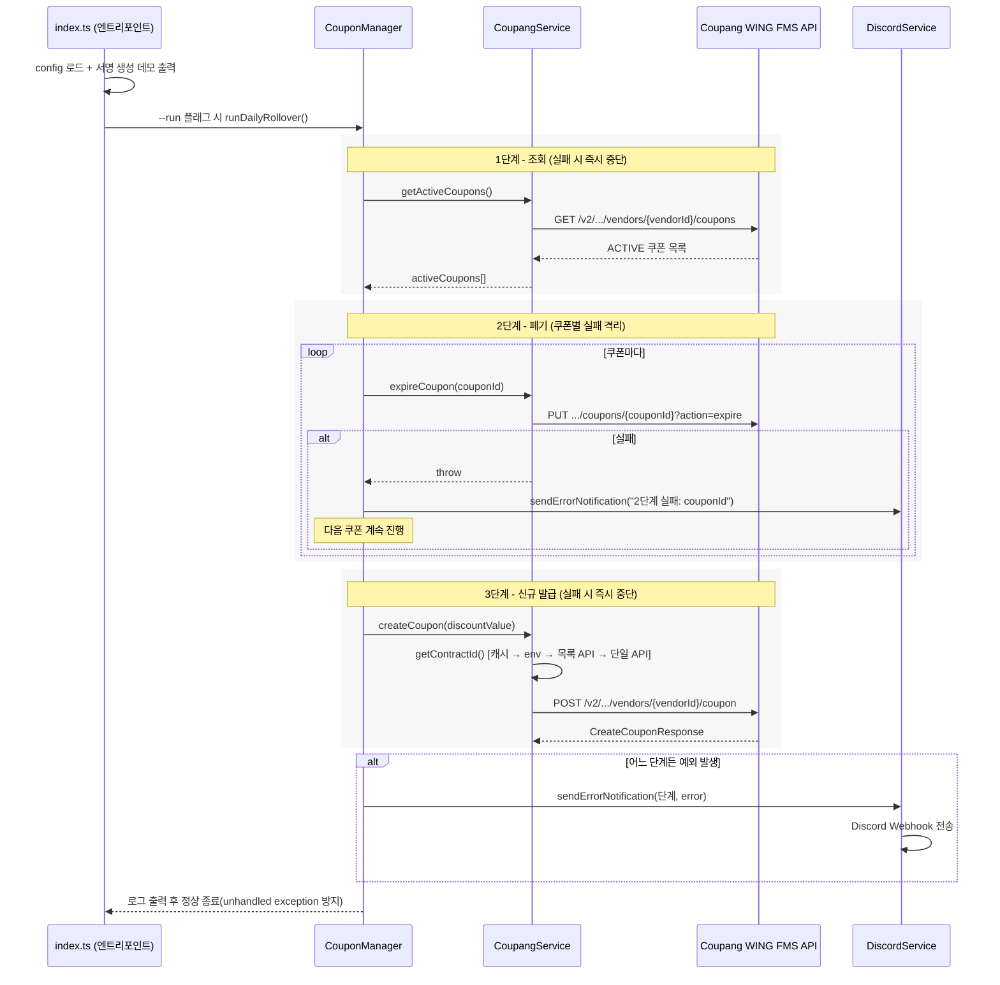

# 쿠팡 WING 쿠폰 자동 갱신 스케줄러 - 스크린샷 촬영 가이드

> 이 프로젝트는 UI 화면이 없는 서버 사이드 CLI 스크립트(Node.js 배치 + Discord Webhook 알림)입니다. 근거가 없는 화면은 만들지 않았습니다. 아래 항목은 `coupang-wing-coupon-manager.md`의 "9. 스크린샷 및 문서 제안"을 출발점으로 하고, "5. 핵심 구현" / "6. 트러블 슈팅" / "10. 확인 필요 항목"과 대조해 보강한 것입니다.

---

## 촬영할 화면

- [ ] **CLI 실행 콘솔 로그**
  - 촬영 대상: `npm run dev -- --run` 실행 시 터미널에 출력되는 전체 로그(설정 로드 확인, `src/index.ts`의 서명 생성 데모 출력, `runDailyRollover()`의 1~3단계 진행 로그, 성공/실패 콘솔 메시지)
  - 근거: md "9. 스크린샷 및 문서 제안" 표의 `cli-run-log.png` 항목, "4. 설계 - 아키텍처"의 요청 처리 흐름 1~7단계, "5. 핵심 구현" 전 항목
  - 들어갈 위치: "5. 핵심 구현" 옆 (전체), "7. 결과" 옆 (테스트 코드가 없어 콘솔 출력이 유일한 수동 검증 수단이라는 서술 보강)
  - 우선순위: 필수
  - 비고: 실행 전 `.env`에 실제 Coupang Access Key/Secret Key/Vendor ID/Discord Webhook URL이 콘솔에 노출되지 않는지 확인. 서명 생성 로그에 access-key/signature 값이 그대로 찍힐 수 있으므로 캡처 전 반드시 마스킹하거나 테스트/더미 키로 재실행 후 촬영.

- [ ] **Discord Webhook 오류 알림 Embed**
  - 촬영 대상: 의도적으로 실패를 유발한 뒤(예: 잘못된 vendorId) Discord 채널에 실제로 도착하는 오류 알림 Embed 메시지 화면. `DiscordService.sendErrorNotification()`이 보내는 오류 컨텍스트와 스택 트레이스 일부 포함 여부 확인
  - 근거: md "9. 스크린샷 및 문서 제안"의 `discord-alert.png` 항목, "5. 핵심 구현 - 단계별 실패 격리를 적용한 순차 롤오버 오케스트레이션"(1/2/3단계별 `sendErrorNotification` 호출), "3. 기술 스택"의 Discord Webhook 행
  - 들어갈 위치: "5. 핵심 구현 - DiscordService(오류 알림)" 옆, "3. 기술 스택" 옆 보조 이미지
  - 우선순위: 필수
  - 비고: 테스트용 Discord 서버/채널과 더미 Webhook URL 사용 권장. 실제 운영 Webhook URL이나 서버명이 캡처에 노출되지 않도록 채널명·서버 아이콘 마스킹.

- [ ] **환경변수 검증 실패 시 에러 메시지 콘솔 출력**
  - 촬영 대상: `.env`에 placeholder(`your_...`) 값을 그대로 두거나 값을 비운 상태로 실행했을 때 `[Configuration Error] Environment variable '...' is required but not configured correctly in .env.` 형태로 즉시 종료되는 콘솔 화면
  - 근거: md "5. 핵심 구현 - 환경변수 검증 시 플레이스홀더 값 방어" (`getEnvOrThrow`, `parseDiscountValue` 코드 발췌 포함)
  - 들어갈 위치: "5. 핵심 구현 - 환경변수 검증 시 플레이스홀더 값 방어" 옆
  - 우선순위: 권장
  - 비고: `.env.example`을 복사해 값을 채우지 않은 상태로 실행하면 재현 가능. 실제 키 값 노출 위험 없음(오류가 나는 상황이므로 더미 값으로 충분).

- [ ] **git log 커밋 타임라인**
  - 촬영 대상: `git log --format="%h %ad %s" --date=iso` 실행 결과 — 3개 커밋(`3cb5e37`, `c726127`, `e9f5bf1`)이 2026-06-23 14:47:51~15:37:31 KST 사이 약 50분 내 발생했음을 보여주는 터미널 캡처
  - 근거: md "1. 3분 요약" 표의 "기간" 행("2026-06-23 하루, 커밋 3건(14:47:51 ~ 15:37:31 KST)"), "6. 트러블 슈팅"의 "바로 다음 커밋(4분 뒤)" 서술
  - 들어갈 위치: "1. 3분 요약" 옆, "6. 트러블 슈팅" 옆 보조 자료
  - 우선순위: 권장
  - 비고: 커밋 author 이메일이 함께 출력되면(`%ae`) 개인 이메일이 노출되므로 이름만 노출되는 포맷(`%an` 또는 생략) 사용.

- [ ] **커밋 `c726127` diff 비교 (API 경로/스펙 전면 교체)**
  - 촬영 대상: `git show c726127 -- src/services/coupang.service.ts` (또는 `git diff 3cb5e37 c726127 -- src/services/coupang.service.ts`) 실행 결과 중 `createCoupon()` 함수 변경 부분 — 경로가 `openapi v4`에서 `fms v2`로, 필드명이 `couponName/discountType/discountValue`에서 `name/type/discount`로 바뀐 diff
  - 근거: md "6. 트러블 슈팅 - Coupang API 엔드포인트 경로·요청 스펙 전면 교체"의 변경 전/후 코드 발췌, 근거 커밋 해시(`c726127379a395cf86fac8ba55a494c86fa040a7`, `3cb5e37d690106939f6e045b2b1aac3a95281aba`)
  - 들어갈 위치: "6. 트러블 슈팅 - Coupang API 엔드포인트 경로·요청 스펙 전면 교체" 옆
  - 우선순위: 권장
  - 비고: 순수 코드 diff이므로 민감정보 없음. 가독성을 위해 터미널 캡처보다는 diff 뷰어(GitHub 비교 화면 등)로 촬영하는 것을 권장.

- [ ] **자격 증명 삭제 확인 (`git status` / `git ls-files`)**
  - 촬영 대상: `git ls-files | grep '^\.env$'`(결과 없음)과 `git status`(로컬이 origin보다 1커밋 앞서 있는 상태) 실행 결과 캡처
  - 근거: md "6. 트러블 슈팅 - 저장소에 커밋된 실제 API 자격 증명 삭제 및 키 교체"의 "결과" 문단, "10. 확인 필요 항목 - 보안 관련 확인 필요"
  - 들어갈 위치: "6. 트러블 슈팅 - 저장소에 커밋된 실제 API 자격 증명 삭제 및 키 교체" 옆
  - 우선순위: 권장
  - 비고: **절대 실제 `.env` 파일 내용이나 `git show 3cb5e37:.env` 결과를 캡처하지 말 것.** 반드시 md "10. 확인 필요 항목 - 보안 관련 확인 필요"의 키 회전 절차를 먼저 완료한 뒤 촬영. 해시/파일명만 보이는 명령 결과만 촬영 대상.

- [ ] **Coupang WING 판매자 콘솔의 쿠폰 생성/폐기 화면**
  - 촬영 대상: Coupang WING 판매자센터에서 실제로 쿠폰이 생성되거나 폐기된 화면(스크립트 실행 전/후 비교)
  - 근거: md "9. 스크린샷 및 문서 제안"의 `coupang-console.png` 항목
  - 들어갈 위치: "2. 개요 - 배경과 문제" 옆
  - 우선순위: 선택
  - 비고: md 자체가 "비즈니스 계정 접근 필요"라고 명시하며, "실제 운영 여부와 기간"이 "10. 확인 필요 항목"에 미확인으로 남아있음. 실제 운영 계정에 접근 가능하고 스크립트가 현재도 동작 중일 때만 촬영. 접근 불가 시 이 항목은 생략.

---

## 직접 제작 필요

### 1. 아키텍처 다이어그램 (롤오버 배치 파이프라인)

md "4. 설계 - 아키텍처"의 요청 처리 흐름 7단계와 "조회 → 폐기 → 신규 발급" 3단계 구조를 근거로 한 시퀀스 다이어그램 초안입니다.

- 용도: "4. 설계 - 아키텍처" 옆에 배치. md 원안의 `arch-flow.png`(제작 필요) 항목을 대체.
- 참고: HMAC-SHA256 서명 생성(`src/utils/signature.ts`)은 `CoupangService`가 매 API 호출마다 내부적으로 수행하는 공통 단계이므로, 위 다이어그램에서는 각 API 호출 화살표에 암묵적으로 포함된 것으로 간주함. 필요 시 "서명 생성" 단계를 별도 note로 추가 가능.

### 2. 성능/신뢰성 개선 전후 그래프

**생략.** md "1. 3분 요약", "6. 트러블 슈팅", "7. 결과"가 모두 명시적으로 "실 운영 처리량·성공률 등 성과 수치는 레포에서 확인되지 않습니다(수치 확인 필요)"라고 밝히고 있으며, 실패 격리 로직 도입 전/후를 비교할 실측 배치 성공률 데이터가 존재하지 않습니다. 근거 없는 수치를 그래프로 만들면 사실과 다른 인상을 줄 수 있어 작성하지 않았습니다. 실제 운영 로그(성공/실패 건수, 알림 발송 횟수 등)를 확보한 뒤 추가하는 것을 권장합니다(md "10. 확인 필요 항목" 참고).

### 3. 배포/CI 인프라 구성도

**생략.** md "2. 개요"와 "4. 설계 - 인프라 및 배포", "8. 회고"가 공통적으로 지적하듯, `package.json` description은 "scheduler script"라고 되어 있으나 실제 레포에는 cron, PM2, systemd timer, GitHub Actions `schedule` 트리거 등 반복 실행을 담당하는 설정이 전혀 없습니다("확인 필요: 실제 스케줄링 방식"). CI/CD 파이프라인, Dockerfile, 배포 서버 정보도 레포에 없습니다. 실제 배포/스케줄링 방식이 확인되면(md "10. 확인 필요 항목") 그때 구성도를 작성하는 것을 권장합니다.

---

## 촬영 체크리스트

| 화면명 | 우선순위 | 상태 |
| --- | --- | --- |
| CLI 실행 콘솔 로그 | 필수 | 미촬영 |
| Discord Webhook 오류 알림 Embed | 필수 | 미촬영 |
| 환경변수 검증 실패 시 에러 메시지 콘솔 출력 | 권장 | 미촬영 |
| git log 커밋 타임라인 | 권장 | 미촬영 |
| 커밋 c726127 diff 비교 (API 경로/스펙 전면 교체) | 권장 | 미촬영 |
| 자격 증명 삭제 확인 (git status / git ls-files) | 권장 | 미촬영 |
| Coupang WING 판매자 콘솔의 쿠폰 생성/폐기 화면 | 선택 | 미촬영 |
| 아키텍처 다이어그램 (직접 제작) | 필수 | 미제작 |
