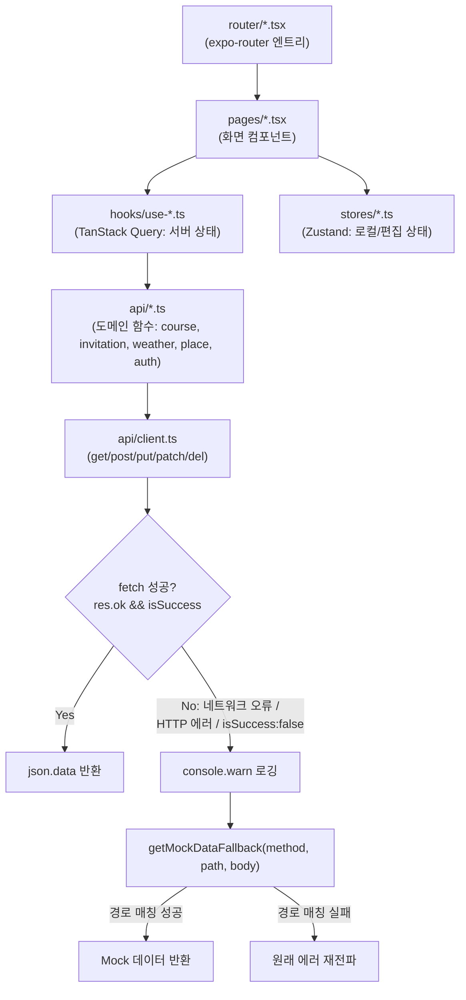

# 혼저옵서예(honja-front) 스크린샷 촬영 가이드

이 문서는 `혼저옵서예.md`(리서치 문서)와 `혼저옵서예.json`(구조화 버전)을 근거로, 상세 페이지 제작 시 촬영/제작해야 할 화면을 정리한 것입니다. 코드 실행이나 실제 화면 캡처는 하지 않았으며, md 9장 "스크린샷 및 문서 제안"에 이미 제시된 6개 항목을 뼈대로, 4장(설계)·5장(핵심 구현)·6장(트러블슈팅) 내용과 대조해 우선순위와 촬영 시 주의점을 보강했습니다.

> 전제: 이 앱은 Expo(React Native) 기반이라 웹/iOS/Android 3개 플랫폼에서 렌더링이 달라질 수 있습니다(특히 지도 화면). 모바일 실기기 또는 iOS/Android 시뮬레이터 촬영을 기본으로 하고, 웹 렌더링(`react-native-web`, `npm run start` 후 `w`)은 비교용으로만 사용하세요.

---

## 촬영 대상 화면

- [ ] **홈 화면 (날씨 위젯 + 올레 행사 목록)**
  - 촬영 대상: `src/pages/home.tsx` 전체 화면. `WeatherWidget.tsx`(날씨), `OlleTrailList.tsx`(올레 행사 목록), `WelcomeBanner.tsx`(환영 배너)가 한 화면에 보이도록 스크롤 포함 캡처.
  - 근거: md "2. 개요"의 배경 설명, "4. 설계" 디렉터리 구조 표(`src/pages/home.tsx`, `src/components/home/*`), "9. 스크린샷 및 문서 제안"의 `01-home.png`.
  - 들어갈 위치: "1. 3분 요약" 상단 대표 이미지, "2. 개요" 옆.
  - 우선순위: 필수
  - 비고: 홈 화면 전체가 본인 작성 영역(커밋 `055c934`, `475a930`)이므로 기여도를 가장 직접적으로 보여줄 수 있는 화면입니다. 날씨 API가 실패해 Mock Fallback으로 전환된 상태라면 그 사실을 캡션에 명시하세요(정상 응답인지 Mock인지 겉보기로 구분이 안 될 수 있음).

- [ ] **지도 화면 — 네이티브(WebView) 렌더링**
  - 촬영 대상: `src/pages/map.tsx`를 iOS/Android 실기기 또는 시뮬레이터에서 실행해 `WebView`로 카카오맵이 렌더링된 화면.
  - 근거: md "5. 핵심 구현 - 크로스플랫폼 지도 렌더링 분기 처리", 코드 발췌의 `WebView = require('react-native-webview').WebView` 분기.
  - 들어갈 위치: "5. 핵심 구현 - 크로스플랫폼 지도 렌더링 분기 처리" 옆.
  - 우선순위: 필수
  - 비고: 반드시 네이티브 환경(웹이 아닌)에서 캡처해야 `WebView` 분기가 실제로 타는지 확인 가능. 즐겨찾기 목록(`FavoriteList.tsx`)이나 필터 패널(`FilterPanel.tsx`)이 함께 보이면 좋음(둘 다 본인 작성).

- [ ] **지도 화면 — 웹(iframe) 렌더링**
  - 촬영 대상: 동일한 지도 화면을 웹(`npm run start` 후 `w`, 또는 `react-native-web`)에서 실행해 `<iframe src={mapUrl}>`로 렌더링된 화면.
  - 근거: md "5. 핵심 구현 - 크로스플랫폼 지도 렌더링 분기 처리", `Platform.OS === 'web'` 분기 코드.
  - 들어갈 위치: "5. 핵심 구현 - 크로스플랫폼 지도 렌더링 분기 처리" 옆, 네이티브 캡처와 나란히 배치(Before/After 아님, Side-by-side 비교).
  - 우선순위: 필수
  - 비고: 네이티브 캡처와 반드시 세트로 제시해야 "3단 분기 렌더링"이라는 구현 포인트가 전달됩니다.

- [ ] **지도 화면 — WebView 미지원 안내 텍스트 (3단 분기 중 마지막 케이스)**
  - 촬영 대상: `WebView` 모듈 로드에 실패했을 때 노출되는 "지도를 불러올 수 없습니다 (WebView 미지원)" 안내 텍스트 화면.
  - 근거: md "5. 핵심 구현" 코드 발췌의 `else` 분기(`styles.mapFallback`).
  - 들어갈 위치: "5. 핵심 구현 - 크로스플랫폼 지도 렌더링 분기 처리" 옆(3단 비교의 마지막 컷).
  - 우선순위: 선택
  - 비고: 이 상태를 재현하려면 `react-native-webview` 모듈을 일부러 제거하거나 require를 강제로 실패시켜야 하므로 촬영 난이도가 높습니다. 실사용 시나리오가 아니라 "예외 처리를 구현했다"는 근거용이라 여유 있을 때만 촬영.

- [ ] **마이페이지 — 프로필 수정 폼 (저장 로딩 상태 포함)**
  - 촬영 대상: `src/pages/mypage.tsx`의 `ProfileEditForm.tsx` 영역. 닉네임/이메일 입력, 비밀번호 변경 토글, 저장 버튼을 누른 직후 `isSaving`으로 버튼이 비활성/로딩 표시되는 순간.
  - 근거: md "5. 핵심 구현 - 마이페이지 프로필 수정/계정 삭제의 실제 API 연동과 플랫폼별 확인 UX", 코드 발췌의 `handleSave`/`isSaving`.
  - 들어갈 위치: "5. 핵심 구현 - 마이페이지 프로필 수정/계정 삭제 API 연동" 옆.
  - 우선순위: 필수
  - 비고: 로딩 상태는 순간적이라 캡처가 까다로우므로, 화면 녹화 후 프레임 추출을 권장합니다. 저장 실패 시 에러 메시지 노출 화면(`Alert.alert('오류', ...)` 또는 `window.alert`)도 여유 있으면 함께 촬영(권장, 아래 별도 항목).

- [ ] **마이페이지 — 저장 실패 에러 메시지**
  - 촬영 대상: `updateProfile` 호출이 실패했을 때 `Alert.alert('오류', msg)`(네이티브) 또는 `window.alert(msg)`(웹)로 에러 메시지가 노출된 화면.
  - 근거: md "5. 핵심 구현" 코드 발췌 `catch (e: any) { ... }` 블록.
  - 들어갈 위치: "5. 핵심 구현 - 마이페이지 프로필 수정/계정 삭제 API 연동" 옆(성공 케이스와 나란히).
  - 우선순위: 권장
  - 비고: 의도적으로 실패를 유도해야 하므로(네트워크 차단, 잘못된 값 등) Mock Fallback이 개입하지 않는 시나리오인지 확인 필요 — Mock Fallback은 GET 계열 위주이며 `updateProfile`(PUT/PATCH 추정)이 Mock으로 처리되는지 md에는 명시되어 있지 않음.

- [ ] **마이페이지 — 계정 삭제 확인 다이얼로그 (플랫폼별)**
  - 촬영 대상: 계정 삭제 버튼을 눌렀을 때 웹에서는 `window.confirm`, 네이티브에서는 `Alert.alert` 확인창이 뜨는 두 화면.
  - 근거: md "5. 핵심 구현" 항목 3 "계정 삭제는 `Platform.OS === 'web'`일 때 `window.confirm`, 네이티브일 때 `Alert.alert`의 버튼 콜백으로 확인창을 분기".
  - 들어갈 위치: "5. 핵심 구현 - 마이페이지 프로필 수정/계정 삭제 API 연동" 옆.
  - 우선순위: 권장
  - 비고: 실제로 삭제를 실행하면 `clearToken()` 후 welcome 화면으로 이동하며 테스트 계정이 삭제되므로, 촬영용 더미 계정을 별도로 만들어 사용할 것.

- [ ] **마이페이지 — 스탬프/방문 통계 위젯**
  - 촬영 대상: `StampGrid.tsx`(방문 스탬프), `VisitStatsCard.tsx`(방문 통계)가 보이는 마이페이지 상단/중단 영역.
  - 근거: md "2. 담당 범위" 표의 마이페이지 행(`src/components/mypage/StampGrid.tsx`, `VisitStatsCard.tsx`, 본인 작성).
  - 들어갈 위치: "2. 개요 - 담당 범위" 옆, 또는 "1. 3분 요약" 보조 이미지.
  - 우선순위: 권장
  - 비고: 더미 방문 데이터가 없으면 빈 상태(0건)로 보일 수 있으니, 최소 1건 이상의 방문 기록이 있는 테스트 계정으로 촬영.

- [ ] **여행 초대 화면 — 수락/거절 UI**
  - 촬영 대상: `src/pages/InvitationScreen.tsx`에서 받은 초대 목록과 수락/거절 버튼이 보이는 화면.
  - 근거: md "5. 핵심 구현 - 여행 초대 API 연동과 하위 호환 DTO 설계", "9. 스크린샷 및 문서 제안"의 `04-invitation-flow.png`.
  - 들어갈 위치: "5. 핵심 구현 - 여행 초대 API 연동과 하위 호환 DTO 설계" 옆.
  - 우선순위: 필수
  - 비고: 이 화면 UI 자체는 팀원(`서린`) 작성이지만, 본인이 담당한 API/훅 연동(`getMyInvitations`, `useAcceptInvitation`)의 결과 화면이므로 캡션에 "UI: 팀원 작성, API 연동: 본인 담당"을 명확히 구분해 표기할 것. "보낸 초대" 탭은 항상 빈 배열(`getSentInvitations` 스텁)이므로, 빈 상태 자체가 의도된 동작임을 캡션에 남기면 좋음.

- [ ] **초대 수락 후 마이페이지/코스 목록 갱신**
  - 촬영 대상: 초대를 수락한 직후 "내 코스" 목록(`use-my-courses.ts` 연동 화면, `TripCard.tsx`)에 새 코스가 반영되는 전/후 화면.
  - 근거: md "5. 핵심 구현" 항목 4 "`useAcceptInvitation`/`useRejectInvitation` 뮤테이션이 성공하면 `RECEIVED_INVITATIONS_QUERY_KEY`와 `MY_COURSES_QUERY_KEY`를 함께 무효화".
  - 들어갈 위치: "5. 핵심 구현 - 여행 초대 API 연동과 하위 호환 DTO 설계" 옆(캐시 무효화 설명 보강용).
  - 우선순위: 권장
  - 비고: 두 계정(초대한 사람/받은 사람)이 필요한 시나리오라 촬영 난이도가 있음. 시간이 부족하면 생략 가능(핵심 구현 설명은 코드 발췌만으로도 전달 가능).

- [ ] **여행 경로 생성 플로우 — 동행 유형/테마 선택**
  - 촬영 대상: `src/pages/route/*` 화면 중 `COMPANION_CATEGORIES`(혼자/가족과 함께/친구와 함께/애인과 함께/그 외), `THEME_CATEGORIES`(일반/배리어프리/반려동물) 선택 UI.
  - 근거: md "2. 개요 - 배경과 문제" 단락의 `src/pages/route/constants.ts` 상수 인용.
  - 들어갈 위치: "2. 개요" 옆(서비스의 핵심 차별점인 동행 유형별 탐색을 보여주는 대표 컷).
  - 우선순위: 필수
  - 비고: 이 화면 자체는 팀원(`eeeeeaaan`) 작성 영역이지만, 서비스 정의(1장 "한 줄 소개")를 시각적으로 뒷받침하는 화면이라 상세 페이지 전체의 이해를 위해 필요. 캡션에 "화면 구현: 팀원 담당"임을 명시.

- [ ] **날짜별 일정(장소 순서) 편집 화면**
  - 촬영 대상: 일자별로 방문 장소를 드래그/버튼으로 순서 변경하는 화면(`routeStore.ts`의 `movePlaceUp`/`movePlaceDown`, `addPlaceToRoute`에 대응하는 UI).
  - 근거: md "5. 핵심 구현 - Zustand 스토어 단위 테스트" 코드 발췌(`movePlaceUp` 테스트), "4. 설계 - 데이터 모델"의 `Record<number, DayPlan>` 설명.
  - 들어갈 위치: "5. 핵심 구현 - Zustand 스토어 단위 테스트" 옆.
  - 우선순위: 권장
  - 비고: 본인이 작성한 `routeStore` 테스트가 검증하는 실제 동작(순서 변경)을 화면으로 보여줄 수 있어, 테스트 코드와 짝을 이루면 설득력이 높아짐.

- [ ] **배리어프리/반려동물 장소 상세 화면**
  - 촬영 대상: `getLocationBarrierFreePlaces`, `getBarrierFreePlaceDetail`, `getLocationPetPlaces` API로 렌더링되는 장소 상세 화면.
  - 근거: md "2. 개요 - 배경과 문제" 단락, `src/api/place.ts`(본인 작성) 함수명 인용.
  - 들어갈 위치: "2. 개요" 옆, 또는 "4. 설계 - API 및 인터페이스" 옆.
  - 우선순위: 권장
  - 비고: `src/api/place.ts`가 본인 작성 영역이므로, 이 API의 실제 소비 화면을 보여주면 기여 범위가 더 명확해짐. 해당 데이터가 Mock Fallback으로 채워진 것인지 실제 백엔드 응답인지 캡션에 구분 표기.

- [ ] **로그인/온보딩 화면 (전후 맥락용, 참고 컷)**
  - 촬영 대상: 앱 진입 시 최초로 보이는 로그인/welcome 화면.
  - 근거: md "2. 담당 범위 - 타인 작성 영역" 표(`anhyunjung` 담당), "5. 핵심 구현" 계정 삭제 후 이동하는 "welcome 화면" 언급.
  - 들어갈 위치: "2. 개요" 도입부(서비스 전체 흐름 설명용).
  - 우선순위: 선택
  - 비고: 본인 담당 영역이 아니므로 상세 페이지의 메인 비주얼로는 부적합. 서비스 전체 흐름을 보여주는 도입부 컷 정도로만 선택적으로 사용.

- [ ] **Zustand 스토어 테스트 실행 결과 (터미널)**
  - 촬영 대상: `npm run test` 또는 `jest` 실행 후 4개 스토어(`homeStore`, `mapStore`, `mypageStore`, `routeStore`) 19개 테스트가 통과하는 터미널 출력.
  - 근거: md "5. 핵심 구현 - Zustand 스토어 단위 테스트", "7. 결과"의 "Zustand 스토어 테스트 4개 파일, 19개 케이스(299줄)".
  - 들어갈 위치: "5. 핵심 구현 - Zustand 스토어 단위 테스트" 옆, "7. 결과" 옆.
  - 우선순위: 필수
  - 비고: md는 "코드를 실행하지 않는 원칙"에 따라 테스트 통과 여부를 실측하지 않았다고 명시(7장). 상세 페이지 제작자가 실제로 `npm run test`를 실행해 통과 여부를 확인한 뒤 캡처해야 하며, 실패하는 테스트가 있다면 그 사실도 정직하게 반영할 것(테스트가 실패한 채로 "통과 화면"이라고 캡션을 달면 안 됨).

- [ ] **기여도 근거 — git log/파일별 최초 작성자 조회 터미널**
  - 촬영 대상: `git log --author="..." --oneline | wc -l`, `git log --author=... --numstat -- src` 등 1장 "핵심 성과"에 인용된 명령어의 실행 결과 터미널 캡처.
  - 근거: md "1. 3분 요약 - 핵심 성과" 각주의 측정 방법(`git log --author=...`, `git log --format=%an -- <file> | tail -1`).
  - 들어갈 위치: "1. 3분 요약" 옆(수치 신뢰도 보강용).
  - 우선순위: 권장
  - 비고: 커밋 작성자 이메일(`poppppp00@gmail.com`, `164151329+kimyw1018`)이 그대로 노출되므로, 공개 페이지에 올릴 경우 이메일 일부를 마스킹할지 여부를 검토할 것.

---

## 트러블슈팅 관련 스크린샷에 대한 판단

md "6. 트러블 슈팅" 섹션은 "검증된 트러블슈팅 사례를 발견하지 못했다"고 명시하고 있고, `troubleshooting` 배열도 비어 있습니다(json). 따라서 "문제 상황 → 해결" 형태의 Before/After 스크린샷은 **이 프로젝트에는 해당 사항 없음**으로 처리하고 별도로 촬영하지 않습니다. 10장에서 제외된 후보(`handleSave` 정적 알림 → 실제 API 연동 등)는 트러블슈팅이 아니라 "5. 핵심 구현"에 이미 반영되어 있으므로, 위 목록의 "마이페이지 프로필 수정 폼" 항목이 그 역할을 대신합니다.

---

## 직접 제작 필요

### 1. 아키텍처 다이어그램 (필수)

md "4. 설계 - 아키텍처"의 요청 처리 흐름(router → pages → hooks/stores → api → client(Mock Fallback) → fetch)을 mermaid로 재작성한 초안입니다. md 9장의 `05-architecture-diagram.png` 항목을 대체합니다.

- 참고: `src/api/dto/client.ts`(팀원 작성, `ApiResponse` 래퍼 미사용, 자체 Mock 로직)는 위 흐름과 별개의 경로로 `createCourse`/`searchPlaces`를 처리하므로, 다이어그램에 포함하려면 "예외 경로"로 점선 분리해 표시하는 것을 권장합니다(md "4. 설계 - API 및 인터페이스", "8. 회고" 참고).

### 2. 성능/개선 전후 그래프 → 표로 대체 제안

md와 json 어디에도 로딩 시간, FPS, 응답 시간 같은 실측 성능 수치가 없습니다(md "1. 3분 요약" 핵심 성과 마지막 줄: "실사용자 트래픽, 성능 벤치마크, 배포 환경 지표는 저장소 내에서 확인되지 않습니다"). 따라서 전후 비교 그래프는 **제안하지 않습니다**.

대신 이 프로젝트는 팀 기여도 지표(커밋 비율, 파일 작성 비율, 라인 증감, 테스트 케이스 수)가 핵심이므로, 그래프보다 아래와 같은 **표**로 정리하는 것이 더 정확하고 오해의 소지가 적습니다(수치는 md "1. 3분 요약"/json `keyResults` 그대로 사용).

| 지표 | 값 | 측정 조건 |
|---|---|---|
| 전체 커밋 중 본인 작성 비율 | 12 / 34 (약 35%) | `git log --author="poppppp00@gmail.com\|164151329+kimyw1018" --oneline` |
| TS/TSX 파일 중 본인 최초 작성 비율 | 44 / 95 (약 46%) | 각 파일 `git log --format=%an -- <file> \| tail -1` |
| `src/` 기준 본인 커밋 순변경량 | +7,892 / -1,955줄 | `git log --author=poppppp00@gmail.com --numstat -- src` |
| Zustand 스토어 단위 테스트 | 4개 파일 / 19개 케이스 / 299줄 | `grep -c "  it(" src/stores/__tests__/*.test.ts` |

이 표는 그래프 이미지가 아니라 상세 페이지의 텍스트/표 컴포넌트로 바로 구현 가능하므로, 별도 이미지 제작 없이 "1. 3분 요약" 섹션에 직접 삽입하는 것을 권장합니다.

### 3. 배포/CI 인프라 구성도 → 생략

md "4. 설계 - 인프라 및 배포"에 "저장소에는 CI 설정(`.github/workflows`), Dockerfile, k8s manifest, EAS(`eas.json`) 설정이 존재하지 않습니다"라고 명시되어 있고, "7. 결과"에서도 "배포/운영 결과: ... 배포된 적이 있는지 코드만으로는 판단할 수 없습니다"라고 확인됩니다. 실행 경로는 `npm run start`(로컬 Expo 개발 서버)가 유일합니다. 인프라/CI 구성 자체가 존재하지 않으므로 **구성도 제작을 생략**합니다. 상세 페이지에는 이미지 대신 "CI/CD 미구성, 로컬 Expo 개발 서버로만 실행 확인됨"이라는 텍스트 설명으로 대체하는 것을 권장합니다.

---

## 촬영 체크리스트

| 화면명 | 우선순위 | 상태 |
|---|---|---|
| 홈 화면 (날씨 위젯 + 올레 행사 목록) | 필수 | 미촬영 |
| 지도 화면 — 네이티브(WebView) 렌더링 | 필수 | 미촬영 |
| 지도 화면 — 웹(iframe) 렌더링 | 필수 | 미촬영 |
| 지도 화면 — WebView 미지원 안내 텍스트 | 선택 | 미촬영 |
| 마이페이지 — 프로필 수정 폼(로딩 상태 포함) | 필수 | 미촬영 |
| 마이페이지 — 저장 실패 에러 메시지 | 권장 | 미촬영 |
| 마이페이지 — 계정 삭제 확인 다이얼로그(플랫폼별) | 권장 | 미촬영 |
| 마이페이지 — 스탬프/방문 통계 위젯 | 권장 | 미촬영 |
| 여행 초대 화면 — 수락/거절 UI | 필수 | 미촬영 |
| 초대 수락 후 마이페이지/코스 목록 갱신 | 권장 | 미촬영 |
| 여행 경로 생성 — 동행 유형/테마 선택 | 필수 | 미촬영 |
| 날짜별 일정(장소 순서) 편집 화면 | 권장 | 미촬영 |
| 배리어프리/반려동물 장소 상세 화면 | 권장 | 미촬영 |
| 로그인/온보딩 화면(참고 컷) | 선택 | 미촬영 |
| Zustand 스토어 테스트 실행 결과(터미널) | 필수 | 미촬영 |
| 기여도 근거 — git log 터미널 | 권장 | 미촬영 |
| 아키텍처 다이어그램(직접 제작) | 필수 | 미촬영 |
