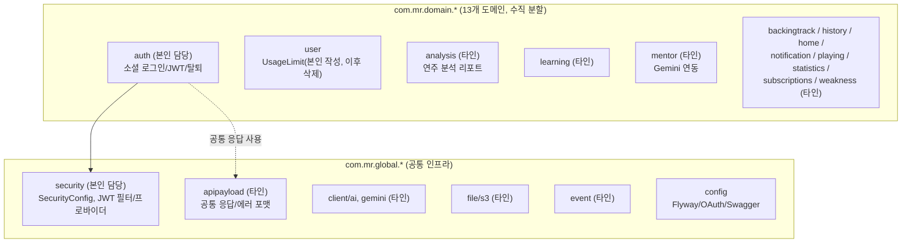
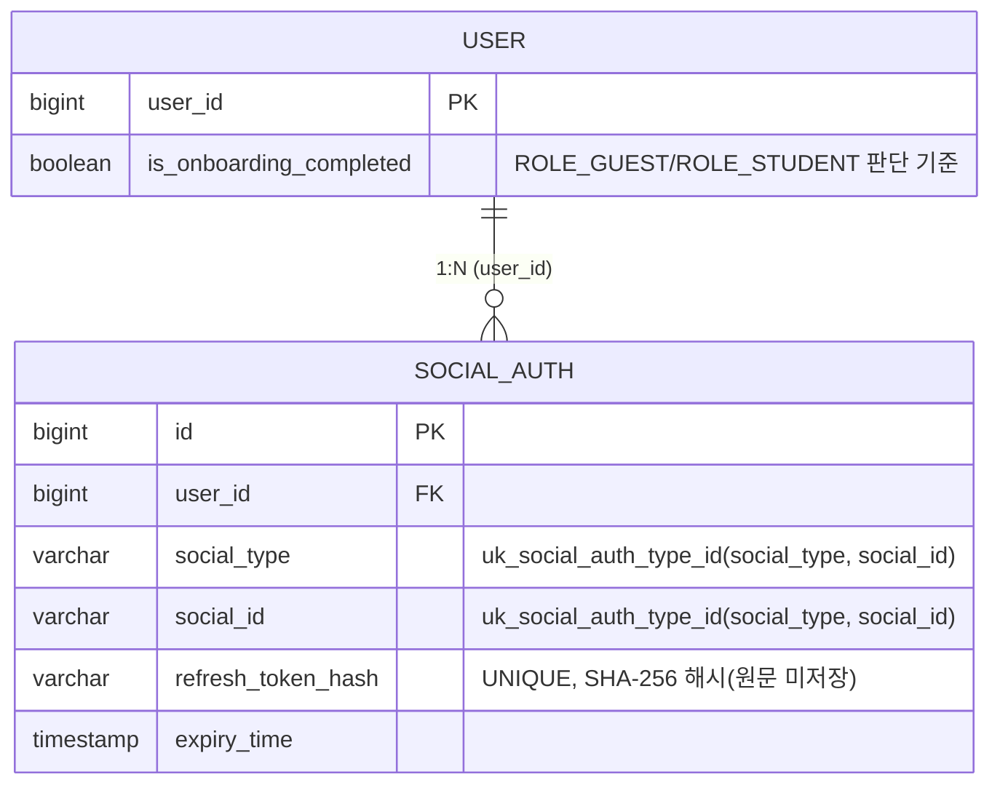
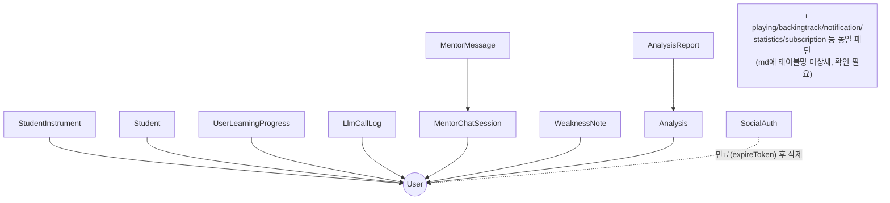
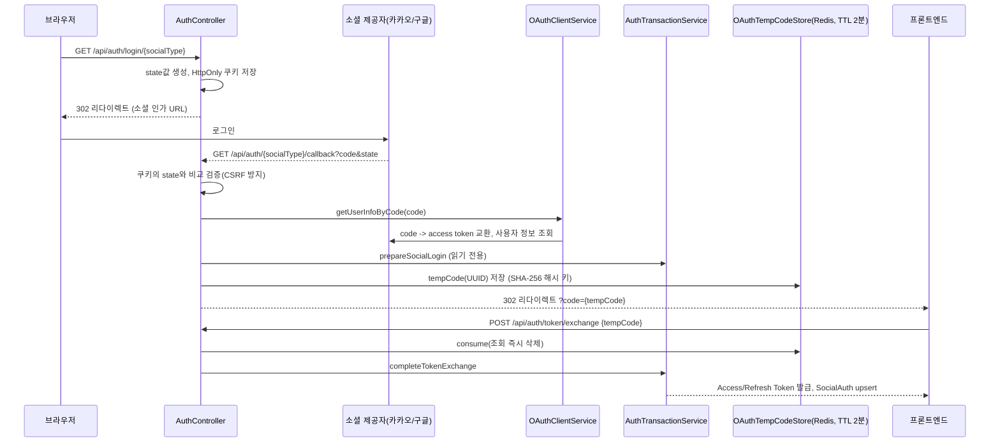
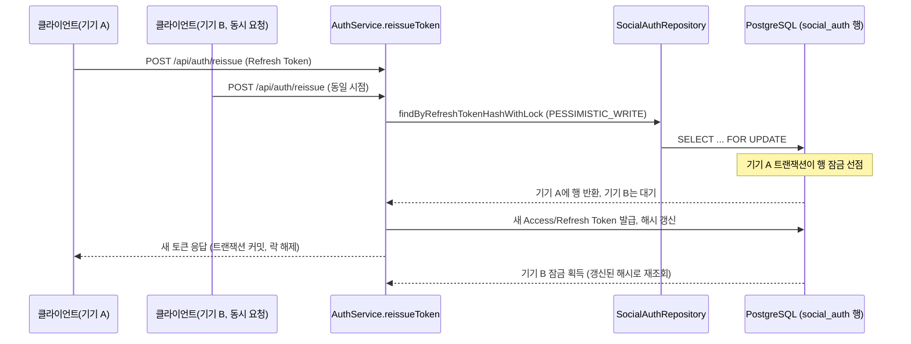
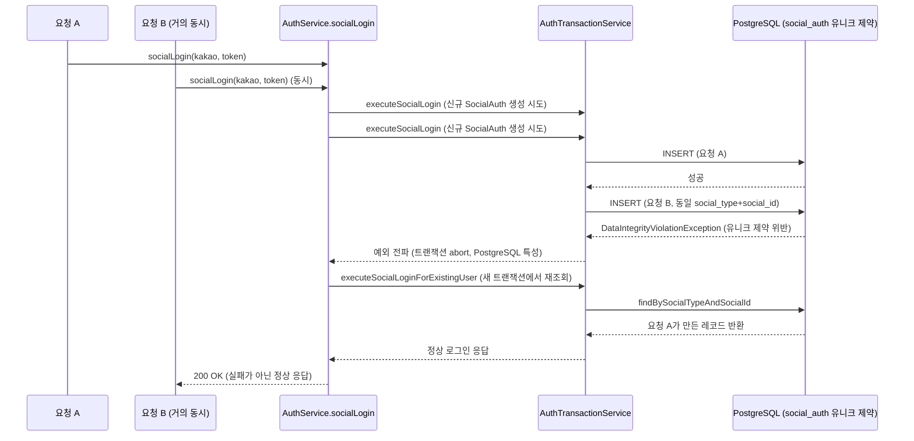
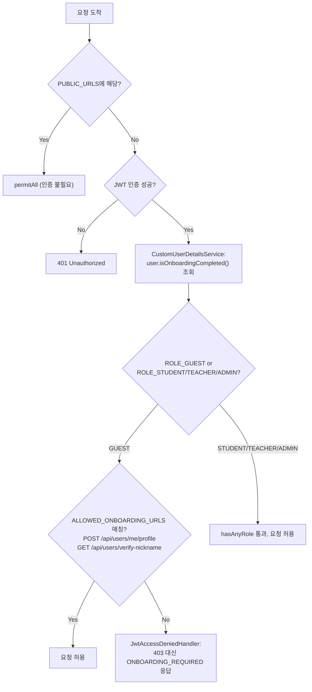
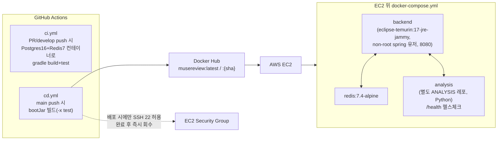

# Muse Review — 스크린샷 촬영 가이드

이 문서는 `Muse Review.md`(특히 4장 설계, 5장 핵심 구현, 6장 트러블슈팅, 9장 스크린샷 및 문서 제안)를 근거로 작성되었습니다. Muse Review는 백엔드 코어 시스템이므로 실제 화면(UI)보다 **Swagger API 문서, DB 관계, 인증 흐름도, CI/CD 실행 로그**가 중심입니다. md 9장의 저자 제안 7건을 출발점으로 삼되, 5장/6장 본문과 대조해 누락 항목을 보강하고 우선순위를 재판단했습니다.

md 9장 기준(2026-09-29 조사 시점) 레포 안에는 스크린샷·ERD·다이어그램 파일이 전혀 존재하지 않습니다(`*.png`, `*.jpg`, `*.pdf`, `docs/` 검색 결과 없음). 즉 아래 항목은 전부 신규 촬영/제작이 필요합니다.

---

## 촬영이 필요한 화면 (실행 환경에서 캡처)

- [ ] **Swagger UI — `/api/auth` 엔드포인트 목록 전체**
  - 촬영 대상: `http://localhost:8080/swagger-ui/index.html`에서 `auth` 태그를 펼쳐 8개 엔드포인트(`GET /api/auth/login/{socialType}`, `GET /api/auth/{socialType}/callback`, `POST /api/auth/token/exchange`, `POST /api/auth/login/{socialType}`, `POST /api/auth/reissue`, `POST /api/auth/link/{socialType}`, `POST /api/auth/logout`, `POST /api/auth/withdraw`)가 한 화면에 보이도록 캡처
  - 근거: md 4장 "API 및 인터페이스" 엔드포인트 표, 9장 `swagger-auth-overview.png` 제안, README.md 명시 Swagger UI 경로
  - 들어갈 위치: "4. 설계 - API 및 인터페이스" 옆
  - 우선순위: 필수
  - 비고: 로컬 프로필로 서버 기동 필요(`MR_config/local/application.yml` 설정 필요). 민감정보가 응답 예시에 섞이지 않도록 주의.

- [ ] **Swagger — `POST /api/auth/withdraw` 응답 예시 확장 화면**
  - 촬영 대상: withdraw 엔드포인트의 `@ExampleObject` 성공/실패 응답 예시가 펼쳐진 상태 (에러 코드 `AUTH_xxx` 형식 확인 가능하도록)
  - 근거: md 4장 "Swagger UI는... 각 엔드포인트에 `@ExampleObject`로 성공/실패 응답 예시가 코드에 직접 포함", 9장 `swagger-auth-withdraw-example.png` 제안
  - 들어갈 위치: "5. 핵심 구현 - 회원 탈퇴 시 연관 데이터 일괄 삭제" 옆
  - 우선순위: 권장
  - 비고: 실패 응답(예: `USER_NOT_FOUND`)도 함께 보이면 에러 코드 컨벤션(`{도메인}_{HTTP상태}_{순번}`) 설명에 유용.

- [ ] **Swagger — `POST /api/auth/reissue` 요청/응답 스키마**
  - 촬영 대상: RTR(Refresh Token Rotation) 엔드포인트의 요청 바디(Refresh Token)와 응답(새 Access/Refresh Token) 스키마
  - 근거: md 5장 "Refresh Token Rotation과 비관적 락", 4장 엔드포인트 표의 `POST /api/auth/reissue` 행
  - 들어갈 위치: "5. 핵심 구현 - Refresh Token Rotation과 비관적 락" 옆
  - 우선순위: 선택
  - 비고: 비관적 락 자체는 화면에 드러나지 않으므로 보조 자료용. 핵심은 직접 제작 섹션의 시퀀스 다이어그램.

- [ ] **GitHub Actions — `cd.yml` 실행 로그 (EC2 배포 단계)**
  - 촬영 대상: Docker 이미지 빌드 → Docker Hub push → EC2 보안그룹 SSH 임시 허용 → SSH 배포 → 보안그룹 규칙 회수까지 5단계가 순서대로 보이는 워크플로 실행 로그 화면
  - 근거: md 4장 "인프라 및 배포 - 배포 파이프라인" 5단계 서술, `.github/workflows/cd.yml`
  - 들어갈 위치: "4. 설계 - 인프라 및 배포" 옆
  - 우선순위: 필수
  - 비고: 보안그룹 IP, EC2 인스턴스 ID, Docker Hub 계정명 등 민감정보는 캡처 전 마스킹. AWS 자격증명 관련 로그 라인 노출 여부 재확인.

- [ ] **GitHub Actions — `ci.yml` 테스트 실행 결과**
  - 촬영 대상: PR에서 PostgreSQL 16 + Redis 7 서비스 컨테이너가 뜬 상태로 `./gradlew clean build` 성공 로그, 또는 실패 시 업로드되는 테스트 리포트 아티팩트 화면
  - 근거: md 4장 "CI: PR 생성/업데이트 시... PostgreSQL 16 + Redis 7 서비스 컨테이너를 띄우고... 빌드+테스트", 7장 결과 "GitHub Actions CI가 PR마다... 자동 실행", 9장 `ci-test-report.png` 제안
  - 들어갈 위치: "7. 결과" 옆
  - 우선순위: 권장
  - 비고: 447건 테스트(63개 파일) 전체 통과 화면이면 가장 좋음. 실패 리포트 캡처 시 어떤 실패인지 문맥 설명 필요.

- [ ] **테스트 실행 결과 — 인증/보안 도메인 8개 테스트 클래스**
  - 촬영 대상: IDE(IntelliJ) 또는 `./gradlew test` 콘솔에서 `AuthServiceTest`, `AuthTransactionServiceTest`, `OAuthClientServiceTest`, `OAuthTempCodeStoreTest`, `JwtTokenProviderTest`, `JwtAuthenticationFilterTest`, `JwtAccessDeniedHandlerTest`, `SecurityConfigTest` 8개가 전부 통과(녹색)한 화면
  - 근거: md 7장 "본인 담당 영역(인증/보안)에는... 8개 테스트 파일이 존재", 1장 핵심 성과 "인증 도메인에는 13개 테스트 파일... 존재"
  - 들어갈 위치: "7. 결과" 옆, 본인 기여 강조용
  - 우선순위: 권장
  - 비고: md 1장은 13개, 7장은 8개로 숫자가 다름(범위 기준 차이로 추정) — 실제 캡처 시 몇 개 파일이 잡히는지 직접 확인해서 문서 숫자와 맞출 것.

- [ ] **`git log --stat` / 커밋 그래프 — 본인 기여 파일 Top 3**
  - 촬영 대상: `git log --author="..." --name-only` 또는 GitHub Insights의 Contributors 그래프에서 `AuthService.java`(45커밋), `AuthController.java`(31커밋), `OAuthClientService.java`(30커밋)가 상위로 보이는 화면
  - 근거: md 1장 핵심 성과, 7장 "정량 지표"
  - 들어갈 위치: "1. 3분 요약" 또는 "7. 결과" 옆
  - 우선순위: 선택
  - 비고: GitHub Insights는 조직 레포 접근 권한이 있어야 확인 가능. 로컬 `git log` 캡처로 대체 가능.

---

## 직접 제작 필요

### 1. 아키텍처 다이어그램 및 ERD

md 4장 "설계"(architecture, dataModel, tree) 근거로 아래 3개를 제작합니다.

**(A) 전체 패키지 구조 다이어그램** — md "아키텍처" 및 "디렉터리 구조" 근거

**(B) `SocialAuth` 중심 인증 도메인 ERD** — md "데이터 모델" 근거 (`SocialAuth.java` 유니크 제약, `User` 관계)

- 비고: `uk_social_auth_user_type(user_id, social_type)` 제약도 함께 표기 필요(한 유저가 같은 소셜 타입 중복 연동 방지).

**(C) 회원 탈퇴(`withdraw()`) 삭제 대상 ERD** — md 6장 "#114" 및 5장 "회원 탈퇴" 근거

md에 실제로 명시된 삭제 대상은 `AuthService.withdraw()` 코드 발췌 기준 다음과 같습니다(전체 17개 중 코드에 이름이 나온 것만 표기, 나머지는 "playing/backingtrack/notification/statistics/subscription 등 동일 패턴"으로만 언급되어 있어 임의로 지어내지 않음):

- 근거: `AuthService.withdraw()` 코드 발췌(md 5장), "17개 이상 리포지토리"(md 6장 #114, 7건 커밋 df59eed 등)
- 주의: md 자체가 "playing, backingtrack, notification, statistics, subscription 등 동일 패턴"이라고만 적고 구체적 테이블/컬럼명을 밝히지 않았으므로, 실제 코드(`AuthService.java` 전체, 17개 리포지토리)를 열어 정확한 목록으로 보강해야 완전한 ERD가 됩니다. 지금 md 근거만으로는 위 9개 엔티티까지만 확정 가능합니다.

### 인증/토큰 흐름 시퀀스 다이어그램

**(D) OAuth 로그인 + tempCode 교환 흐름** — md 4장 "아키텍처" 요청 처리 흐름 5단계 근거

- 근거: md 4장 아키텍처 1~5단계 서술, 5장 "OAuth 소셜 로그인" 코드 발췌

**(E) Refresh Token Rotation + 비관적 락 흐름** — md 5장 "Refresh Token Rotation과 비관적 락" 근거

- 근거: md 5장 코드 발췌(`findByRefreshTokenHashWithLock`), "트랜잭션이 끝날 때까지 같은 행에 대한 다른 트랜잭션의 쓰기를 차단"

**(F) 동시 소셜 로그인 시 유니크 제약 위반 처리 흐름 (#64)** — md 6장 트러블슈팅 근거

- 근거: md 6장 "#64 동시 소셜 로그인" 문제상황/해결과정/코드 발췌

### 온보딩 ROLE 접근 제어 플로우차트

**(G) 요청별 ROLE 분기** — md 5장 "온보딩 상태 기반 ROLE 접근 제어" 및 9장 `security-role-flowchart.png` 제안 근거

- 근거: md 5장 `ALLOWED_ONBOARDING_URLS` 코드 발췌, `JwtAccessDeniedHandler` 설명

### 2. 성능 개선 전후 그래프

md 전체를 검토한 결과, **실측 수치가 있는 성능 개선 항목은 없습니다.** #64(동시 로그인), #114(FK 위반), #144(ROLE 접근 제어) 모두 "수치 확인 필요: 실제 오류율/발생 빈도는 기록되어 있지 않음"이 명시되어 있고(md 6장 각 항목 "결과" 문단), 응답 시간·처리량·에러율 등을 정량 비교할 실측 데이터가 md/json 어디에도 없습니다. 따라서 이 항목은 **생략**합니다. (지어낸 수치로 그래프를 만들지 않음)

만약 향후 실측이 가능해진다면 다음 형태가 유용할 것으로 보입니다: (1) #64 수정 전/후 동시 로그인 요청 성공률 막대그래프, (2) #114 hotfix 전/후 회원 탈퇴 API 실패율 막대그래프. 단, 현재는 데이터 부재로 제작 보류.

### 3. 배포/CI 인프라 구성도

md 3장/4장에 Docker Compose 구성(backend + redis + analysis 3서비스)과 CI/CD 파이프라인이 명시되어 있어 아래 구성도를 제안합니다.

- 근거: md 3장 "인프라/배포" 표, 4장 "인프라 및 배포" 배포 파이프라인 5단계, "docker-compose.yml: backend + redis + analysis 3서비스 구성"

---

## 촬영 체크리스트

| 화면명 | 우선순위 | 상태 |
|---|---|---|
| Swagger UI — `/api/auth` 엔드포인트 목록 전체 | 필수 | 미촬영 |
| GitHub Actions — `cd.yml` 실행 로그 (EC2 배포 단계) | 필수 | 미촬영 |
| Swagger — `POST /api/auth/withdraw` 응답 예시 확장 화면 | 권장 | 미촬영 |
| GitHub Actions — `ci.yml` 테스트 실행 결과 | 권장 | 미촬영 |
| 테스트 실행 결과 — 인증/보안 도메인 테스트 클래스 | 권장 | 미촬영 |
| Swagger — `POST /api/auth/reissue` 요청/응답 스키마 | 선택 | 미촬영 |
| `git log --stat` / 커밋 그래프 — 본인 기여 파일 Top 3 | 선택 | 미촬영 |
| (제작) 전체 패키지 구조 다이어그램 | 필수 | 미촬영 |
| (제작) SocialAuth 중심 인증 도메인 ERD | 필수 | 미촬영 |
| (제작) 회원 탈퇴 삭제 대상 ERD | 권장 | 미촬영 |
| (제작) OAuth 로그인 + tempCode 교환 시퀀스 다이어그램 | 필수 | 미촬영 |
| (제작) Refresh Token Rotation + 비관적 락 시퀀스 다이어그램 | 권장 | 미촬영 |
| (제작) 동시 소셜 로그인 유니크 제약 처리 흐름(#64) | 권장 | 미촬영 |
| (제작) 온보딩 ROLE 접근 제어 플로우차트 | 필수 | 미촬영 |
| (제작) 배포/CI 인프라 구성도 | 권장 | 미촬영 |
| 성능 개선 전후 그래프 | 해당 없음(실측 데이터 부재로 생략) | - |
