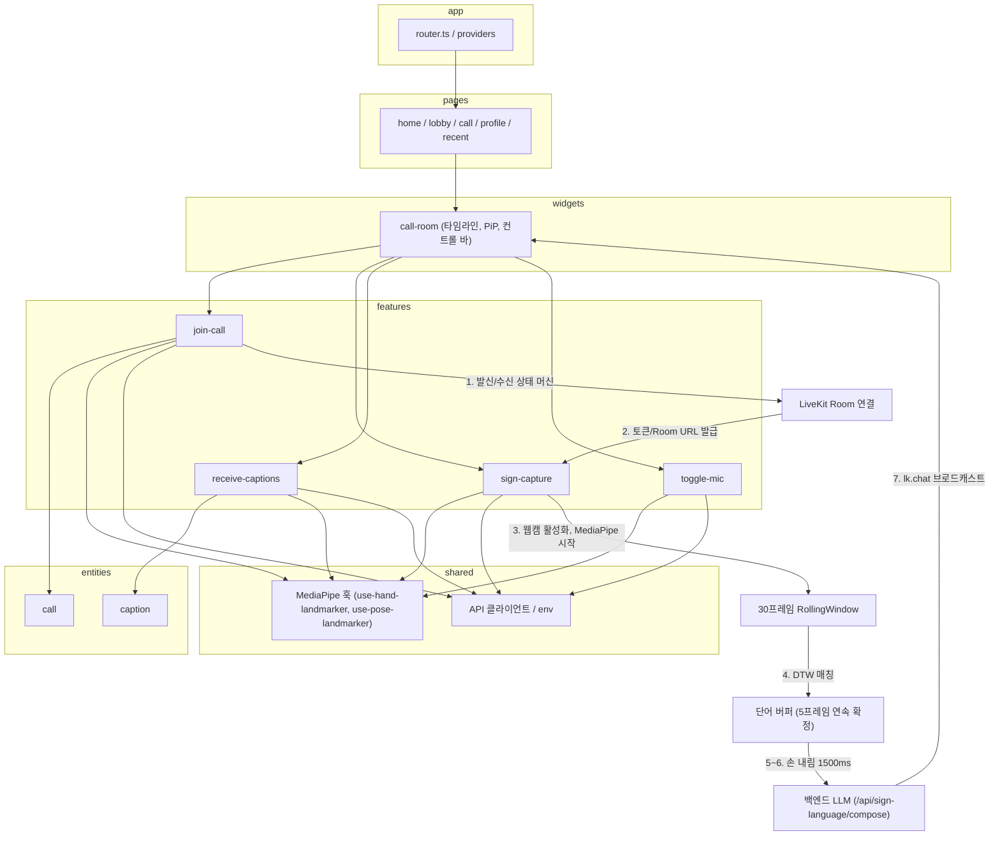
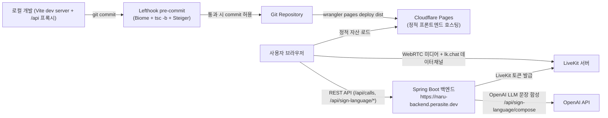

# Naru 스크린샷 촬영 가이드

이 문서는 `Naru.md` / `Naru.json`의 내용(특히 "4. 설계", "5. 핵심 구현", "6. 트러블 슈팅", "9. 스크린샷 및 문서 제안")을 근거로, 실제로 촬영해야 할 화면과 별도로 제작해야 할 다이어그램/그래프를 정리한 것입니다. md 섹션 9에 저자가 이미 제안한 5개 항목을 출발점으로 삼고, 5.핵심 구현 / 6.트러블 슈팅 내용과 대조하여 빠진 화면을 보강했습니다. md/json에 근거가 없는 화면은 만들지 않았습니다.

---

## 1. 촬영할 화면 (스크린샷)

- [ ] **청각장애인 시점 수어 통화 룸 전체 화면**
  - 촬영 대상: 상단 타이머, 중앙 대화 타임라인, 우측 상단 캔버스 스켈레톤 PiP 오버레이가 모두 보이는 통화 룸 화면
  - 근거: Naru.md 섹션 9 표 1번(`call_room_deaf_view.png`), 섹션 4 "요청 처리 흐름" 3·7번, 섹션 5 "단일 진실 공급원(Single Source of Truth) 기반 양방향 통화 룸 타임라인 및 PiP 레이아웃" (`src/widgets/call-room/ui/call-room.tsx`, `SignCaptureView pip`)
  - 들어갈 위치: "1. 3분 요약" 옆, "4. 설계 - 아키텍처" 옆
  - 우선순위: 필수
  - 비고: 실제로 수어 동작을 하며 캡처해야 스켈레톤과 PiP가 의미 있게 보임. 타임라인에 표시할 더미 대화 내용을 미리 준비할 것.

- [ ] **건청인 시점 통화 룸 화면**
  - 촬영 대상: 실시간 수신된 수어 번역 자막과 음성 마이크/스피커 컨트롤 바
  - 근거: Naru.md 섹션 9 표 5번(`call_room_hearing_view.png`), 섹션 4 "API 및 인터페이스" 오디오 트랙 및 `lk.chat` 자막 수신
  - 들어갈 위치: "4. 설계" 옆, "5. 핵심 구현 - 손 내림 감지 및 LLM 문장 번역 파이프라인" 옆
  - 우선순위: 필수
  - 비고: 상대(수어 사용자) 쪽에서 문장이 막 도착한 직후 캡처해야 자막 텍스트가 화면에 보임.

- [ ] **수어 인식 진행 중 클로즈업 (스켈레톤 오버레이 + 확정/힌트 단어 표시)**
  - 촬영 대상: 손·상체 랜드마크 점 오버레이가 선명히 보이는 화면과, 확정된 단어(`activeSign`) 및 아직 DTW 임계값(`DEFAULT_DTW_THRESHOLD = 0.6`) 미만이라 힌트로만 표시되는 `closestWord` 카드가 함께 노출된 상태
  - 근거: Naru.md 섹션 5 "상체 및 양손 랜드마크 기반 150차원 특징 추출과 DTW 템플릿 매칭 엔진" (`splitHandsByHandedness`, `extractFeatures`), 섹션 6 트러블슈팅 2번 "DTW 무조건적 최근접 매칭으로 인한 오인식" 해결 후 `candidate`/`closestWord` 분리 로직 — 이 화면은 섹션 9 원 제안 목록에는 없었지만 트러블슈팅 핵심 근거(임계값 게이팅)를 직접 보여주는 화면이라 추가함
  - 들어갈 위치: "5. 핵심 구현 - DTW 템플릿 매칭 엔진" 옆, "6. 트러블 슈팅 - DTW 무조건적 최근접 매칭" 옆
  - 우선순위: 필수
  - 비고: (a) 등록되지 않은/애매한 손동작(힌트만 뜨는 상태), (b) 확정된 단어가 뜨는 상태, 두 경우를 각각 촬영하면 트러블슈팅 전후 설명에 효과적.

- [ ] **마이페이지 수어 단어 등록 화면 (10초 연속 반복 녹화)**
  - 촬영 대상: 케이던스 바 기반 DTW 참조 데이터 수집 UI
  - 근거: Naru.md 섹션 9 표 4번(`sign_registration_page.png`), 섹션 10 "단일 클릭 DTW 캡처 방식이 커밋 `948036f`에서 10초 자동 분할 녹화 방식으로 대체"
  - 들어갈 위치: "5. 핵심 구현" 옆
  - 우선순위: 필수
  - 비고: 녹화 진행 중 케이던스 바 애니메이션이 보이는 순간에 캡처해야 함.

- [ ] **손 내림 감지(Hands-Gone) 및 번역 전송 상태 UI**
  - 촬영 대상: 손이 화면에서 사라진 뒤 번역 처리 중임을 나타내는 인디케이터, 전송 직후 로컬 타임라인이 갱신되는 화면
  - 근거: Naru.md 섹션 5 "손 내림 감지(Hands-Gone Detection) 및 LLM 대화 컨텍스트 기반 수어-자연어 문장 번역 파이프라인", `HANDS_GONE_FLUSH_MS = 1500`
  - 들어갈 위치: "5. 핵심 구현 - 손 내림 감지" 옆
  - 우선순위: 권장
  - 비고: 지속시간이 1.5초로 짧아 타이밍을 맞추기 어려움. 가능하면 화면 녹화 후 프레임을 추출하는 방식을 권장.

- [ ] **통화 모드 전환 UI (SIGN / TEXT / HEARING)**
  - 촬영 대상: 모드 전환 버튼/탭 UI와, 전환 전후에도 대화 타임라인 순서가 유지되는 모습
  - 근거: Naru.md 섹션 5 "단일 진실 공급원 기반 타임라인" — "청각장애인 모드(수어 SIGN <-> 텍스트 TEXT) 전환 및 건청인 모드(HEARING) 간에 메시지와 자막이 유실되지 않고 시간순으로 정렬"
  - 들어갈 위치: "5. 핵심 구현 - 타임라인 및 PiP 레이아웃" 옆
  - 우선순위: 권장
  - 비고: 전환 전/전환 후 2장을 나란히 배치하면 "타임스탬프 보존" 효과를 시각적으로 설명하기 좋음.

- [ ] **통화 종료 화면 (ended 상태)**
  - 촬영 대상: `markRejected` 호출 후 도달하는 정상 종료 화면
  - 근거: Naru.md 섹션 6 트러블슈팅 1번 "LiveKit 통화 종료 시 상태 판별 Race Condition", 코드상 `checkAlreadyEnded` → `markRejected` → `ended` 상태 전환
  - 들어갈 위치: "6. 트러블 슈팅 - LiveKit 통화 종료 Race Condition" 옆
  - 우선순위: 권장
  - 비고: 버그가 이미 수정되어 "다시 연결 중..." 깜빡임 자체는 재현이 어려울 수 있음. 재현 가능하면 화면 녹화로 전/후 비교, 불가능하면 최종 종료 화면만 촬영하고 캡션 텍스트로 문제 상황을 보완 설명할 것.

- [ ] **대기실(lobby) 화면**
  - 촬영 대상: 통화 연결 대기 중 UI (발신 중 / 수신 중)
  - 근거: Naru.md 섹션 4 디렉터리 구조 `pages/lobby`, 섹션 2 "`useJoinCall` 훅이 발신/수신 상태 머신을 구동"
  - 들어갈 위치: "4. 설계 - 아키텍처" 옆
  - 우선순위: 선택
  - 비고: 발신 중 상태와 수신 중 상태 UI가 다르면 각각 촬영.

- [ ] **홈 화면 (키패드)**
  - 촬영 대상: 전화번호 입력 키패드 UI
  - 근거: Naru.md 섹션 4 디렉터리 구조 `pages/home`, 섹션 2 협업 항목(Andy Hong 담당: "키패드 UI 및 전화번호 입력 플로우")
  - 들어갈 위치: "1. 3분 요약" 서비스 흐름 소개 옆
  - 우선순위: 선택
  - 비고: 본인(작성자) 담당 기능이 아니므로, 사용할 경우 캡션에 "팀원 구현"임을 명시할 것.

- [ ] **최근 통화 기록 페이지**
  - 촬영 대상: `recent` 라우트 화면
  - 근거: Naru.md 섹션 4 디렉터리 구조 `pages/recent`
  - 들어갈 위치: "4. 설계" 부록
  - 우선순위: 선택
  - 비고: 더미 통화 기록 데이터가 필요함.

- [ ] **카메라 독립 테스트 라우트 (test-camera)**
  - 촬영 대상: 개발용 카메라/랜드마커 단독 테스트 화면
  - 근거: Naru.md 섹션 2 "카메라 독립 테스트 라우트 개발 (`src/pages/test-camera/`)"
  - 들어갈 위치: "2. 개요 - 담당 범위" 옆
  - 우선순위: 선택
  - 비고: 개발/디버깅용 내부 도구이므로 캡션에 "개발용 테스트 도구"임을 명시.

---

## 2. 직접 제작 필요 (스크린샷이 아닌 별도 제작물)

### 2-1. 아키텍처 다이어그램
근거: Naru.md 섹션 4 "아키텍처"(FSD 의존성 방향 `app -> pages -> widgets -> features -> entities -> shared`), "요청 처리 흐름" 1~7단계, 디렉터리 구조 트리.

### 2-2. 성능/정확도 개선 전후 그래프
Naru.md의 keyResults · results · 트러블슈팅에 나온 **실측 수치가 있는 항목만** 제안합니다. 수치가 없는 항목(수상 결과, FPS 실측치 등은 "확인 필요"로 표시된 항목이므로)은 그래프로 만들지 않았습니다.

- **발화 종료 감지(Hands-Gone Flush) 지연시간 — 막대그래프**
  - 데이터: `HANDS_GONE_FLUSH_MS` 3000ms(변경 전) → 1500ms(변경 후), 50% 단축
  - 근거: Naru.md 섹션 6 트러블슈팅 2번, 섹션 7 "정량 지표", keyResults[1]
  - 형태 제안: 세로 막대 2개(변경 전/후), Y축 ms, 막대 위에 "-50%" 라벨 강조. "5. 핵심 구현" 또는 "6. 트러블 슈팅 - DTW 오인식" 옆에 배치.

- **연속 프레임 일치 확정 임계치(REQUIRED_STREAK) — 막대그래프**
  - 데이터: 3프레임(변경 전) → 5프레임(변경 후)
  - 근거: Naru.md 섹션 6 트러블슈팅 2번, 섹션 7 "정량 지표"
  - 형태 제안: 위 그래프와 별도로, 혹은 같은 슬라이드에 보조 지표로 배치. 이 수치는 "속도 향상"이 아니라 "오인식 방지 강화(정확도 트레이드오프)"임을 캡션에 명확히 구분해서 표기할 것 — 값이 커진 것이 개선인 지표이므로 3000→1500ms 그래프와 화살표 방향(감소=개선)이 반대임에 유의.

- (참고) 통화 종료 Race Condition 재확인 루프(`END_CHECK_ATTEMPTS = 3`, `END_CHECK_RETRY_DELAY_MS = 500`)는 "몇 회 재시도하는가"라는 스펙값이며, 명확한 개선 전 수치(예: 이전 대기시간 몇 ms)가 md에 없으므로 막대그래프 형태로 만들지 않음. 필요하다면 2-1 아키텍처 다이어그램처럼 흐름도/시퀀스 형태로 표현하는 것을 권장.

### 2-3. 배포/CI 인프라 구성도
근거: Naru.md 섹션 4 "인프라 및 배포"(Cloudflare Pages, `wrangler pages deploy dist`, Vite 프록시, Zod 환경변수 검증), 섹션 7 "테스트 및 코드 품질 검증 현황"(`bun run check`, Lefthook pre-commit 3중 검증).

### 2-4. (참고) 저자 제안 설명 다이어그램
md 섹션 9 원문에서 이미 제안했으나 "촬영"이 아닌 "제작"이 필요한 항목이라 이 섹션으로 옮겨 기록합니다.

- **수어 인식 및 번역 파이프라인 시퀀스 다이어그램** (`sign_pipeline_sequence.png`): MediaPipe → RollingWindow → DTW → Hands-Gone → LLM Compose → LiveKit 흐름. 위 2-1 아키텍처 다이어그램의 하단 흐름 부분과 내용이 겹치므로, 별도 상세 시퀀스 다이어그램으로 분리 제작하거나 2-1로 통합해도 무방.
- **신체 좌표 정규화 비교 다이어그램** (`coordinate_normalization_diagram.png`): 어깨 중심점 원점 이동 및 어깨 너비 스케일 정규화 전후 좌표 비교. 근거: Naru.md 섹션 5 "신체 기준 좌표 정규화" 코드 발췌(`normalizeFrame`, `dtw.ts`). 원본 좌표계(화면 기준 [0,1])와 정규화된 좌표계(어깨 중심 원점, 어깨너비=1 스케일)를 나란히 그리는 형태를 제안.

---

## 3. 촬영 체크리스트

| 화면명 | 우선순위 | 상태 |
| :--- | :---: | :---: |
| 청각장애인 시점 수어 통화 룸 전체 화면 | 필수 | 미촬영 |
| 건청인 시점 통화 룸 화면 | 필수 | 미촬영 |
| 수어 인식 진행 중 클로즈업 (스켈레톤+확정/힌트 단어) | 필수 | 미촬영 |
| 마이페이지 수어 단어 등록 화면 (10초 녹화) | 필수 | 미촬영 |
| 손 내림 감지 및 번역 전송 상태 UI | 권장 | 미촬영 |
| 통화 모드 전환 UI (SIGN/TEXT/HEARING) | 권장 | 미촬영 |
| 통화 종료 화면 (ended 상태) | 권장 | 미촬영 |
| 대기실(lobby) 화면 | 선택 | 미촬영 |
| 홈 화면 (키패드) | 선택 | 미촬영 |
| 최근 통화 기록 페이지 | 선택 | 미촬영 |
| 카메라 독립 테스트 라우트 (test-camera) | 선택 | 미촬영 |
