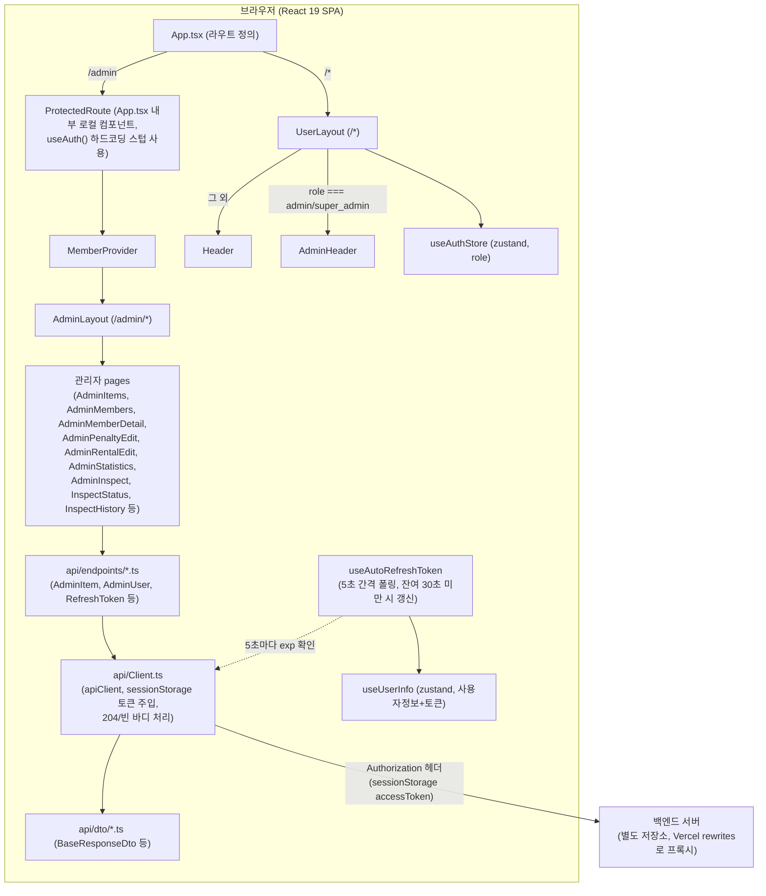
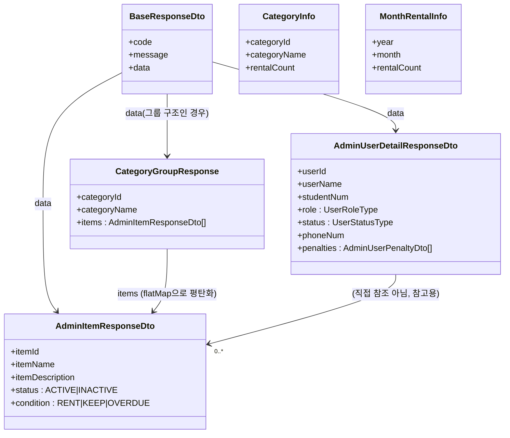
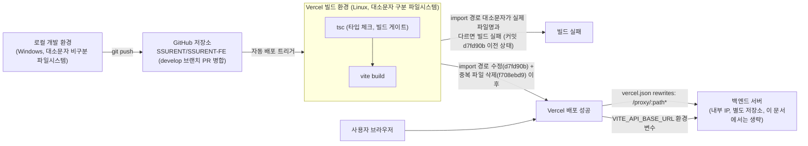

# SSURENT (웹 서비스) 스크린샷 촬영 가이드

이 문서는 `SSURENT.md`(리서치 문서) 및 `SSURENT.json`을 근거로, 포트폴리오 상세페이지 제작 시 실제로 촬영해야 할 화면과 그 근거, 배치 위치, 우선순위를 정리한 가이드입니다. 코드 실행/캡처가 불가능한 환경에서 작성되었으므로, 아래 항목은 실제 앱을 로컬 실행(`npm run dev`)하거나 Vercel 배포본에서 직접 촬영해야 합니다.

주의: 본 프로젝트는 data.js의 기존 `ssurent`(캡스톤 디자인 기획서, 코드 없음)와는 별개인 `ssurent-webapp`(실제 코드베이스가 있는 React/TS 프론트엔드 저장소, SSURENT-FE) 기준입니다.

---

## 1. 화면 스크린샷 체크리스트

- [ ] **역할별 헤더 비교 — 일반 Header vs AdminHeader**
  - 촬영 대상: 일반 사용자 계정으로 로그인했을 때의 `Header`와, 관리자 계정으로 로그인했을 때의 `AdminHeader`를 같은 레이아웃(`UserLayout`) 안에서 나란히 비교
  - 근거: `src/App.tsx`의 `UserLayout` 컴포넌트 — `useAuthStore`의 role 값이 `admin`/`super_admin`이면 `AdminHeader`, 아니면 `Header` 렌더링, md "5. 핵심 구현 - 역할 기반 레이아웃 분기와 관리자 라우트 구성"
  - 들어갈 위치: "4. 설계 - 아키텍처" 옆, "5. 핵심 구현 - 역할 기반 레이아웃 분기와 관리자 라우트 구성" 옆
  - 우선순위: 필수
  - 비고: 일반 계정과 관리자 계정 두 세션을 각각 준비해 같은 화면 폭/시간대에 캡처한 뒤 좌우로 배치하면 "같은 레이아웃 안에서 헤더만 조건부 렌더링된다"는 설계 포인트가 명확히 드러남.

- [ ] **관리자 하위 라우트 전체 내비게이션**
  - 촬영 대상: `/admin` 진입 후 보이는 관리자 메뉴 전체(물품/회원/회원상세/징계/통계/대여수정/검수 등 하위 라우트로 이동 가능한 내비게이션)
  - 근거: md "5. 핵심 구현 - 역할 기반 레이아웃 분기와 관리자 라우트 구성" 2번 항목(`ProtectedRoute` → `MemberProvider` → `AdminLayout` → 관리자 하위 라우트), md "4. 설계 - 아키텍처"
  - 들어갈 위치: "4. 설계 - 아키텍처" 옆
  - 우선순위: 권장
  - 비고: 관리자 권한 계정으로 로그인한 상태에서 캡처. 라우트 트리 자체는 아래 "2-1. 아키텍처 다이어그램"으로 보완 가능.

- [ ] **물품 관리 화면 — 카드 그리드**
  - 촬영 대상: `AdminItems` — `/admin/items` 물품 카드 그리드, 카테고리별 필터/구분
  - 근거: `src/features/admin/pages/AdminItems.tsx`(본인 수정 11회, md "2. 개요 - 담당 범위" 표 1위), md "9. 스크린샷 및 문서 제안"의 `admin-items.png` 제안
  - 들어갈 위치: "5. 핵심 구현 - 중복 클릭/중복 제출 방지가 적용된 관리 CRUD 패턴" 옆, "6. 트러블 슈팅 - 관리자 물품 목록 API 응답 구조 변경(카테고리 그룹화)으로 인한 조회 오류" 옆
  - 우선순위: 필수
  - 비고: 카테고리가 2개 이상, 물품이 여러 상태(`ACTIVE`/`INACTIVE`, `RENT`/`KEEP`/`OVERDUE`)로 섞인 더미 데이터로 재현해야 카드 그리드의 상태 구분이 드러남.

- [ ] **물품 추가 모달 — 제출 중(로딩) 상태**
  - 촬영 대상: 물품 추가 모달에서 "추가 중..." 로딩 텍스트가 표시되고 버튼이 `disabled` 처리된 순간
  - 근거: md "5. 핵심 구현 - 중복 클릭/중복 제출 방지가 적용된 관리 CRUD 패턴" — `isSubmitting` 플래그, `handleAddItem` 코드 발췌 (`src/features/admin/pages/AdminItems.tsx`)
  - 들어갈 위치: "5. 핵심 구현 - 중복 클릭/중복 제출 방지가 적용된 관리 CRUD 패턴" 옆
  - 우선순위: 필수
  - 비고: 네트워크가 빠르면 로딩 상태가 순식간에 지나감. 브라우저 개발자 도구 Network 탭에서 쓰로틀링(Slow 3G 등)을 걸어 제출 버튼 클릭 직후 "추가 중..." 문구와 비활성화된 버튼을 캡처.

- [ ] **회원 목록/관리 탭 화면**
  - 촬영 대상: `MemberList`, `AdminMembers` — `/admin/members` 회원 목록 테이블 및 관리 탭
  - 근거: `src/features/admin/pages/MemberList.tsx`(수정 9회), `AdminMembers.tsx`(수정 6회), md "2. 개요 - 담당 범위" 표
  - 들어갈 위치: "2. 개요 - 담당 범위" 옆
  - 우선순위: 권장
  - 비고: `NORMAL`/`ADMIN`/`SUPERADMIN` role과 `ACTIVE`/`BANNED` status가 섞인 더미 회원 데이터로 재현.

- [ ] **회원 상세 화면 + 징계내역**
  - 촬영 대상: `AdminMemberDetail` — `/admin/users/:id` 회원 기본 정보와 `penalties` 배열(징계내역) 표시 영역
  - 근거: `src/features/admin/pages/AdminMemberDetail.tsx`(수정 7회), `AdminUserDetailResponseDto`의 `penalties: AdminUserPenaltyDto[]` 필드 (md "4. 설계 - 데이터 모델", `src/api/dto/AdminUser.dto.ts`), md "9. 스크린샷 및 문서 제안"의 `admin-member-detail.png` 제안
  - 들어갈 위치: "4. 설계 - 데이터 모델" 옆
  - 우선순위: 권장
  - 비고: `penalties` 배열이 최소 1건 이상 있는 회원을 대상으로 캡처해야 징계내역 UI가 빈 상태로 보이지 않음.

- [ ] **징계 관리(편집) 화면**
  - 촬영 대상: `AdminPenaltyEdit` — 특정 회원의 징계 등록/수정 폼
  - 근거: `src/features/admin/pages/AdminPenaltyEdit.tsx`(수정 7회, md "2. 개요 - 담당 범위" 표)
  - 들어갈 위치: "2. 개요 - 담당 범위" 옆
  - 우선순위: 권장
  - 비고: -

- [ ] **대여내역 수정 화면**
  - 촬영 대상: `AdminRentalEdit`(구 `Adminrentaledit.tsx`) — 대여 이력 수정 폼
  - 근거: `src/features/admin/pages/AdminRentalEdit.tsx`(수정 4+2회), md "8. 회고" — 파일명 표기가 `Adminrentaledit.tsx` → `AdminRentalEdit.tsx`로 흔들린 이력
  - 들어갈 위치: "8. 회고 - 파일명 컨벤션 관련 아쉬운 점" 옆
  - 우선순위: 선택
  - 비고: 화면 자체보다 파일명 변경 이력이 회고의 핵심이므로, 화면 스크린샷은 보조 자료 성격. 파일명 이력 자체는 아래 "GitHub 커밋 diff" 항목이나 `git log --follow` 결과로도 대체 가능.

- [ ] **통계 화면 — 바차트 + 라인차트**
  - 촬영 대상: `AdminStatistics` — `/admin/statistics`(또는 `/admin/stats`) recharts 기반 바차트(카테고리별 대여 수)와 라인차트(월별 대여 추이)
  - 근거: `src/features/admin/pages/AdminStatistics.tsx`(수정 4회), `recharts` 의존성(md "3. 기술 스택 - UI"), `CategoryInfo`/`MonthRentalInfo` 타입(md "4. 설계 - 데이터 모델"), md "9. 스크린샷 및 문서 제안"의 `admin-statistics.png` 제안
  - 들어갈 위치: "3. 기술 스택" 옆(차트 라이브러리 사용 예시), "6. 트러블 슈팅 - Windows와 Vercel(Linux) 간 파일명 대소문자 불일치로 인한 배포 전용 import 오류" 옆(이 문제가 발생한 화면이 바로 이 통계 페이지)
  - 우선순위: 필수
  - 비고: `CategoryInfo`/`MonthRentalInfo` 더미 데이터가 여러 건 있어야 차트가 빈 화면으로 보이지 않음.

- [ ] **물품 검수 진입 화면**
  - 촬영 대상: `AdminInspect` — 검수 대상 카테고리/물품을 선택해 `InspectStatus`로 진입하는 화면
  - 근거: `src/features/admin/pages/AdminInspect.tsx`(수정 4회, md "2. 개요 - 담당 범위" 표)
  - 들어갈 위치: "5. 핵심 구현 - ExcelJS 기반 리치 텍스트 엑셀 내보내기" 옆(진입 흐름 보조)
  - 우선순위: 선택
  - 비고: -

- [ ] **물품 검수 현황 화면 + 엑셀 다운로드 버튼**
  - 촬영 대상: `InspectStatus` — `/admin/inspect` 물품명 기준 그룹핑된 개별 유닛 목록, 상태별 색상 뱃지(`rented`/`returned`/`overdue`/`disabled`), 엑셀 다운로드 버튼
  - 근거: `src/features/admin/pages/InspectStatus.tsx`, md "5. 핵심 구현 - ExcelJS 기반 리치 텍스트 엑셀 내보내기"(`mapConditionToStatus()`, `groupedItems`, `handleExcelDownload()`), md "9. 스크린샷 및 문서 제안"의 `admin-inspect-status.png` 제안
  - 들어갈 위치: "5. 핵심 구현 - ExcelJS 기반 리치 텍스트 엑셀 내보내기" 옆
  - 우선순위: 필수
  - 비고: 한 물품명 그룹 안에 상태가 다른 유닛(대여중/완료/연체/불가)이 최소 3종 이상 섞인 더미 데이터로 재현해야 색상 구분이 드러남.

- [ ] **엑셀 다운로드 결과 파일(xlsx) — 리치 텍스트 색상 확인**
  - 촬영 대상: `handleExcelDownload()` 실행 후 생성된 `SSURENT_물품현황_YYYY-MM-DD.xlsx` 파일을 열어, 한 셀 안에 상태별 색상(초록 `FF22C55E`/완료, 회색 `FF94A3B8`/대여중, 빨강 `FFDC2626`/연체)이 리치 텍스트로 섞여 표시된 모습
  - 근거: md "5. 핵심 구현 - ExcelJS 기반 리치 텍스트 엑셀 내보내기" 코드 발췌 (`src/features/admin/pages/InspectStatus.tsx`의 `richText`/`argb` 색상 지정)
  - 들어갈 위치: "5. 핵심 구현 - ExcelJS 기반 리치 텍스트 엑셀 내보내기" 옆(위 검수 현황 화면과 Before(웹 화면)/After(엑셀 결과물) 세트로 배치)
  - 우선순위: 필수
  - 비고: 엑셀 프로그램(또는 뷰어)에서 실제로 열어 셀 안 텍스트 색상이 유닛별로 다르게 렌더링되는지 확인 후 캡처. 스크린샷 파일명은 실제 다운로드된 날짜가 들어가므로 캡션에 "다운로드 시점 기준" 표기 권장.

- [ ] **검수 이력 화면**
  - 촬영 대상: `InspectHistory` — 과거 검수 기록 목록
  - 근거: `src/features/admin/pages/InspectHistory.tsx`(수정 4회, md "2. 개요 - 담당 범위" 표)
  - 들어갈 위치: "5. 핵심 구현 - ExcelJS 기반 리치 텍스트 엑셀 내보내기" 옆(보조 화면)
  - 우선순위: 선택
  - 비고: -

- [ ] **도우미 관리 화면**
  - 촬영 대상: `AdminHelpers` — 도우미(운영 보조 인력) 목록/관리 화면
  - 근거: `src/features/admin/pages/AdminHelpers.tsx`(수정 6회, md "2. 개요 - 담당 범위" 표)
  - 들어갈 위치: "2. 개요 - 담당 범위" 옆
  - 우선순위: 선택
  - 비고: -

- [ ] **회원 일괄 갱신(업로드) 화면**
  - 촬영 대상: `AdminMemberUpload` — 엑셀 파일 업로드를 통한 회원 정보 일괄 갱신 화면(미리보기 포함)
  - 근거: `src/features/admin/pages/AdminMemberUpload.tsx`(수정 5회), `MemberContext`(회원 일괄 갱신 미리보기 상태, md "4. 설계 - 디렉터리 구조"), `xlsx` 의존성(md "3. 기술 스택 - 파일 처리", "사용처는 `AdminMemberUpload.tsx` 계열로 추정, 확인 필요")
  - 들어갈 위치: "3. 기술 스택 - 파일 처리" 옆
  - 우선순위: 선택
  - 비고: `xlsx` 파싱이 실제로 이 화면에서 동작하는지 md에서 "확인 필요"로 남겨둔 부분이므로, 촬영 전 실제 업로드 기능이 정상 동작하는지 먼저 확인할 것.

- [ ] **관리자 메인 화면**
  - 촬영 대상: `AdminHome` — `/admin` 진입 시 첫 화면(대시보드성 메인)
  - 근거: `src/features/admin/pages/AdminHome.tsx`(수정 4회, md "2. 개요 - 담당 범위" 표)
  - 들어갈 위치: "4. 설계 - 아키텍처" 옆
  - 우선순위: 선택
  - 비고: -

- [ ] **DevTools — sessionStorage accessToken 자동 갱신 확인**
  - 촬영 대상: 브라우저 개발자 도구 Application 탭의 Session Storage에서 `accessToken` 값이 만료 임박 시점에 자동으로 갱신되는 전/후 스냅샷
  - 근거: md "5. 핵심 구현 - JWT 만료 폴링 기반 자동 토큰 갱신" (`src/hooks/UseAutoRefreshToken.ts`의 5초 간격 `setInterval`, 잔여 30초 미만 조건)
  - 들어갈 위치: "5. 핵심 구현 - JWT 만료 폴링 기반 자동 토큰 갱신" 옆
  - 우선순위: 권장
  - 비고: 실제 토큰 만료 시간이 길면 재현에 시간이 오래 걸림. 백엔드 테스트 환경에서 토큰 만료 시간을 임시로 짧게 설정해 재현 권장. 토큰 값 자체는 민감정보이므로 캡처 시 일부 모자이크 처리.

- [ ] **DevTools — Network 탭 204/빈 바디 응답 확인**
  - 촬영 대상: 브라우저 개발자 도구 Network 탭에서 상태 변경/삭제류 API 호출 시 `204 No Content` 또는 빈 바디 응답이 정상 처리되는 모습
  - 근거: md "6. 트러블 슈팅 - fetch 응답 바디가 비어 있을 때 JSON.parse 실패" (`src/api/Client.ts`의 `response.status === 204` 분기)
  - 들어갈 위치: "6. 트러블 슈팅 - fetch 응답 바디가 비어 있을 때 JSON.parse 실패" 옆
  - 우선순위: 권장
  - 비고: 실제 백엔드가 204를 반환하는 엔드포인트(예: 상태 토글)를 호출한 직후의 Network 탭을 캡처. 로컬에 mock 서버로 204 응답을 재현해도 무방.

- [ ] **GitHub 커밋 diff — Windows/Vercel 대소문자 트러블슈팅**
  - 촬영 대상: 커밋 `d7fd90b`(import 경로를 대문자 파일명으로 수정)와 `f708ebd9`(중복 소문자 파일 삭제)의 GitHub diff 화면
  - 근거: md "6. 트러블 슈팅 - Windows와 Vercel(Linux) 간 파일명 대소문자 불일치로 인한 배포 전용 import 오류", 커밋 해시 `d7fd90b987e3be2a2e7f2ccd7bdcb3da2067c3e3`, `f708ebd91936c1a643b08117a94917c93e1c3285`
  - 들어갈 위치: "6. 트러블 슈팅 - Windows와 Vercel(Linux) 간 파일명 대소문자 불일치로 인한 배포 전용 import 오류" 옆
  - 우선순위: 권장
  - 비고: GitHub 저장소(`SSURENT/SSURENT-FE`)에 접근 권한이 있어야 캡처 가능. import 경로 변경 diff와 파일 삭제 diff 두 장을 세트로 캡처하면 "수정 → 근본 삭제"의 2단계 해결 과정이 잘 드러남. 저장소가 비공개라 접근이 어렵다면 로컬 `git show <hash>` 터미널 출력 캡처로 대체 가능.

- [ ] **.github 이슈/PR 템플릿**
  - 촬영 대상: `.github/pull_request_template.md`, `.github/ISSUE_TEMPLATE/fix-템플릿.md` 등 fix/refactor/feature 3종 이슈 템플릿
  - 근거: md "2. 개요 - 협업 방식" (`.github/pull_request_template.md`, `.github/ISSUE_TEMPLATE/` 하위 템플릿 3종), md "9. 스크린샷 및 문서 제안"에서 이미 레포에 존재하는 문서로 언급됨
  - 들어갈 위치: "2. 개요 - 타인 작성 영역과 협업 방식" 옆
  - 우선순위: 선택
  - 비고: 새로 촬영할 화면이 아니라 이미 레포에 존재하는 마크다운 파일이므로, GitHub 렌더링 화면을 캡처하거나 파일 내용을 그대로 발췌 인용하는 것으로 대체 가능.

---

## 2. 직접 제작 필요 (다이어그램/그래프)

### 2-1. 아키텍처 다이어그램 및 ERD

md "4. 설계 - 아키텍처"와 "데이터 모델"에 근거해 아래 두 다이어그램을 제안합니다. 이 저장소는 프론트엔드 전용이라 실제 DB ERD는 존재하지 않으므로, 두 번째 다이어그램은 DB 스키마가 아닌 "API 계약(DTO) 관계도"로 대체합니다.

**라우트/요청 흐름 아키텍처**

**API 계약(DTO) 관계도** — 프론트엔드 전용 저장소이므로 실제 DB 스키마 대신 TypeScript DTO 간 관계를 표현했습니다.

(근거: `src/api/dto/BaseResponse.dto.ts`, `src/api/dto/AdminItem.dto.ts`, `src/api/dto/AdminUser.dto.ts`, `src/types/Statistics.ts`, `src/api/endpoints/AdminItem.ts`의 `CategoryGroupResponse` 판별 로직, md "4. 설계 - 데이터 모델")

### 2-2. 성능/개선 전후 그래프

md와 json 전체를 검토한 결과, 실측 수치가 확보된 "before → after" 형태의 정량 데이터는 존재하지 않습니다.

- md "1. 3분 요약"과 "7. 결과"에서 운영 지표(이용자 수, 대여 처리 건수, 응답 시간)는 모두 "(수치 확인 필요)"로 명시되어 있고, 레포에 측정 기록이 없다고 밝히고 있습니다.
- 트러블슈팅 3건(파일명 대소문자, 빈 바디 JSON 파싱, API 응답 구조 변경) 모두 "결과" 항목에서 "수정 전후의 실패율/오류 빈도 수치는 레포에 없음(수치 확인 필요)"이라고 명시되어 있습니다.
- 코드 규모(`src` 약 6,786줄, 파일 120개)나 커밋 수(본인 36건/전체 344건)는 존재하지만 이는 "개선 전후" 비교가 아닌 단일 시점 통계이므로 성능 개선 그래프의 소재로 적합하지 않습니다.

따라서 이 항목은 **현재 근거로는 그래프를 제작하지 않습니다.** 실제로 Vercel 빌드 로그나 브라우저 성능 측정(Lighthouse, Network 탭 응답 시간 등)을 실측한 뒤에만 그래프 제작을 권장합니다.

### 2-3. 배포/CI 인프라 구성도

md "4. 설계 - 인프라 및 배포"와 "6. 트러블 슈팅 - Windows와 Vercel(Linux) 간 파일명 대소문자 불일치" 내용을 근거로 아래 구성도를 제안합니다.

참고: md "4. 설계 - 인프라 및 배포"에 따르면 GitHub Actions 등 별도 CI 파이프라인은 확인되지 않았고, `.github/`에는 이슈/PR 템플릿만 존재합니다. 따라서 위 구성도의 검증 단계는 Vercel 자체 빌드 게이트(`tsc && vite build`)가 전부이며, 이 점이 바로 Windows/Vercel 대소문자 트러블슈팅이 CI 단계가 아닌 실제 배포 시점에야 발견된 이유이기도 합니다.

---

## 3. 촬영 체크리스트

| 화면명 | 우선순위 | 상태 |
| :--- | :--- | :--- |
| 역할별 헤더 비교 — 일반 Header vs AdminHeader | 필수 | 미촬영 |
| 관리자 하위 라우트 전체 내비게이션 | 권장 | 미촬영 |
| 물품 관리 화면 — 카드 그리드 | 필수 | 미촬영 |
| 물품 추가 모달 — 제출 중(로딩) 상태 | 필수 | 미촬영 |
| 회원 목록/관리 탭 화면 | 권장 | 미촬영 |
| 회원 상세 화면 + 징계내역 | 권장 | 미촬영 |
| 징계 관리(편집) 화면 | 권장 | 미촬영 |
| 대여내역 수정 화면 | 선택 | 미촬영 |
| 통계 화면 — 바차트 + 라인차트 | 필수 | 미촬영 |
| 물품 검수 진입 화면 | 선택 | 미촬영 |
| 물품 검수 현황 화면 + 엑셀 다운로드 버튼 | 필수 | 미촬영 |
| 엑셀 다운로드 결과 파일(xlsx) — 리치 텍스트 색상 확인 | 필수 | 미촬영 |
| 검수 이력 화면 | 선택 | 미촬영 |
| 도우미 관리 화면 | 선택 | 미촬영 |
| 회원 일괄 갱신(업로드) 화면 | 선택 | 미촬영 |
| 관리자 메인 화면 | 선택 | 미촬영 |
| DevTools — sessionStorage accessToken 자동 갱신 확인 | 권장 | 미촬영 |
| DevTools — Network 탭 204/빈 바디 응답 확인 | 권장 | 미촬영 |
| GitHub 커밋 diff — Windows/Vercel 대소문자 트러블슈팅 | 권장 | 미촬영 |
| .github 이슈/PR 템플릿 | 선택 | 미촬영 |
