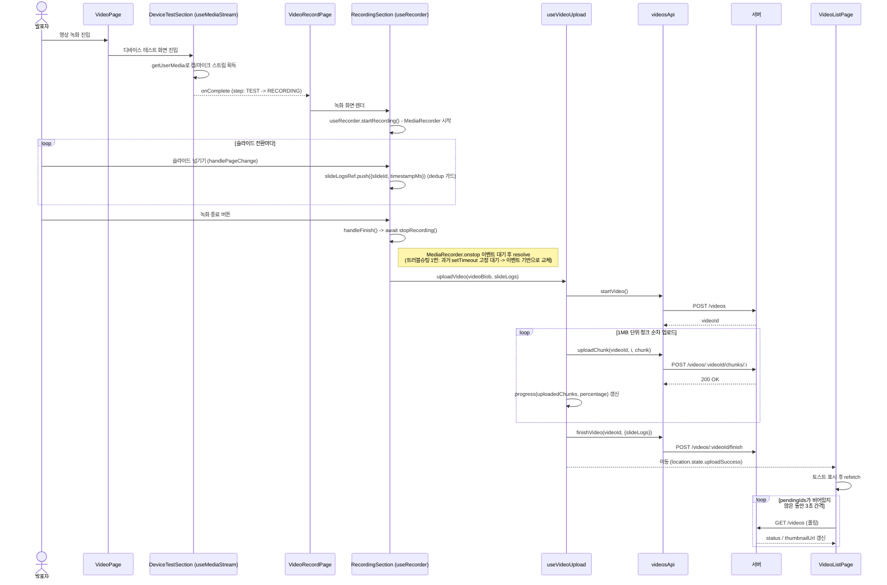
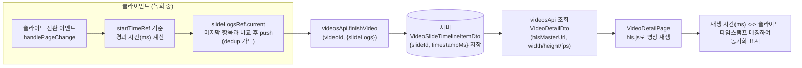
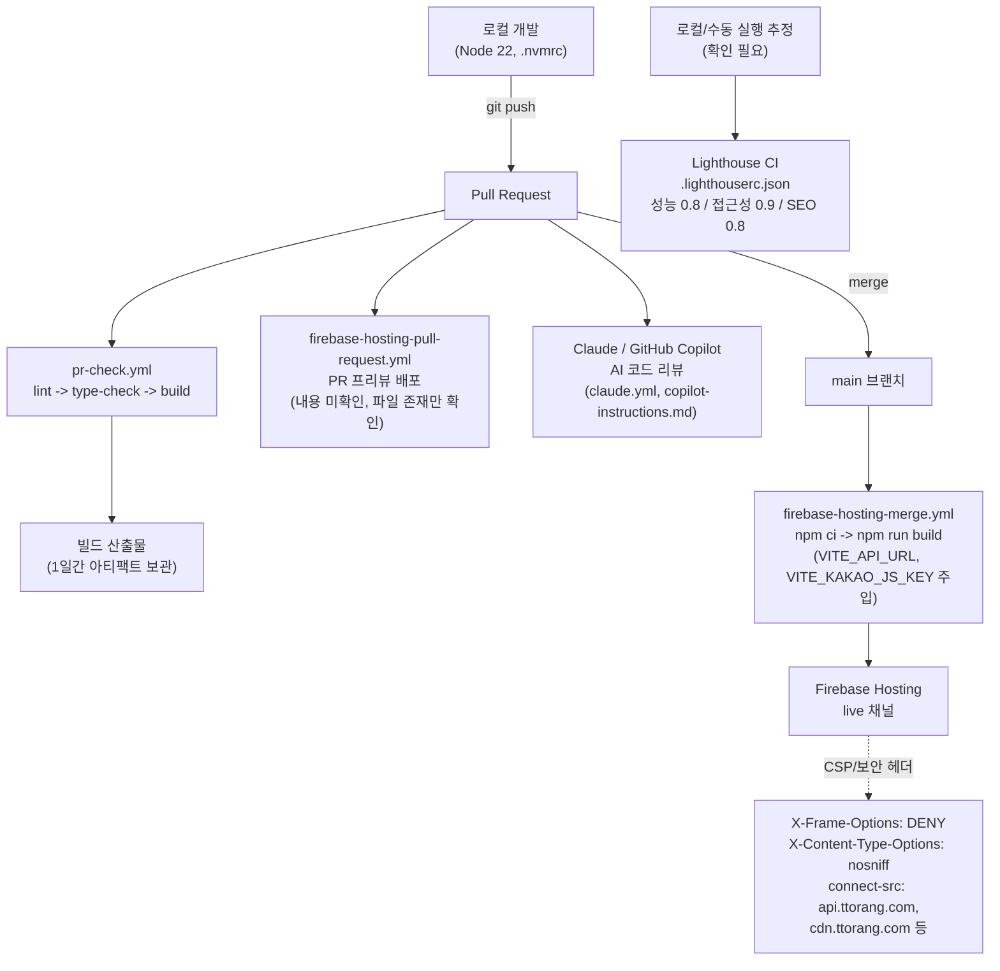

# TTORANG 스크린샷 촬영 가이드

이 문서는 `TTORANG.md`(리서치 문서)와 `TTORANG.json`(구조화 버전)의 "5. 핵심 구현", "6. 트러블 슈팅", "9. 스크린샷 및 문서 제안", "4. 설계"를 근거로, 어떤 화면을 촬영해야 포트폴리오 상세 페이지(`projects/ttorang.html`)의 내용을 뒷받침할 수 있는지 정리한 촬영 지시서입니다.

코드 실행/캡처가 불가능한 환경에서 작성되었으므로, 실제 촬영은 로컬에서 `TTORANG` 웹 레포(`https://github.com/TTORANG/Web`)를 구동한 뒤 진행해야 합니다.

---

## A. 촬영 목록 (앱 화면)

### A-1. 핵심 기능 화면 (5장 근거)

- [ ] **디바이스 테스트 화면 (웹캠/마이크 선택 + 마이크 볼륨 시각화)**
  - 촬영 대상: `/:projectId/video/record` 진입 직후 `DeviceTestSection` 화면. 웹캠 미리보기, 마이크 선택 드롭다운, 그리고 말하는 동안 움직이는 마이크 볼륨 바(Web Audio API `AnalyserNode` 기반)가 함께 보이도록 촬영.
  - 근거: `TTORANG.md` "5. 핵심 구현 - 4. Web Audio API 기반 마이크 볼륨 시각화" (`src/hooks/useMediaStream.ts`), "9. 스크린샷 및 문서 제안"의 `device-test.png` 제안.
  - 들어갈 위치: "5. 핵심 구현 - Web Audio API 기반 마이크 볼륨 시각화" 옆
  - 우선순위: 필수
  - 비고: 마이크에 소리를 내며 볼륨 바가 반응하는 순간을 캡처(정적 0 상태는 기능을 보여주지 못함). 가능하면 짧은 영상(GIF)으로 남기는 것을 권장.

- [ ] **녹화 중 화면 (슬라이드 + 캠 PiP + 진행 상황)**
  - 촬영 대상: `RecordingSection`에서 슬라이드가 보이는 상태로 실제 녹화 중인 화면. 캠 영상(PiP), 진행 중인 슬라이드 번호/진행률, 녹화 타이머가 함께 보이도록 촬영.
  - 근거: `TTORANG.md` "5. 핵심 구현 - 1. MediaRecorder 기반 청크 녹화" (`src/hooks/useRecorder.ts`), "2. 녹화 중 슬라이드-타임라인 로그 수집" (`src/components/video/RecordingSection.tsx`), "9. 스크린샷 및 문서 제안"의 `recording-in-progress.png`.
  - 들어갈 위치: "5. 핵심 구현 - MediaRecorder 기반 청크 녹화" 및 "녹화 중 슬라이드-타임라인 로그 수집" 옆 (두 섹션에서 공용으로 사용 가능)
  - 우선순위: 필수
  - 비고: 슬라이드를 한 번 이상 넘긴 직후 상태를 캡처하면 "슬라이드 전환 로그 기록" 맥락이 잘 드러남. 웹캠 접근 권한이 필요하므로 더미 얼굴/화면 공유로 대체 가능.

- [ ] **슬라이드 전환 시점의 브라우저 DevTools 콘솔/상태 (slideLogs 기록 증빙)**
  - 촬영 대상: 녹화 중 슬라이드를 여러 번 빠르게 전환한 뒤, `slideLogsRef.current` 배열(React DevTools의 컴포넌트 상태 패널 또는 임시 `console.log`)에 중복 없이 순서대로 기록된 로그를 캡처.
  - 근거: `TTORANG.md` "6. 트러블 슈팅 - 2. 슬라이드 전환 로그 중복/누락" (커밋 `a56f2cc`, 이슈 #284), `src/components/video/RecordingSection.tsx`의 dedup 가드 로직.
  - 들어갈 위치: "6. 트러블 슈팅 - 슬라이드 전환 로그 중복/누락" 옆
  - 우선순위: 권장
  - 비고: 문제 자체(수정 전 코드)는 현재 레포에 남아있지 않아 "전"은 재현 불가. "후" 상태에서 슬라이드를 연타로 전환해도 중복이 없음을 보여주는 방식으로 촬영(개발자 도구 필요, React DevTools 설치 권장).

- [ ] **청크 업로드 진행률 UI**
  - 촬영 대상: 녹화 종료 후 `useVideoUpload`가 1MB 단위로 청크를 순차 업로드하는 동안의 진행률 바/퍼센티지 표시 화면. 가능하면 진행 중(예: 40%)과 완료 직전(예: 95%) 두 시점을 캡처.
  - 근거: `TTORANG.md` "5. 핵심 구현 - 3. 청크 단위 순차 업로드와 진행률 관리" (`src/hooks/useVideoUpload.ts`, `CHUNK_SIZE = 1024*1024`), "9. 스크린샷 및 문서 제안"의 `upload-progress.png`.
  - 들어갈 위치: "5. 핵심 구현 - 청크 단위 순차 업로드와 진행률 관리" 옆
  - 우선순위: 필수
  - 비고: 진행률이 실시간으로 갱신되는 모습이 핵심이므로 짧은 영상/GIF 권장. 큰 영상 파일(수십 MB 이상)로 테스트해야 청크 여러 개가 실제로 순차 처리되는 모습이 드러남.

- [ ] **네트워크 탭: 청크 업로드 요청 헤더/페이로드 (Content-Type boundary 증빙)**
  - 촬영 대상: 브라우저 DevTools Network 탭에서 `/videos/:videoId/chunks/:chunkIndex` 요청을 선택해, Request Headers의 `Content-Type: multipart/form-data; boundary=...`가 자동으로 채워진 것과, 업로드된 파일명이 `chunk-N.webm` 또는 `chunk-N.mp4`로 실제 코덱과 일치하는 것을 캡처.
  - 근거: `TTORANG.md` "6. 트러블 슈팅 - 3. 청크 업로드 시 코덱/Content-Type 불일치" (커밋 `6e3e5eb`, 이슈 #178), `src/api/endpoints/videos.ts`의 `uploadChunk`, `headers: { 'Content-Type': undefined }`.
  - 들어갈 위치: "6. 트러블 슈팅 - 청크 업로드 시 코덱/Content-Type 불일치" 옆
  - 우선순위: 권장
  - 비고: 가능하면 Chrome(webm)과 Safari(mp4) 두 브라우저에서 각각 캡처해 "브라우저별 코덱 차이 대응"을 시각적으로 대조. Safari 환경이 없다면 Chrome 캡처만으로도 boundary 자동 설정 여부는 확인 가능.

- [ ] **영상 목록 화면 (처리 중/완료/실패 상태 배지)**
  - 촬영 대상: `VideoListPage`에서 `processing`(썸네일 없음, 배지 표시), `completed`(썸네일 있음), 가능하면 `failed`/`stuck` 상태가 함께 보이는 목록. 3초 간격 폴링으로 processing → completed로 바뀌는 전후를 비교 캡처하면 가장 좋음.
  - 근거: `TTORANG.md` "5. 핵심 구현 - 5. 영상 처리 상태 폴링과 stuck 감지" (`src/pages/VideoListPage.tsx`, `isStuck`, `isPending`, 3초 폴링), "9. 스크린샷 및 문서 제안"의 `video-list-processing.png`.
  - 들어갈 위치: "5. 핵심 구현 - 영상 처리 상태 폴링과 stuck 감지" 옆
  - 우선순위: 필수
  - 비고: `stuck`(1시간 초과) 상태는 실제로 1시간을 기다리거나 서버 응답을 조작해야 재현 가능 — 시간이 없다면 `processing` 배지만이라도 필수로 촬영. 업로드 직후 토스트(`location.state.uploadSuccess`)가 함께 보이면 더 좋음(선택 사항).

- [ ] **영상 상세 페이지: 타임스탬프 댓글 스레드**
  - 촬영 대상: `VideoDetailPage`에서 영상 재생바 위 타임스탬프 마커와, 아래쪽 댓글 목록(루트 댓글 + 답글이 같은 타임스탬프 그룹으로 묶여 있는 모습)을 함께 캡처. 답글이 부모의 타임스탬프를 상속받아 정렬된 것이 보이도록 답글이 있는 스레드를 포함.
  - 근거: `TTORANG.md` "5. 핵심 구현 - 6. 영상 타임스탬프 기반 댓글 스레딩" (`src/pages/VideoDetailPage.tsx`, `getThreadTimestamp`, `rootTimestampById`), "9. 스크린샷 및 문서 제안"의 `video-detail-comments.png`.
  - 들어갈 위치: "5. 핵심 구현 - 영상 타임스탬프 기반 댓글 스레딩" 옆
  - 우선순위: 필수
  - 비고: 더미 계정 여러 개로 같은 타임스탬프에 답글을 남겨 스레딩 구조를 명확히 재현할 것.

### A-2. 맥락/진입 화면 (2장·4장 근거, 타인 담당 영역 포함)

- [ ] **서비스 홈/진입 화면**
  - 촬영 대상: `HomePage`(라우트 `/`) 또는 프로젝트 목록 화면. 서비스 전체가 "슬라이드 업로드 + 발표 영상 녹화 + 피드백"임을 보여줄 수 있는 첫 화면.
  - 근거: `TTORANG.md` "2. 개요 - 배경과 문제" (README.md 인용), `src/router/Router.tsx`의 라우팅 구조.
  - 들어갈 위치: "2. 개요" 옆
  - 우선순위: 권장
  - 비고: 이 화면 자체는 본인 담당 영역이 아닐 수 있으나(2장에 따르면 슬라이드 편집/인증은 타인 담당), 전체 서비스 맥락을 보여주는 용도로 필요.

- [ ] **프레젠테이션 카드/목록에서 영상 목록으로 진입하는 지점**
  - 촬영 대상: `PresentationCard`/`PresentationList`에서 영상 관련 기능(녹화 시작, 영상 목록 보기)으로 이어지는 버튼/링크가 보이는 화면.
  - 근거: `TTORANG.md` "담당 범위 요약" 및 "2. 개요 - 담당 범위": `src/components/presentation/PresentationCard.tsx`, `PresentationList.tsx` (타인 작성 컴포넌트에 본인이 기능 추가).
  - 들어갈 위치: "2. 개요 - 담당 범위" 옆
  - 우선순위: 권장
  - 비고: "타인 작성 컴포넌트에 기능 추가"라는 담당 경계를 설명할 때 근거로 사용 가능.

- [ ] **영상 상세 페이지 재생 화면 (HLS 스트리밍 + 리액션 세그먼트, 댓글 제외)**
  - 촬영 대상: `hls.js` 기반으로 재생되는 영상 플레이어와, 재생바 위의 리액션 하이라이트 세그먼트(`computeSegmentHighlights`)가 함께 보이는 화면.
  - 근거: `TTORANG.md` "3. 기술 스택"의 hls.js 항목, "2. 개요 - 타인 작성 영역"(`src/utils/video.ts`의 세그먼트 하이라이트는 타인 담당, 본인은 버그 수정 1건만).
  - 들어갈 위치: "3. 기술 스택 - hls.js" 옆, 또는 "4. 설계 - 데이터 모델(VideoDetailDto)" 옆
  - 우선순위: 선택
  - 비고: 세그먼트 하이라이트 로직은 본인 담당이 아니므로, 본인 성과로 오인되지 않도록 캡션에 "리액션 세그먼트는 타 팀원 담당" 명시 필요.

### A-3. 트러블슈팅 관련 화면 (6장 근거)

> 6장의 트러블슈팅 6건은 대부분 레이스 컨디션/클로저/무한 렌더링처럼 코드 내부 동작이라, 수정 전 상태를 지금 다시 재현해 "전후 비교 스크린샷"을 찍기는 어렵습니다. 아래 항목은 현재 코드(수정 후) 기준으로 "정상 동작 증빙"에 가깝습니다.

- [ ] **녹화 종료 → 업로드까지 정상 흐름 (0바이트 영상 이슈의 "해결 후" 증빙)**
  - 촬영 대상: 녹화 종료 버튼을 누른 직후부터 업로드가 시작되기까지의 화면 전환(로딩 인디케이터 등)과, 업로드된 영상이 정상 재생되는 상세 페이지.
  - 근거: `TTORANG.md` "6. 트러블 슈팅 - 1. 녹화 종료 시 빈 영상(0바이트) 발생 가능성" (커밋 `a56f2cc`→`e7fe097`→`792d5d2`, 이슈 #284).
  - 들어갈 위치: "6. 트러블 슈팅 - 녹화 종료 시 빈 영상 발생 가능성" 옆
  - 우선순위: 선택
  - 비고: "전"(고정 대기 버전)은 현재 코드에 없어 재현 불가. 코드 diff(`RecordingSection.tsx` before/after)는 이미 문서에 포함되어 있으므로, 스크린샷은 "결과가 정상 동작함"을 보여주는 보조 자료로만 사용.

- [ ] **DeviceTestSection에서 디바이스 변경 시 스트림 정리 확인**
  - 촬영 대상: 마이크/카메라를 두 번 이상 바꿔가며 테스트한 뒤, 브라우저 탭의 마이크/카메라 사용 표시(주소창 아이콘)가 남아있지 않고 볼륨 바도 새 디바이스에만 반응하는 상태.
  - 근거: `TTORANG.md` "6. 트러블 슈팅 - 4. 미디어 스트림 훅의 stale closure와 오디오 분석 참조 오류" (커밋 `d8c2853`, 이슈 #37), `streamRef`/`analyzerRef` 정리 로직.
  - 들어갈 위치: "6. 트러블 슈팅 - 미디어 스트림 훅의 stale closure" 옆
  - 우선순위: 선택
  - 비고: 좀비 스트림/애니메이션 프레임 문제는 브라우저 탭 오디오 인디케이터나 DevTools Performance 탭의 활성 애니메이션 프레임 수로 간접 확인 가능하나, 완전한 시각적 증빙은 어려움.

- [ ] **VideoRecordPage 진입 시 정상 렌더링 (무한 루프 없음 증빙)**
  - 촬영 대상: React DevTools Profiler로 `VideoRecordPage` 진입 시 렌더링 횟수가 1회로 안정화되는 것을 캡처, 또는 브라우저 성능 탭에서 CPU 사용률이 튀지 않는 것을 캡처.
  - 근거: `TTORANG.md` "6. 트러블 슈팅 - 5. VideoRecordPage 무한 리렌더링 루프" (커밋 `5e75db5`, 이슈 #111), `MOCK_SLIDES` 모듈 스코프 이동.
  - 들어갈 위치: "6. 트러블 슈팅 - VideoRecordPage 무한 리렌더링 루프" 옆
  - 우선순위: 선택
  - 비고: React DevTools 설치 및 Profiler 사용법 숙지가 필요. 없다면 생략 가능(코드 diff만으로도 충분히 설명 가능한 사례).

- [ ] **GitHub 이슈 #109 커밋 이력 (빌드 오류 반복)**
  - 촬영 대상: GitHub 저장소의 커밋 히스토리에서 "빌드 오류 해결/재수정" 메시지가 연속된 구간(커밋 `4efeb69`, `5fe1c9c`, `6cc7127`, `636405c`, `199c37a`, `f35d7f5`)을 캡처.
  - 근거: `TTORANG.md` "6. 트러블 슈팅 - 6. 빌드 오류 반복 발생 (이슈 #109)", "9. 스크린샷 및 문서 제안"에는 없으나 6장 본문에서 커밋 목록이 명시적으로 근거로 제시됨.
  - 들어갈 위치: "6. 트러블 슈팅 - 빌드 오류 반복 발생" 옆
  - 우선순위: 선택
  - 비고: 앱 화면이 아니라 GitHub 웹 UI 캡처. 저장소 접근 권한 필요.

### A-4. 협업/문서 근거 화면 (2장 근거, 선택)

- [ ] **PR/브랜치 컨벤션 및 AI 코드 리뷰 흔적**
  - 촬영 대상: GitHub PR 목록에서 `feat/media-core#37`, `fix/video-recording-finish-178`, `fix/pd-vid-284` 등 브랜치 컨벤션과, "gemini 코드리뷰 반영"/"클로드 리뷰 반영" 커밋 메시지 또는 `.github/workflows/claude.yml` 실행 로그.
  - 근거: `TTORANG.md` "2. 개요 - 협업 방식" (`CONVENTION.md`, 커밋 `08132b0`, `26daea2`, `02119e3`).
  - 들어갈 위치: "2. 개요 - 협업 방식" 옆
  - 우선순위: 선택
  - 비고: 리뷰 코멘트 원문은 md 10장에서 "근거 부족으로 제외"된 항목이므로, 스크린샷도 어떤 지적을 받았는지 과장하지 말고 "AI 리뷰 프로세스가 있었다"는 사실 증빙 용도로만 사용.

---

## B. 직접 제작 필요 (다이어그램/그래프)

### B-1. 아키텍처 다이어그램 — 녹화→업로드 파이프라인 (시퀀스 다이어그램)

근거: `TTORANG.md` "4. 설계 - 아키텍처"의 요청 흐름 텍스트(`VideoPage → DeviceTestSection → VideoRecordPage → RecordingSection → useVideoUpload → VideoListPage`)를 시각화.

### B-2. 비디오-슬라이드 동기화 구조 (플로우 다이어그램)

근거: `TTORANG.md` "5. 핵심 구현 - 2. 녹화 중 슬라이드-타임라인 로그 수집", "4. 설계 - 데이터 모델"의 `VideoSlideTimelineItemDto({slideId, timestampMs})`가 클라이언트가 만든 로그와 동일 구조로 서버 응답에도 쓰인다는 설명.

### B-3. 성능 개선 전후 그래프 — 생략

`TTORANG.md`의 모든 트러블슈팅 항목에서 "결과" 절은 실측 수치 없이 "수치 확인 필요"로 명시되어 있습니다(예: 0바이트 영상 발생 빈도, 슬라이드 로그 중복 발생률, 브라우저별 업로드 성공률, 무한 렌더링 CPU 사용률 등 — 모두 "레포에서 확인되지 않음"). 실측 전/후 수치가 없으므로 이 항목은 생성하지 않습니다. 추후 QA 로그나 서버 모니터링 데이터를 확보하면(`TTORANG.md` "10. 확인 필요 항목" 참고) 그래프를 추가할 수 있습니다.

### B-4. 배포/CI 인프라 구성도

근거: `TTORANG.md` "3. 기술 스택 - 인프라/CI", "4. 설계 - 인프라 및 배포" (`firebase.json`, `.github/workflows/pr-check.yml`, `firebase-hosting-merge.yml`, `firebase-hosting-pull-request.yml`, `claude.yml`, `.lighthouserc.json`).

---

## C. 촬영 체크리스트

| 화면명 | 우선순위 | 상태 |
| --- | --- | --- |
| 디바이스 테스트 화면 (마이크 볼륨 시각화) | 필수 | 미촬영 |
| 녹화 중 화면 (슬라이드 + 캠 PiP + 진행 상황) | 필수 | 미촬영 |
| 슬라이드 전환 로그 기록 (DevTools 상태 증빙) | 권장 | 미촬영 |
| 청크 업로드 진행률 UI | 필수 | 미촬영 |
| 네트워크 탭: 청크 업로드 요청 (Content-Type boundary) | 권장 | 미촬영 |
| 영상 목록 화면 (처리 중/완료/실패 배지) | 필수 | 미촬영 |
| 영상 상세 - 타임스탬프 댓글 스레드 | 필수 | 미촬영 |
| 서비스 홈/진입 화면 | 권장 | 미촬영 |
| 프레젠테이션 카드 - 영상 목록 진입 지점 | 권장 | 미촬영 |
| 영상 상세 재생 화면 (HLS + 리액션 세그먼트) | 선택 | 미촬영 |
| 녹화 종료->업로드 정상 흐름 (0바이트 이슈 해결 후) | 선택 | 미촬영 |
| 디바이스 변경 시 스트림 정리 확인 | 선택 | 미촬영 |
| VideoRecordPage 정상 렌더링 (무한 루프 없음) | 선택 | 미촬영 |
| GitHub 이슈 #109 커밋 이력 | 선택 | 미촬영 |
| PR/브랜치 컨벤션 및 AI 코드 리뷰 흔적 | 선택 | 미촬영 |
| 아키텍처: 녹화-업로드 파이프라인 다이어그램 (직접 제작) | 필수 | 미촬영 |
| 아키텍처: 비디오-슬라이드 동기화 다이어그램 (직접 제작) | 필수 | 미촬영 |
| 배포/CI 인프라 구성도 (직접 제작) | 권장 | 미촬영 |
